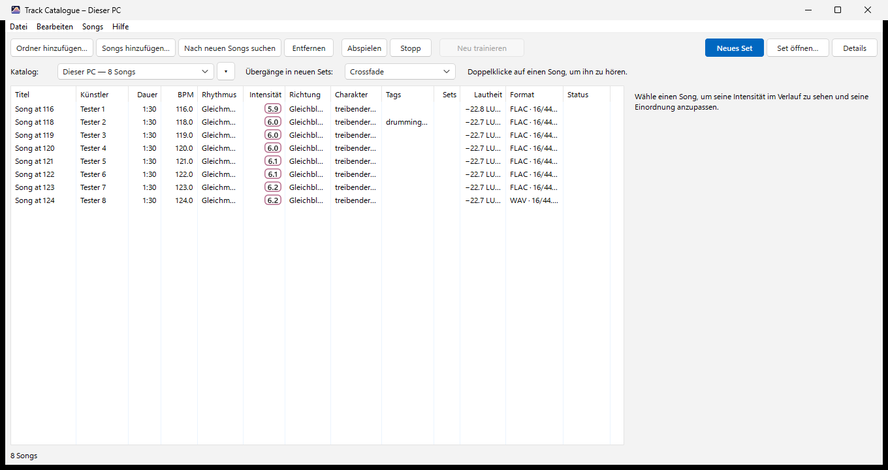
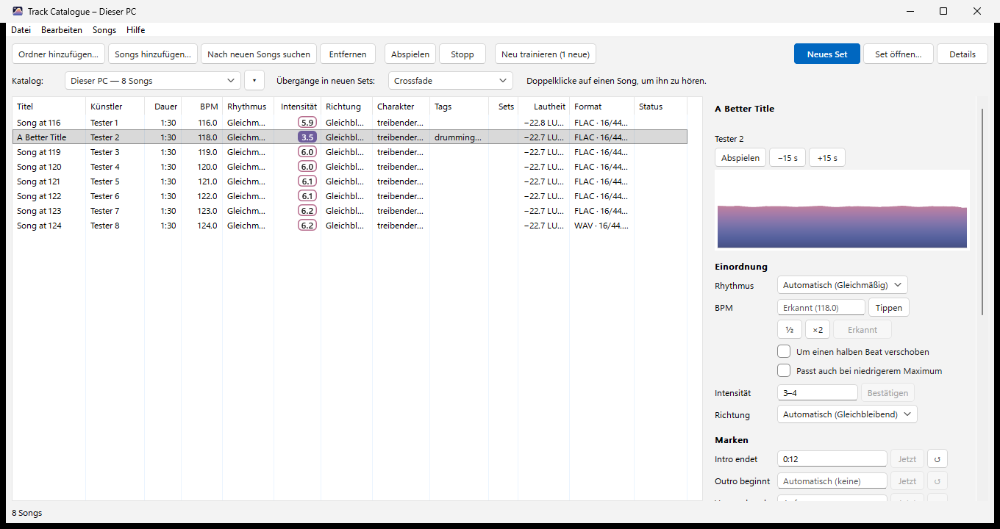
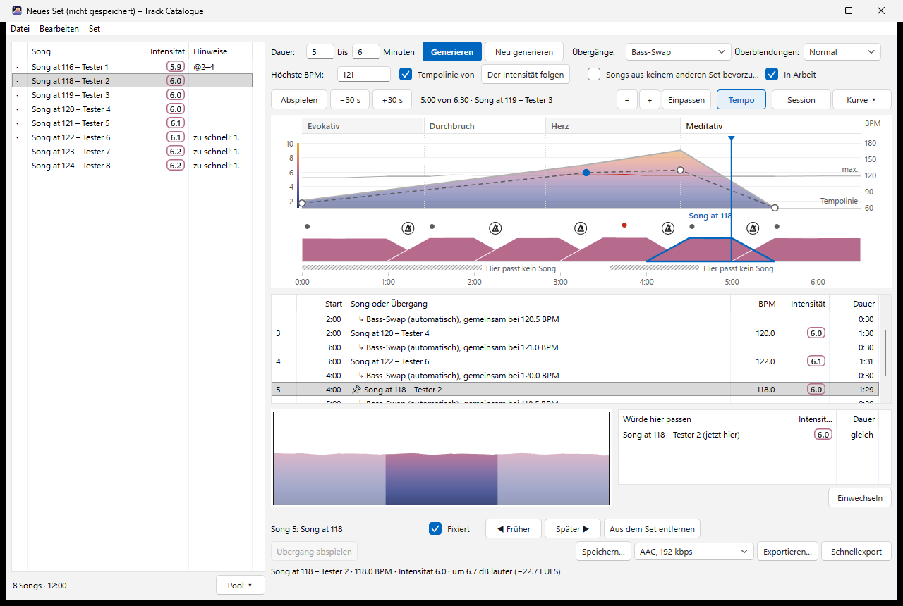
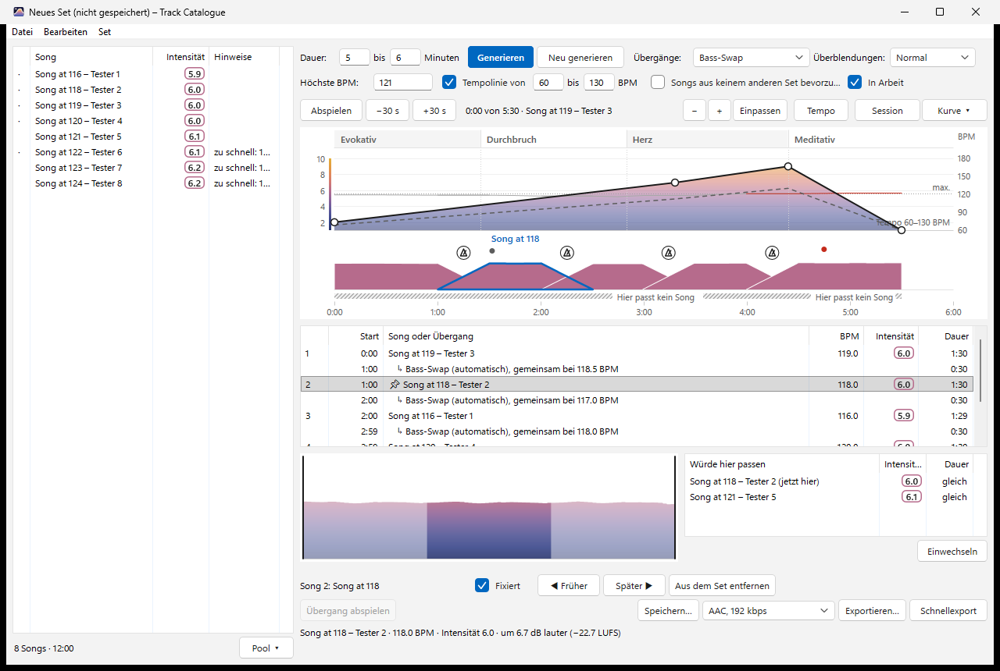
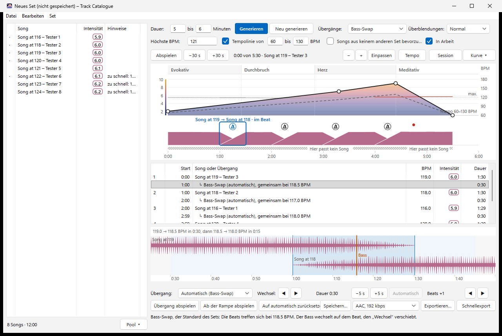
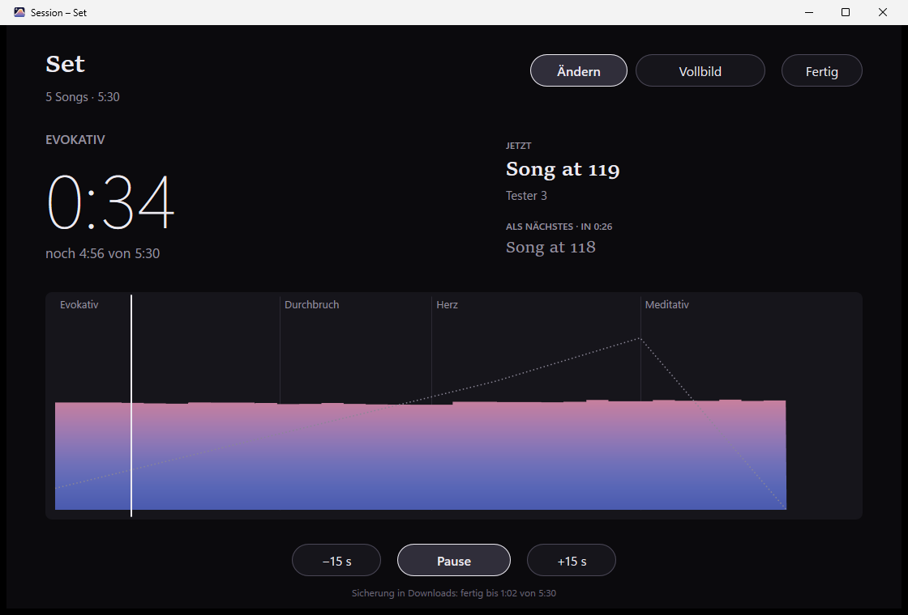
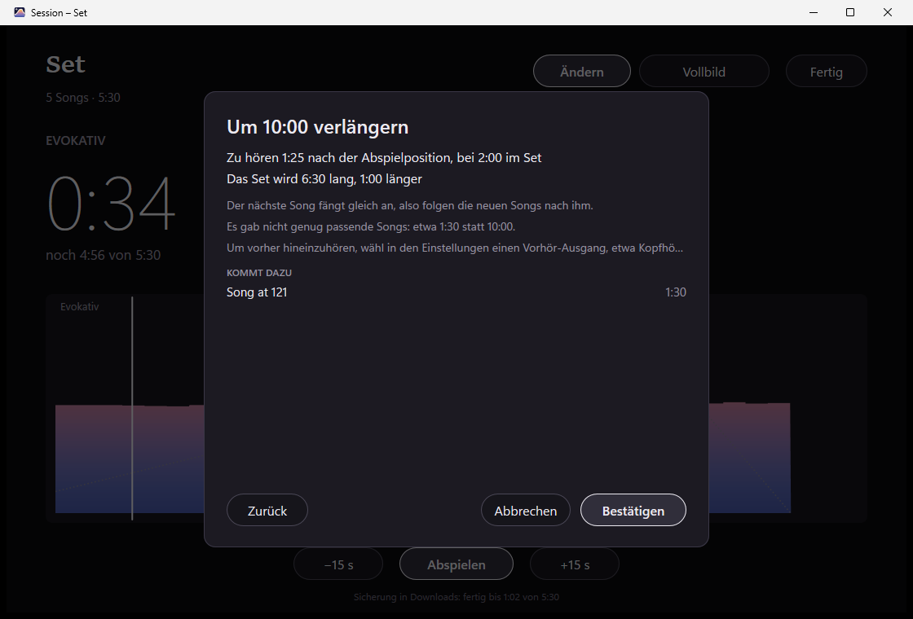

# Was Track Catalogue macht

Track Catalogue stellt Musik-Sets für Sitzungen in holotropem Atmen zusammen. Es ist zum
Vorbereiten einer Sitzung zu Hause gedacht, nicht zum Live-Auflegen mit Decks.

Du beschreibst das Set, das du möchtest: wie lang es ist, wie seine Intensität steigt und fällt
und welche Songs es verwenden darf. Die App wählt Songs aus deiner Musik, bringt sie in eine
Reihenfolge und blendet jeden in den nächsten über. Dann änderst du, was dir nicht gefällt, und
hörst es dir so oft an, wie du willst. Am Ende macht sie daraus eine durchgehende Audiodatei und
eine Trackliste, fertig zum Abspielen in der Sitzung.

Ein Set entsteht in sechs Schritten:

1. **Musik hinzufügen** zum Katalog. Die App hört sich jeden Song an und ermittelt Tempo,
   Rhythmus, Intensität und Lautheit.
2. **Korrigieren**, was die App falsch eingeschätzt hat, und dein eigenes Urteil ergänzen: wie
   intensiv ein Song ist, wohin in einem Set er gehört.
3. **Das Set formen**: seine Dauer und seine Intensitätskurve, etwa den klassischen Bogen einer
   Atemsitzung.
4. **Generieren.** Die App wählt Songs aus und ordnet sie so, dass sie der Kurve folgen, und
   plant jeden Übergang.
5. **Anpassen und anhören.** Songs austauschen, verschieben, fixieren oder entfernen, Übergänge
   ändern und das Set oder einen Teil davon abspielen.
6. **Exportieren**: eine Audiodatei mit ihrer Trackliste.

Alles funktioniert mit Musikdateien auf deinem Computer oder deinen Laufwerken (MP3, FLAC und WAV).
Musik von Streamingdiensten lässt sich nicht verwenden, weil sie kopiergeschützt ist.

# Installieren und starten

## Installieren

Du bekommst es unter <https://github.com/hdsjulian/TrackCatalogue-downloads>. Es gibt zwei Wege,
Track Catalogue auf einen PC zu bringen. Beide brauchen Windows 10 oder 11 auf einem gewöhnlichen
PC (x64).

- **Das Installationsprogramm**, `TrackCatalogue-Setup-0.4.exe`. Es legt Track Catalogue ins
  Startmenü, öffnet Set-Dateien (`.tcset`) damit und lässt sich unter **Einstellungen › Apps**
  wieder entfernen. Es installiert nur für dich und braucht keinen Administrator.
- **Der Ordner**, `TrackCatalogue-Windows-0.4.zip`. Entpacke ihn irgendwohin, zum Beispiel in
  Dokumente, und starte `TrackCatalogue.exe`. Es wird nichts installiert.

Die App ist nicht signiert. Beim ersten Start meldet Windows deshalb vielleicht, es habe **deinen
PC geschützt**. Klick auf **Weitere Informationen** und dann auf **Trotzdem ausführen**. Das
passiert nur einmal.

## Sprache

Track Catalogue spricht Deutsch, wenn die Anzeigesprache von Windows Deutsch ist, sonst
Englisch. Dieses Handbuch verwendet die deutschen Namen.

## Wo deine Arbeit liegt

- **Deine Kataloge und alles, was die App über deine Songs weiß** (Analyse, deine Bewertungen,
  Korrekturen und Tags), liegen in `%APPDATA%\TrackCatalogue`. Diesen Ordner solltest du
  sichern. Um ihn zu öffnen, tipp `%APPDATA%\TrackCatalogue` in die Adressleiste des Explorers.
- **Sets** sind Dateien (`.tcset`), die du speicherst, wo du willst.
- **Deine Musik** wird von der App nie verändert, verschoben oder gelöscht.

Track Catalogue läuft immer nur einmal. Öffnest du ein Set im Explorer, während die App läuft,
öffnet es sich in der App, die schon offen ist.

# Der Katalog

Beim Start öffnet sich das Katalogfenster. Es listet deine Songs mit dem auf, was die Analyse
gefunden hat. Daneben stehen die Details des ausgewählten Songs.

## Musik hinzufügen

- **Ordner hinzufügen…** fügt alle MP3-, FLAC- und WAV-Dateien eines Ordners und all seiner
  Unterordner hinzu.
- **Songs hinzufügen…** fügt die Dateien hinzu, die du auswählst.
- Du kannst Dateien und Ordner auch aus dem Explorer auf das Fenster **ziehen**.

Songs, die schon im Katalog sind, kommen nicht doppelt hinein. Die App analysiert jeden neuen
Song im Hintergrund; die Spalte **Status** zeigt **Wartet** oder **Wird analysiert…**, und die
Zeile ganz unten zählt, wie viele noch fehlen. Du kannst währenddessen weiterarbeiten.

**Nach neuen Songs suchen** sieht in den Ordnern, die du hinzugefügt hast, nach neuen Dateien
und fügt sie hinzu. Sind Songs nicht mehr dort, wo sie hinzugefügt wurden, fragt die App, bevor
sie sie aus dem Katalog entfernt.

**Entfernen** (oder die Taste Entf) nimmt die ausgewählten Songs aus dem Katalog. Die Dateien
bleiben, wo sie sind.

## Die Spalten

| Spalte | Was sie zeigt |
|------|----------------------|
| Titel, Künstler | Aus den Tags der Datei, sofern du sie nicht bearbeitet hast. |
| Dauer | Die Länge des Songs. |
| BPM | Sein Tempo in Schlägen pro Minute. „–“ heißt: kein gleichmäßiger Beat. |
| Rhythmus | **Gleichmäßig** (das Tempo bleibt stabil), **Variabel** (es gibt einen Puls, aber er schwankt) oder **Frei** (kein verlässlicher Puls, etwa bei Drones oder Gesang). |
| Intensität | Von 1 (am ruhigsten) bis 10 (am intensivsten). Ein Bereich wie „2–4“ ist eine Bewertung von dir. |
| Richtung | Wohin der Song auf der Kurve des Sets gehört: **Aufwärts**, **Gleichbleibend**, **Abwärts** oder **Beliebig**. |
| Charakter | Ein paar Worte dazu, wie er klingt, etwa „treibender Beat, perkussiv, hell“. |
| Tags | Deine eigenen Worte, etwa „Trommeln, Gesang, Herz“. |
| Sets | In wie vielen gespeicherten Sets der Song vorkommt. |
| Lautheit | Wie laut er ist, in LUFS. Sets gleichen alle Songs auf dieselbe Lautheit an. |
| Format | MP3, FLAC oder WAV, mit seiner Qualität. |
| Status | Was die Analyse gerade macht, oder warum sie fehlgeschlagen ist. |

Werte, die die App selbst ermittelt hat, sind grau. Werte, die du festgelegt hast, stehen in
normaler Schrift, und **deine gelten immer**.

Klick auf den Kopf einer Spalte, um danach zu sortieren. Zieh Zeilen, um sie in eine eigene
Reihenfolge zu bringen.

## Anhören

Doppelklicke auf einen Song, um ihn zu hören, oder wähl ihn aus und drück **Abspielen**.
**Stopp** hält ihn an. Die Zeile oben im Fenster zeigt, was gerade spielt und wo.

## Mehrere Kataloge

Du kannst mehrere Kataloge führen, etwa einen für alle Musik auf diesem PC, einen für ein
bestimmtes Laufwerk und einen für eine Auswahl, an der du gerade arbeitest. Es ist immer einer
offen; gewechselt wird mit der Liste **Katalog** oben im Fenster. Mit dem Knopf **▾** daneben
legst du einen **Neuer Katalog…** an oder benennst den offenen um oder löschst ihn.

Ein Song kann in mehreren Katalogen sein. Was die App über einen Song weiß (seine Analyse, deine
Bewertungen, Korrekturen und Tags), gehört zum Song selbst und ist darum in jedem Katalog
gleich. Es übersteht sogar, wenn du die Tags der Datei in einem anderen Programm änderst. Löschst
du einen Katalog, wird nur seine Liste der Songs gelöscht, nie die Musik und nie, was die App
darüber weiß.

Ein Set gehört zu dem Katalog, in dem es entstanden ist, und verwendet nur dessen Songs.

## Laufwerke

Songs können auf externen Laufwerken liegen. Ist ein Laufwerk nicht angeschlossen, zeigen seine
Songs **Laufwerk nicht angeschlossen** und lassen sich erst wieder abspielen, wenn du es
ansteckst; das merkt die App von selbst. Ein Set, das Songs auf einem nicht angeschlossenen
Laufwerk braucht, wird weder abgespielt noch exportiert, und die App sagt dir, welches Laufwerk
du anschließen sollst.

Verschiebst oder umbenennst du eine Musikdatei auf demselben Laufwerk, findet die App sie
wieder.

# Die Songs richtig einordnen

Die Analyse der App ist ein guter Anfang, aber sie kann nicht wissen, was du über einen Song
weißt. Die Korrekturen lohnen sich: Ein Set ist nur so gut wie das, was die App über seine Songs
weiß.

## Automatische Werte und deine eigenen

Jeder Wert (Rhythmus, BPM, Intensität, Richtung und die Marken) hat einen automatischen Wert aus
der Analyse und, wenn du einen festlegst, deinen eigenen. Dein Wert gilt immer, übersteht eine
neue Analyse und lässt sich mit **Auf automatisch zurücksetzen** zurücknehmen.

## Die Details eines Songs

Wähl einen Song aus, um neben der Liste seine Details zu sehen. **Details** oben im Fenster
blendet sie ein und aus.

Oben ist die Intensität des Songs über seine Dauer, von kühlem Blau (ruhig) bis warmem Rot
(intensiv). Klick hinein, um von dort abzuspielen; **Abspielen**, **−15 s** und **+15 s** steuern
die Wiedergabe. Darunter:

**Einordnung**

- **Rhythmus**: Automatisch, oder Gleichmäßig, Variabel oder Frei.
- **BPM**: Tipp ein Tempo ein, oder drück mehrmals im Takt der Musik auf **Tippen**. **½** und
  **×2** korrigieren ein Tempo, das die Analyse mit halber oder doppelter Geschwindigkeit
  gehört hat. **Erkannt** geht zum Tempo zurück, das die Analyse gefunden hat. Dein BPM-Wert
  gilt überall, wo ein Tempo zählt.
- **Um einen halben Beat verschoben**: Kreuz das an, wenn die Beats der App zwischen den
  echten liegen (zum Beispiel auf Offbeat-Hi-Hats).
- **Passt auch bei niedrigerem Maximum**: siehe „Höchste BPM“ unter *Ein Set erstellen*.
- **Intensität**: Tipp eine Zahl von 1 bis 10 ein, oder einen Bereich wie `2-4`, wenn ein Song
  überall darin passt. **Bestätigen** übernimmt den automatischen Wert als deine eigene
  Bewertung („der stimmt“).
- **Richtung**: Songs mit **Aufwärts** kommen nur auf den Weg hinauf zu einem Höhepunkt, Songs
  mit **Abwärts** nur auf den Weg hinunter, Songs mit **Gleichbleibend** auf flache Strecken;
  **Beliebig** hat keine Regel.

**Marken**

- **Intro endet** und **Outro beginnt** markieren, wo der Hauptteil des Songs anfängt und
  aufhört. Die App findet sie selbst; korrigier sie, indem du eine Zeit eintippst (m:ss), oder
  drück **Jetzt**, während der Song an der Stelle spielt. **↺** geht zum automatischen Wert
  zurück.
- **Verwenden ab** und **Verwenden bis** markieren einen Ausschnitt des Songs. Hat ein Song
  einen Ausschnitt, verwendet jedes Set nur diesen, als wäre er der ganze Song. **Ausschnitt**
  bietet die Teile an, die die Analyse gefunden hat (das Intro, den Song ohne Intro und Outro,
  das Outro oder einen Abschnitt, der lebhafter oder ruhiger ist als der Rest), und **Der ganze
  Song** hebt ihn wieder auf.
- **Alle Marken auf automatisch** setzt alle vier zurück.

**Tags**: deine eigenen Worte zum Song, durch Kommas getrennt.

**Info**: die Charakter-Worte, die Lautheit und die Pulsstärke, dazu Titel, Künstler und Album.
Hier korrigierst du die Tags der Datei (nur in der App; die Datei wird nicht verändert).
**Zurück zur Datei** holt die Tags der Datei zurück; **Auf automatisch zurücksetzen** löscht
alle deine Werte für den Song.

Felder werden übernommen, wenn du die Eingabetaste drückst oder das Feld verlässt.

## Mehrere Songs auf einmal ändern

Wähl mehrere Songs aus (Strg+Klick, Umschalt+Klick oder Strg+A) und klick sie mit der rechten
Maustaste an für:

- **Rhythmus**, **Intensität** und **Richtung**, jeweils mit ihrer Auswahl.
- **Intensität bestätigen**, **Auf automatisch zurücksetzen**, **Marken auf automatisch**.
- **Titel bearbeiten…**, **Künstler festlegen…**, **Album festlegen…** und **Zurück zur Datei**.
- **Neu analysieren**.
- **BPM verdoppeln**, **BPM halbieren** und **Erkannte BPM verwenden**.
- **Im Explorer zeigen** und **Aus dem Katalog entfernen**.

## Intensität mit der Tastatur bewerten

Wähl einen oder mehrere Songs aus und drück:

- **1** bis **9**, um ihre Intensität zu bewerten, **0** für 10;
- **C**, um die automatische Intensität als richtig zu bestätigen.

## Der App dein Gefühl für Intensität beibringen

Die automatische Intensität beginnt mit allgemeinen Regeln. Je mehr Songs du bewertest oder
bestätigst, desto besser kann sie lernen, wie *du* Intensität hörst:

1. Bewerte mindestens 10 Songs, besonders solche, bei denen sie falschliegt, und bestätige die,
   bei denen sie richtigliegt.
2. Drück oben im Fenster **Neu trainieren**. Der Knopf zeigt, wie viele Bewertungen neu sind,
   etwa „Neu trainieren (12 neue)“.

Das Training dauert etwa eine Sekunde. Die neue Art, Intensität einzuschätzen, wird nur
übernommen, wenn sie deine Bewertungen besser trifft als die bisherige. Die App sagt dir so oder
so Bescheid, mit den Songs, die sich am meisten geändert haben. Songs, die du bewertet hast,
behalten deine Bewertung. Strg+Z macht ein Training rückgängig. Jeder Katalog lernt für sich.

Der Hinweis unten in den Details eines Songs sagt, wo der Katalog steht und wie viele
Bewertungen ihm noch fehlen.

# Ein Set erstellen

## Ein Set anfangen

Drück **Neues Set** (Strg+N). Sind zwei oder mehr Songs ausgewählt, besteht der **Pool** des
neuen Sets (die Songs, die es verwenden darf) aus diesen Songs; sonst aus dem ganzen Katalog.

**Set öffnen…** (Strg+O) öffnet ein gespeichertes Set. Du kannst auch eine `.tcset`-Datei im
Explorer doppelklicken.

## Das Set-Fenster

Von oben nach unten:

- **Die Optionen**: die Dauer, Generieren, die Art der Übergänge, die höchste BPM, die
  Tempolinie und zwei Einstellungen zu Songs aus anderen Sets.
- **Die Wiedergabe**: Abspielen, −30 s und +30 s, wo das Set gerade spielt, und die Knöpfe für
  Zoom und Ansicht.
- **Die Zeitleiste**: die Phasen, die Intensitätskurve, die Songs als Silhouetten ihrer eigenen
  Intensität, und die Zeit.
- **Die Reihenfolge**: jeder Song und jeder Übergang als Zeile, mit Start, BPM, Intensität und
  Dauer.
- **Die Details** des ausgewählten Songs oder Übergangs.
- **Speichern und Exportieren**, und eine Zeile, die sagt, was die App zuletzt getan hat.

Links ist der **Pool**.

## Dauer und Generieren

Leg die **Dauer** als Bereich in Minuten fest, etwa 58 bis 62 (die Voreinstellung).
**Generieren** (Strg+G) wählt Songs aus dem Pool, die eine Dauer in diesem Bereich füllen und der
Kurve folgen, und plant die Übergänge.

- **Generieren** behält die Songs, die du fixiert oder von Hand platziert hast, und füllt die
  Zeit drumherum.
- **Neu generieren** (Strg+Umschalt+G) versucht ein anderes Set: Es wählt neu aus. Deine
  Einstellungen für einen Übergang kommen zurück, wo immer dieselben zwei Songs wieder
  aufeinandertreffen.

Kann der Pool die Dauer nicht füllen, sagt die App das. Sets können bis zu 4 Stunden lang sein.

Es gibt keinen eigenen Schritt zum „Berechnen“: Sobald du etwas änderst, wird das Set sofort neu
geplant, und was du hörst, ist immer das aktuelle Set.

## Die Intensitätskurve

Die Kurve sagt, wie intensiv das Set vom Anfang bis zum Ende sein soll. Sie ist als Landschaft
gezeichnet, mit der Intensität (1 bis 10) links. Die Silhouetten der Songs darunter zeigen, wie
gut sie ihr folgen.

- **Zieh** einen Punkt, um ihn zu verschieben.
- **Klick** auf die Linie, um einen Punkt hinzuzufügen (oder drück und zieh).
- **Doppelklicke** einen Punkt, oder wähl ihn aus und drück Entf, um ihn zu entfernen.
- **Rechtsklick** bietet dasselbe.
- **Kurve ▾** bietet fertige Formen: **Breathwork-Bogen** (die Voreinstellung), **Langer
  Aufbau**, **Zwei Gipfel** und **Sanfte Welle**.

Die Kurve gilt relativ zur Dauer des Sets, darum passt dieselbe Form zu einem Set von einer
Stunde wie von drei Stunden.

Die App liest die Kurve in drei Arten von Strecken: **aufwärts** (zu einem Höhepunkt hin),
**abwärts** (nach einem Höhepunkt) und **flach**. Dort zählt die **Richtung** eines Songs.

## Phasen

Die Leiste über der Kurve benennt die Abschnitte des Sets. Neue Sets beginnen mit den vier
Phasen des klassischen Bogens: **Evokativ**, **Durchbruch**, **Herz** und **Meditativ**.

- Zieh die Linie zwischen zwei Phasen, um sie zu verschieben.
- Doppelklicke den Namen einer Phase, um sie umzubenennen.
- Ein Rechtsklick bietet **Phase hier hinzufügen**, **„…“ umbenennen…** und **Phase entfernen**.

Die Linien zwischen den Phasen hängen an der Kurve: Wenn du einen Punkt der Kurve ziehst, wandern
die Phasen daneben mit, sodass eine Phase bei ihrem Teil der Kurve bleibt.

Phasen sind Beschriftungen für dich: Sie ändern nicht, welche Songs gewählt werden. Sie werden
beim Abspielen gezeigt und in der Session-Ansicht.

## Höchste BPM

**Höchste BPM** legt das schnellste Tempo fest, das das Set haben soll; leer heißt
unbegrenzt. Ein Song über dem Maximum wird nicht langsamer gemacht. Generieren lässt ihn weg,
außer du hast ihn gesetzt oder selbst platziert; dann ist er rot markiert, mit **zu schnell** und
seinem Tempo.

Es zählt der BPM-Wert eines Songs, wie ihn der Katalog zeigt, mit deinen Korrekturen: Ein
Trommelstück, das mit 220 BPM erkannt wurde, gilt bei einem Maximum von 130 als zu schnell, bis
du es halbierst.

Ist ein Song trotzdem in Ordnung, kreuz in seinen Details **Passt auch bei niedrigerem
Maximum** an, oder wähl im Pool **Passt, trotzdem verwenden**. Das gilt für den Song in jedem
Set.

## Die Tempolinie

Die Tempolinie ist eine freiwillige Vorgabe für die Tempi der Songs über das Set hinweg,
gestrichelt über der Kurve gezeichnet, mit einer BPM-Skala rechts. Kreuz **Tempolinie von** an
und leg ihren Bereich fest, etwa 80 bis 128 BPM.

Zuerst **folgt sie der Intensitätskurve**: Sie hat die Form der Kurve, gestreckt über diesen
Bereich. Willst du ihr eine eigene Form geben, drück **Tempo** und zieh die Punkte der
Tempolinie wie bei der Kurve; **Der Intensität folgen** verbindet sie wieder mit der Kurve.

Die Tempolinie lenkt nur sanft, welche Songs gewählt werden: Wenn sie und die Intensitätskurve
sich widersprechen, gewinnt die Intensität. Sie macht nie einen Song schneller oder langsamer.
Songs ohne gleichmäßigen Beat beachten sie nicht.

## Songs in anderen Sets

- **Songs aus keinem anderen Set bevorzugen** (bei neuen Sets an): Songs, die schon in anderen
  gespeicherten Sets vorkommen, werden nur verwendet, wo sie deutlich besser passen als die
  anderen. Songs, die du gesetzt oder selbst platziert hast, werden immer verwendet.
- **In Arbeit**: Kreuz das an, solange du noch an einem Set arbeitest; dann zählen seine Songs
  in deinen anderen Sets nicht als verwendet.

Die Spalte **Sets** im Katalog, der Pool und die Details eines Songs zeigen, welche anderen Sets
einen Song verwenden.

## Der Pool

Der Pool listet die Songs, die dieses Set verwenden darf. Die erste Spalte zeigt die Regel jedes
Songs:

| Zeichen | Bedeutung |
|----|------------------------|
| ✔ | **Gesetzt**: Er muss irgendwo ins Set. |
| ✗ | **Ausgeschlossen**: Er wird nie gewählt. |
| · | Er ist gerade im Set. |
| (keins) | **Erlaubt**: Er darf gewählt werden. |

Die Spalte **Hinweise** sagt, was sonst noch zählt: wohin im Set der Song gehört (etwa
„@2–4“), **zu schnell** für die höchste BPM, **auch in** anderen Sets, oder nur ein Ausschnitt
des Songs.

- **Leertaste** setzt die ausgewählten Songs, oder macht sie wieder frei.
- **Entf** nimmt sie aus dem Pool.
- **Doppelklick** spielt einen Song ab.
- **Rechtsklick** bietet:
  - **Verwenden**: Erlaubt, Gesetzt oder Ausgeschlossen.
  - **Position im Set…**: wohin im Set der Song gehört, in Zehnteln des Sets. 1 ist das erste
    Zehntel, 10 das letzte; „2-4“ heißt 10 bis 40 % des Wegs. Lass es leer, damit Intensität
    und Richtung entscheiden.
  - **Passt, trotzdem verwenden**, für einen Song über der höchsten BPM.
  - **Ans Ende des Sets anfügen** und **Nach dem ausgewählten Song einfügen**.
  - **Aus dem Pool entfernen**.
- **Pool ▾** ganz unten: **Ganzen Katalog hinzufügen**, **Im Katalog ausgewählte Songs
  hinzufügen**, **Ausgewählte aus dem Pool entfernen** und **Alle gesetzten Songs abwählen**.

**Gesetzt** heißt „irgendwo in diesem Set“. Soll ein Song genau dort bleiben, wo er ist,
**fixier** ihn stattdessen (siehe unten).

Beim Wählen setzt Generieren außerdem nie mehr als zwei Songs desselben Künstlers hintereinander.

## Die Zeitleiste lesen

- **Die Songs** sind als Silhouetten ihrer eigenen Intensität gezeichnet und laufen ineinander,
  wo sie sich überlappen. Klick einen an, um ihn auszuwählen.
- **Die Übergänge** sind die Zeichen zwischen den Songs: ein Metronom, wo die Beats angeglichen
  sind, ein Kreuz, wo die Songs einfach überblenden. Klick eines an, um den Übergang
  auszuwählen.
- **Ein roter Punkt** markiert einen Song über der höchsten BPM.
- **Ein schraffiertes Band** unter den Songs zeigt, wo weniger als vier Songs aus dem Pool zur
  Kurve passen („Hier passen nur 2 Songs“, „Hier passt kein Song“). Füg Songs hinzu, die dort
  passen würden, oder ändere die Kurve.
- **Die Zeitachse**: Klick hinein, um von dort abzuspielen.

**← und →** gehen durch die Songs und Übergänge. **Doppelklicke** einen Song, um von dort
abzuspielen.

**Zoomen** mit **−**, **+** und **Einpassen**, oder mit Strg und dem Mausrad. Durch das Set
scrollst du mit dem Mausrad oder der Bildlaufleiste.

## Ein Song im Set

Wähl einen Song aus, in der Zeitleiste oder in der Reihenfolge, und du siehst:

- **Den Ausschnitt, der spielt**, über den ganzen Song gezeichnet, mit seinen Blenden. Zieh
  seine Ränder oder den ganzen Ausschnitt, um ihn zu ändern. Das ändert den Ausschnitt des Songs
  in jedem Set, wie seine Marken.
- **Würde hier passen**: die Songs aus dem Pool, die am besten an diese Stelle passen würden.
  Wähl einen aus und drück **Einwechseln**, um ihn an die Stelle dieses Songs zu setzen.
- **Fixiert**: Der Song bleibt beim Generieren, wo er ist.
- **◀ Früher** und **Später ▶** (oder Alt+↑ und Alt+↓) verschieben ihn in der Reihenfolge.
- **Nach dem Intro**, wo der Song eines hat: Das Set lässt sein Intro weg.
- **Aus dem Set entfernen**.

Die Zeile ganz unten nennt BPM und Intensität des Songs und wie viel lauter oder leiser er
gemacht wurde, damit er zu den anderen passt.

## Ein Set von Hand bauen

Du musst nicht generieren. Zieh Songs aus dem Pool auf die Zeitleiste: Sie landen dort, wo du
sie loslässt. Zieh Songs entlang der Zeitleiste, um die Reihenfolge zu ändern. Songs, die du von
Hand platzierst oder verschiebst, sind fixiert; Generieren behält sie und füllt nur die Zeit,
die noch übrig ist.

Um Songs aus dem Katalog in den Pool des Sets zu holen, wähl sie im Katalog aus und wähl dann
**Pool ▾ › Im Katalog ausgewählte Songs hinzufügen**.

# Übergänge

Jeder Song geht in den nächsten über; es gibt keine harten Schnitte und keine Stille. Jede
Überblendung ist ein Übergang, und jeder lässt sich einzeln wählen und anpassen.

## Die Arten von Übergängen

| Art | Was du hörst |
|------|----------------------|
| **Crossfade** | Ein Song wird leiser, während der nächste lauter wird. Geht mit jeder Musik. |
| **Beatmatch-Blend** | Ein Crossfade, bei dem die Beats beider Songs aneinander ausgerichtet sind. |
| **Bass-Swap** | Im Beat, und nur ein Song hat jeweils den Bass. Der kommende Song beginnt ohne seinen Bass, und der Bass wechselt auf einem Beat, dem Wechselpunkt. |
| **EQ-Blend** | Im Beat, und die sanfteste Übergabe: erst wechseln die Höhen, dann die Mitten, dann der Bass. |
| **Filter-Sweep** | Ein steigender Filter dünnt den gehenden Song aus, bis nur noch Luft bleibt (**Ausgehend**), öffnet den kommenden (**Eingehend**) oder beides (**Beide**). Im Beat, wo es geht. |
| **Automatisch** | Die Standardart des Sets, in Klammern genannt, etwa „Automatisch (Bass-Swap)“. |

Die Arten, die Beats angleichen, brauchen zwei Songs mit gleichmäßigem Beat und Tempi, die nah
genug beieinanderliegen. Wo das nicht geht, wird der Übergang zum Crossfade, und seine Details
sagen, warum.

## Die Art wählen

- **Datei › Einstellungen** (Strg+,), oder **Übergänge in neuen Sets** im Katalogfenster: die
  Art, mit der jedes neue Set beginnt. Zu Beginn ist das Crossfade.
- **Übergänge** im Set-Fenster: der Standard des Sets, für jeden Übergang, der noch auf
  Automatisch steht.
- **Übergang** in den Details eines Übergangs: die eigene Art dieses einen Übergangs.

## Die Länge der Überblendungen

Die App macht jede Überblendung etwa so lang wie das Intro des kommenden Songs, zwischen 15
Sekunden und 3 Minuten. Ohne Intro sind es 30 Sekunden zwischen zwei Songs mit Beat und eine
Minute, wenn einer keinen hat. Nie mehr als die Hälfte eines der beiden Songs.

**Überblendungen** im Set-Fenster macht alle **Kürzer**, **Normal**, **Länger** oder **Viel
länger** (bis doppelt so lang). Längere Überblendungen heißen mehr Songs in derselben Zeit.

## Im Beat

Wenn die Beats zweier Songs angeglichen werden, **treffen sie sich in der Mitte**. Sagen wir,
ein Song hat 118 BPM und der nächste 122: Der erste wird langsam schneller bis 120, beide spielen
mit 120, solange sie sich überlappen, und der zweite kehrt danach langsam zu seinen 122 zurück.
Jeder Song wird um höchstens 4 % verändert, also können sich Songs treffen, die bis zu etwa 8 %
auseinanderliegen. **Außerhalb der Übergänge spielt jeder Song genau so, wie er aufgenommen
wurde.**

Die Details zeigen die Tempi, etwa „118 → 120 BPM in 0:30, dann 120 → 122 BPM in 0:15“.

## Ein Übergang in der Nahansicht

Wähl einen Übergang aus (klick sein Zeichen oder seine Zeile an), um ihn aus der Nähe zu sehen:
oben der gehende Song, unten der kommende, jeder als Wellenform dessen, was spielt, mit
schattierter Überlappung und helleren Tempoänderungen. Ein Zeichen **Bass** zeigt den
Wechselpunkt; ein EQ-Blend zeigt außerdem **Höhen** und **Mitten**.

- **Zieh die Ränder der Überlappung**, um sie länger oder kürzer zu machen: in ganzen Beats,
  wenn die Beats angeglichen sind, sonst in Sekunden.
- **Klick** irgendwohin, um von dort abzuspielen.

Darunter:

- **Übergang**: die Art dieses Übergangs.
- **Wechsel ◀ ▶**: verschiebt den Wechselpunkt einen Beat früher oder später (Bass-Swap und
  EQ-Blend). Bei einem Filter-Sweep wählt **Sweep** stattdessen Ausgehend, Eingehend oder Beide.
- **Dauer**: **−5 s**, **+5 s**, und **Automatisch** für die automatische Länge.
- **Beats ◀ ▶**: verschiebt den kommenden Song einen Beat früher oder später gegenüber dem
  gehenden, falls die Beats nicht ganz übereinanderliegen.
- **Übergang abspielen**: spielt ab 15 Sekunden vor der Überlappung.
- **Ab der Rampe abspielen**: spielt ab der Stelle, wo sich das Tempo zu ändern beginnt.
- **Auf automatisch zurücksetzen**: nimmt alle deine Änderungen an diesem Übergang zurück.

Die Einstellungen eines Übergangs gehören zu seinen beiden Songs. Sie bleiben erhalten, wenn du
neu generierst oder Songs verschiebst, und kommen zurück, wann immer dieselben zwei Songs wieder
aufeinandertreffen.

# Ein Set anhören

- **Abspielen** (oder die Leertaste) spielt das Set ab der aktuellen Stelle; noch einmal drücken
  pausiert.
- **−30 s** und **+30 s** springen zurück und vor.
- **Doppelklicke** einen Song in der Zeitleiste, oder klick auf die Zeitachse, um von dort
  abzuspielen.
- Die Zeile neben den Knöpfen sagt, wo das Set gerade ist, welcher Song spielt und wann der
  nächste beginnt.

Was du hörst, ist genau das, was der Export wird, mit jedem Übergang und mit allen Songs auf
dieselbe Lautheit angeglichen.

## Die Session-Ansicht

**Session** öffnet eine große, dunkle, ruhige Ansicht für den Raum der Sitzung: die Phase, die
Zeit, den Song, der spielt, und den nächsten, und die Form des Sets mit der aktuellen Stelle. Sie
ändert das Set nur über **Ändern**, und nichts erreicht den Raum, bevor du bestätigst. Ein
versehentlicher Klick kann also keinen Schaden anrichten.

- **Leertaste** spielt und pausiert; **−15 s** und **+15 s** (oder ← und →) springen.
- **Vollbild** (oder F11) füllt den Bildschirm.
- **Fertig** (oder Esc) beendet die Session und geht zurück zum Set.

# Ein Set ändern, während es läuft

Manchmal braucht der Raum etwas anderes als geplant: länger auf dieser Stufe, ein früheres Ende
oder früher die nächste Phase. **Ändern** in der Session-Ansicht macht das, während die Musik läuft.

## Verlängern, Kürzen, Phase abschließen

- **Verlängern** bleibt länger auf der aktuellen Stufe: Nach dem laufenden Song kommen Songs dazu,
  für 10, 20 oder 30 Minuten oder so viele Minuten, wie du wählst. Der Rest des Sets folgt später.
  Die Songs kommen zuerst aus dem Pool des Sets; wenn zu wenige passen, aus dem ganzen Katalog.
- **Kürzen** nimmt Songs am Ende der laufenden Phase weg, und aus späteren Phasen, wenn das nicht
  reicht. Der laufende Song spielt zu Ende; jede spätere Phase behält einen Song, und der letzte
  Song bleibt.
- **Phase abschließen** beendet die laufende Phase: innerhalb von etwa einer Minute, an einer
  guten Stelle im laufenden Song, führt ein längerer Übergang in den ersten Song der nächsten Phase.

## Eine Änderung prüfen, bevor der Raum sie hört

Jede Änderung zeigt zuerst eine **Übersicht**: wann sie zu hören ist (als Uhrzeit), wann das Set
endet und welche Songs dazukommen und welche wegfallen. Erst **Bestätigen** ändert das Set.
**Zurück** und **Abbrechen** lassen es, wie es ist.

Nach dem Bestätigen steht über dem Abspielknopf, was du geändert hast und wie lange es noch dauert,
bis es zu hören ist, mit **Rückgängig**. Rückgängig geht, bis die Änderung zu hören ist.

Das vorbereitete Set ändert sich nie: Die Session spielt eine Kopie mit deinen Änderungen.

## Vorher hineinhören

Mit Kopfhörern oder einem zweiten Tonausgang kannst du eine Änderung hören, bevor der Raum sie hört.

1. Wähl den Ausgang unter **Datei › Einstellungen › Vorhör-Ausgang** (nicht den, den der Raum hört).
2. Klick in der Übersicht einer Änderung auf **Auf dem Vorhör-Ausgang anhören**. Die Änderung
   spielt ab 15 Sekunden davor auf diesem Ausgang, während der Raum das Set hört, wie es ist.

## Set anpassen

**Set anpassen** öffnet das Set-Fenster mit dem Set, wie es gerade läuft, während die Musik
weiterspielt. Ein Balken oben sagt **Das laufende Set wird angepasst**.

- Was schon gespielt hat und der laufende Song sind **gesperrt** und abgeblendet; alles danach
  lässt sich ändern: die Kurve, die Phasen, die Songs.
- **−** und **+** im Balken lassen das Set 5 Minuten früher oder später enden.
- **Vorlage für den Rest** lässt den Rest des Sets einer der Kurvenvorlagen folgen. Sie zeigt die
  Vorlage mit einem vorgeschlagenen Punkt, wo die Session gerade ist; klick woanders hin, um einen
  anderen zu wählen.
- Der Raum hört das Set wie bisher, bis du auf **Laufendes Set anpassen** klickst. Das zeigt die
  Übersicht in der Session-Ansicht, wo du bestätigst. **Abbrechen** verwirft deine Änderungen.

Eine Änderung an der Form der Kurve übernimmt an einer guten Stelle innerhalb von etwa einer
Minute, mit einem längeren Übergang.

## Was nach einer Session bleibt

Wenn eine Session mit Änderungen endet (du klickst auf **Fertig**), speichert die App das Set, wie
es gespielt wurde, neben dem vorbereiteten, zum Beispiel „Dienstagsgruppe – gespielt am 20. Nov.“,
mit einer FLAC-Datei und der Trackliste. Bei einem nie gespeicherten Set landen sie in deinem
Musik-Ordner. Eine Session ohne Änderungen speichert nichts extra.

## Wenn die App oder der Computer während einer Session ausgeht

- Während einer Session hält die App eine **Sicherung** des Sets, wie es läuft, in deinem
  Downloads-Ordner: „TrackCatalogue session backup.wav“. Die Session-Ansicht zeigt, wie weit sie
  fertig ist. Im Notfall spielst du sie in irgendeinem Player ab der Zeit, wo die Session war.
- Beim nächsten Start bietet Track Catalogue **Session fortsetzen** an. Es öffnet das Set mit
  deinen Änderungen und spielt dort weiter, wo die Musik aufgehört hat, mit einem Einblenden.

## Einstellungen für Sessions

**Datei › Einstellungen** hat zwei Einstellungen für Sessions:

- **Warnen, wenn eine Änderung im laufenden Set die Längenspanne verlässt**: Die Übersicht sagt dann,
  wenn eine Änderung das Set aus der Länge bringt, die du dafür eingestellt hast. Bestätigen kannst
  du trotzdem.
- **Vorhör-Ausgang**: der Tonausgang zum Vorher-Hineinhören.

# Speichern und exportieren

## Speichern

**Speichern…** (Strg+S) speichert das Set als `.tcset`-Datei; **Datei › Speichern unter…**
(Strg+Umschalt+S) speichert eine Kopie unter neuem Namen. Solange es Änderungen gibt, steht im
Fenstertitel **(nicht gespeichert)**, und die App fragt nach, bevor sie ein Set mit
ungespeicherten Änderungen schließt.

Eine Set-Datei verweist auf die Songs in deinem Katalog; die Musik ist nicht darin enthalten.
Fehlt die Datei eines Songs, öffnet sich das Set trotzdem, und dieser Song bleibt stumm.

## Exportieren

**Exportieren…** (Strg+E) macht aus dem Set eine Audiodatei, im Format, das in der Liste daneben
gewählt ist, und fragt, wo sie gespeichert werden soll:

| Format | Wofür |
|-----------|-----------|
| WAV, 16 Bit (CD-Qualität) | Jeder Player; große Dateien. |
| WAV, 24 Bit | Die beste Qualität; die größten Dateien. |
| FLAC (verlustfrei, 24 Bit) | Die beste Qualität in etwa halber WAV-Größe. |
| AAC, 192 kbit/s | Handys, Laptops und zum Teilen; kleine Dateien. |

Daneben wird eine **Trackliste** gespeichert, als Text und als Tabelle (CSV): Startzeit,
Künstler und Titel jedes Songs. Die Startzeit eines Songs ist die Mitte des Übergangs in ihn
hinein.

**Stopp** bricht einen laufenden Export ab. Ist er fertig, zeigt **Im Explorer zeigen** die
Dateien.

**Schnellexport** (Strg+Umschalt+E) überspringt alle Fragen: Er speichert das Set als AAC mit
192 kbit/s, mit seiner Trackliste als Text, direkt in deinen Downloads-Ordner. Ein früherer
Schnellexport wird nie überschrieben: Der nächste bekommt eine Nummer. Ein Set von drei Stunden
hat etwa 260 MB.

## Lautheit

Jeder Song wird auf dieselbe Lautheit gebracht (−16 LUFS), um höchstens 12 dB lauter oder
leiser, und ein Limiter verhindert, dass die lautesten Stellen verzerren. Wird eine leise
Aufnahme stark angehoben, steigt auch ihr Hintergrundrauschen; die Details eines Songs sagen, um
wie viel er lauter oder leiser gemacht wurde.

# Rückgängig machen

Strg+Z macht jede Änderung rückgängig, Strg+Y (oder Strg+Umschalt+Z) wiederholt sie: im Katalog
(Bewertungen, Korrekturen, entfernte Songs, Training) und in einem Set (die Kurve, Songs,
Übergänge).

# Tastenkürzel

**Überall**

| Tasten | Was sie bewirken |
|:---|:---|
| Strg+Z | Rückgängig |
| Strg+Y oder Strg+Umschalt+Z | Wiederholen |

**Der Katalog**

| Tasten | Was sie bewirken |
|:---|:---|
| Strg+N | Neues Set |
| Strg+O | Set öffnen… |
| Strg+, | Einstellungen |
| Strg+A | Alle Songs auswählen |
| 1 bis 9, 0 | Intensität bewerten (0 ist 10) |
| C | Die automatische Intensität bestätigen |
| Entf | Aus dem Katalog entfernen |
| Doppelklick | Den Song abspielen |

**Ein Set**

| Tasten | Was sie bewirken |
|:---|:---|
| Leertaste | Abspielen oder Pause |
| Strg+G | Generieren |
| Strg+Umschalt+G | Neu generieren |
| Strg+S | Speichern |
| Strg+Umschalt+S | Speichern unter |
| Strg+E | Exportieren |
| Strg+Umschalt+E | Schnellexport |
| Strg+W | Das Set schließen |
| Strg++ und Strg+− | Vergrößern und verkleinern |
| Strg+0 | Das ganze Set einpassen |
| Strg+Mausrad | Zoomen |
| ← und → | Der vorige oder nächste Song oder Übergang |
| Alt+↑ und Alt+↓ | Den ausgewählten Song früher oder später setzen |
| Entf | Den ausgewählten Kurvenpunkt entfernen, sonst den ausgewählten Song |

**Der Pool**

| Tasten | Was sie bewirken |
|:---|:---|
| Leertaste | Setzen, oder wieder freigeben |
| Entf | Aus dem Pool entfernen |
| Doppelklick | Den Song abspielen |

**Die Session-Ansicht**

| Tasten | Was sie bewirken |
|:---|:---|
| Leertaste | Abspielen oder Pause |
| ← und → | 15 Sekunden zurück oder vor |
| F11 | Vollbild |
| Esc | Zurück zum Set |

# Wenn etwas nicht stimmt

**Windows meldet, es habe deinen PC geschützt.** Die App ist nicht signiert. Klick auf **Weitere
Informationen** und dann auf **Trotzdem ausführen**.

**Das BPM eines Songs ist halb oder doppelt so hoch, wie es sein sollte.** Klick ihn mit der
rechten Maustaste an und wähl **BPM verdoppeln** oder **BPM halbieren**, oder nimm **½** und
**×2** in seinen Details. Tempi werden zwischen 40 und 260 BPM erkannt, und langsame Musik wird
manchmal doppelt so schnell gehört.

**Die Beats in einem Übergang liegen nicht übereinander.** Wähl den Übergang aus und nimm **Beats
◀ ▶**. Passiert das bei jedem Übergang eines Songs, kreuz in seinen Details **Um einen halben
Beat verschoben** an.

**Ein Song ist als „zu schnell“ markiert.** Er liegt über der höchsten BPM des Sets. Halbiere
sein BPM, falls es falsch erkannt wurde, erhöhe das Maximum, oder wähl **Passt, trotzdem
verwenden**.

**Unter den Songs ist ein schraffiertes Band.** Dort passen weniger als vier Songs aus dem Pool
zur Kurve. Füg dem Pool Songs mit der passenden Intensität hinzu, oder ändere die Kurve.

**Die Analyse eines Songs ist fehlgeschlagen.** Sein **Status** sagt, warum. Versuch **Neu
analysieren**; ist die Datei beschädigt, kann die App sie nicht lesen.

**Ein Song zeigt „Laufwerk nicht angeschlossen“.** Steck das Laufwerk an, auf dem er liegt. Ein
Set, das ihn braucht, wird bis dahin weder abgespielt noch exportiert.

**Ein Set sagt, es sei mit einem anderen Katalog erstellt worden.** Wechsle im Katalogfenster zu
diesem Katalog und öffne das Set dann noch einmal.

**Es ist nichts zu hören.** Prüf die Tonausgabe und die Lautstärke von Windows. Die App spielt
über die Standardausgabe von Windows.

**Die App oder der Computer ist während einer Session ausgegangen.** Starte Track Catalogue neu und
wähl **Session fortsetzen**. Bis dahin spielt „TrackCatalogue session backup.wav“ aus Downloads in
jedem Player.

**„Anhören“ wird nicht angeboten.** Wähl unter **Datei › Einstellungen** einen Vorhör-Ausgang, und
achte darauf, dass er verbunden ist und nicht der Ausgang ist, den der Raum hört.

**Die App funktioniert nicht mehr.** Starte sie neu. Ein Song, den sie gerade analysiert hat, als
sie stehen blieb, wird nicht von selbst noch einmal analysiert: Sein **Status** sagt das, und
**Neu analysieren** versucht es noch einmal. Wähl dann **Hilfe › Diagnose speichern…**. Das legt
eine Zip-Datei auf den Desktop, mit dem Protokoll der App und, falls sie abgestürzt ist, einer
Aufzeichnung dessen, was sie gerade gemacht hat. Schick diese Datei an die Person, von der du die
App hast.

# Begriffe in der App

| Begriff | Bedeutung |
|------|----------------------|
| Katalog | Eine Liste deiner Songs. Du kannst mehrere haben. |
| Pool | Die Songs, die ein Set verwenden darf. |
| Set | Eine Reihenfolge von Songs mit Übergängen, für eine Sitzung. |
| Intensität | Wie intensiv ein Song ist, von 1 (ruhig) bis 10 (am intensivsten). |
| Kurve | Die geplante Intensität des Sets vom Anfang bis zum Ende. |
| Phase | Ein benannter Abschnitt eines Sets, etwa „Herz“. |
| Richtung | Ob ein Song auf den Weg hinauf zu einem Höhepunkt gehört, hinunter, auf eine flache Strecke oder überallhin. |
| BPM | Schläge pro Minute: das Tempo eines Songs. |
| Tempolinie | Eine freiwillige Vorgabe für die Tempi der Songs über das Set hinweg. |
| Übergang | Die Überblendung von einem Song in den nächsten. |
| Im Beat | Die Beats zweier Songs sind aneinander ausgerichtet, solange sie sich überlappen. |
| Wechselpunkt | Der Beat, auf dem der Bass vom einen Song zum nächsten wechselt. |
| Fixiert | Bleibt beim Generieren an seiner Stelle. |
| Gesetzt | Muss irgendwo ins Set. |
| Ausschnitt | Der Teil eines Songs, den Sets verwenden, wenn nicht den ganzen Song. |
| LUFS | Ein Maß für Lautheit. |
