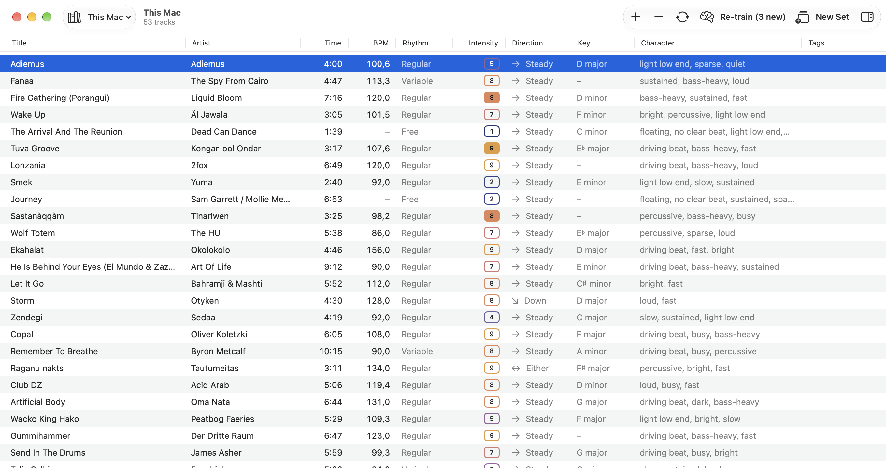
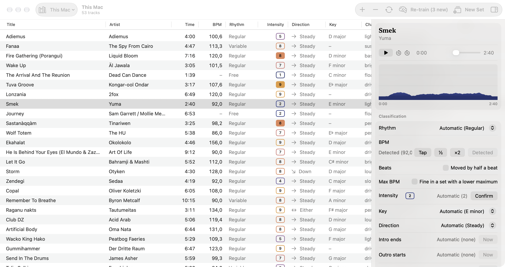
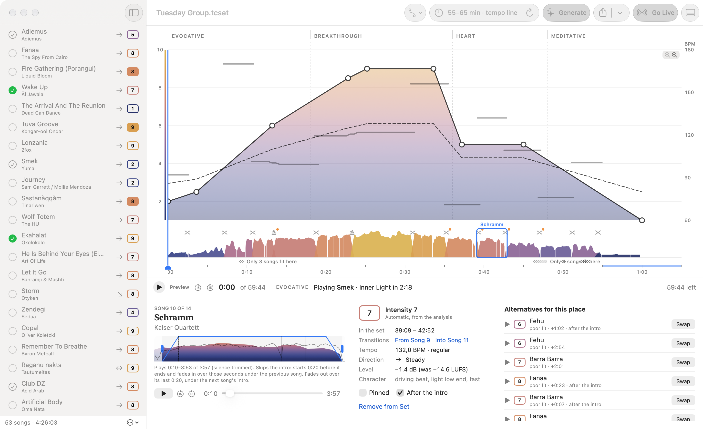
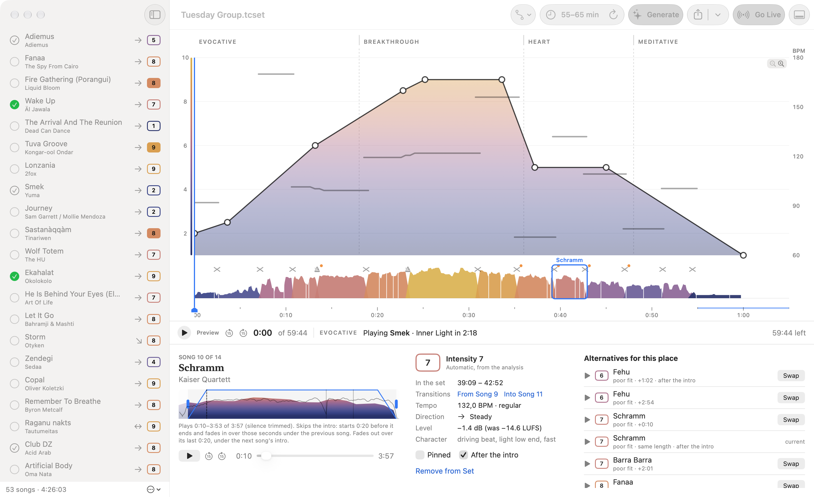
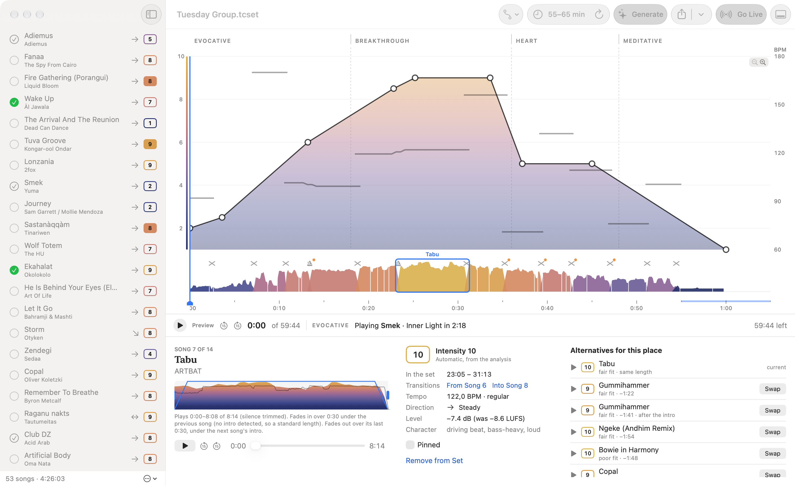
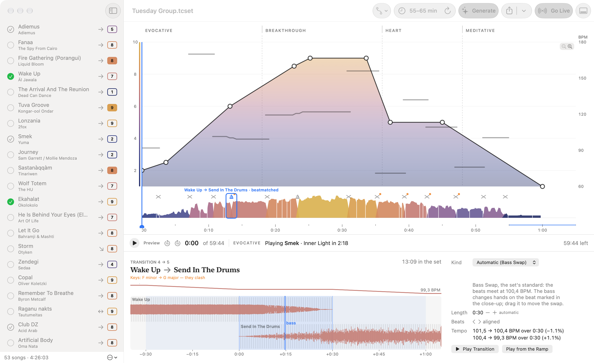
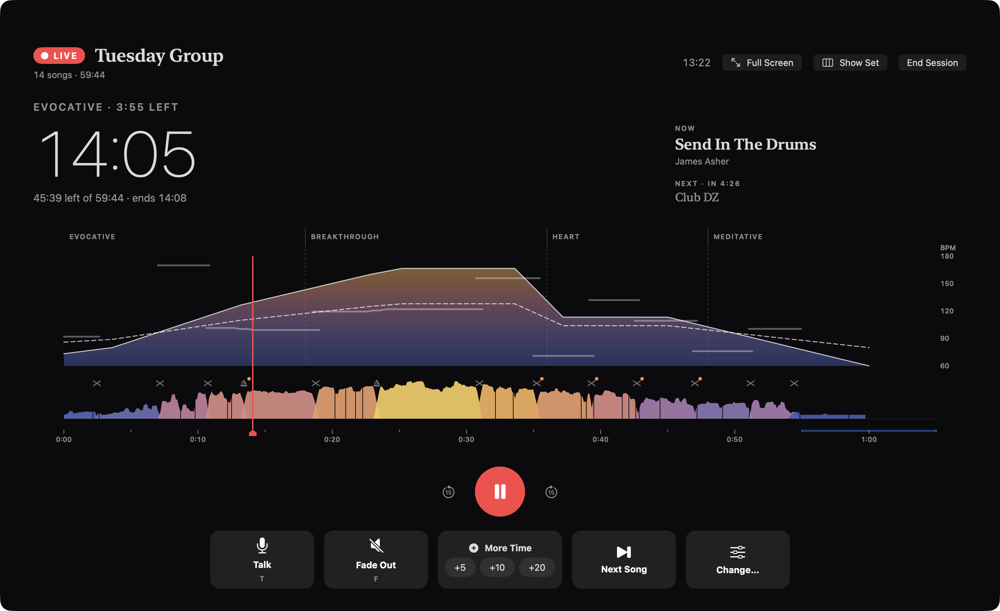
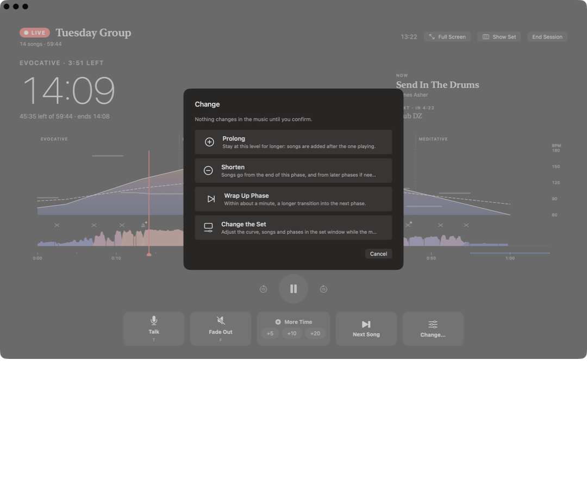

# Was Track Catalogue macht

Track Catalogue baut Musik-Sets für holotropes Atmen. Es ist zum Vorbereiten einer Session zu
Hause da und zum Abspielen im Raum, nicht zum Live-Mischen mit Decks.

Du beschreibst das Set, das du willst: wie lang es ist, wie seine Intensität steigt und fällt und
welche Songs es verwenden darf. Die App wählt Songs aus deiner Musik, bringt sie in eine
Reihenfolge und blendet jeden in den nächsten über. Dann änderst du, was dir nicht gefällt, und
hörst es dir so oft an, wie du willst. Am Ende macht sie eine durchgehende Audiodatei mit einer
Trackliste, oder du spielst das Set direkt in der Session.

Ein Set entsteht in sechs Schritten:

1. **Füg deine Musik** dem Katalog hinzu. Die App hört sich jeden Song an und ermittelt Tempo,
   Rhythmus, Intensität und Lautheit.
2. **Korrigiere**, was die App falsch erkannt hat, und ergänze dein eigenes Urteil: wie intensiv
   ein Song ist, wo er in ein Set gehört.
3. **Form das Set**: seine Länge und seine Intensitätskurve, etwa den klassischen Breathwork-Bogen.
4. **Generiere.** Die App wählt Songs, die der Kurve folgen, ordnet sie und plant jeden Übergang.
5. **Pass an und hör hin.** Tausche, verschiebe, pinne oder entferne Songs, ändere Übergänge und
   spiel das Set oder einen Teil davon ab.
6. **Spiel es in der Session** und ändere es dort, wenn der Raum etwas anderes braucht, oder
   **exportiere** eine Audiodatei mit Trackliste.

Die Mac-App ist auf Englisch. Dieses Handbuch nennt ihre Knöpfe und Menüs so, wie sie auf dem
Bildschirm stehen, **fett** und auf Englisch, und erklärt sie auf Deutsch.

# Installieren und starten

## Installieren

Lade `TrackCatalogue-0.4.dmg` von <https://github.com/hdsjulian/TrackCatalogue-downloads> herunter
und öffne es. Zieh **TrackCatalogue** auf **Applications** (Programme). Die App braucht macOS 15
(Sequoia) oder neuer und läuft auf Macs mit Apple Silicon und Intel.

## Das erste Öffnen

macOS kennt die App noch nicht, weil sie nicht aus dem App Store kommt. Das machst du einmal pro
Version:

1. Doppelklick auf TrackCatalogue im Programme-Ordner. macOS sagt, es konnte die App nicht
   überprüfen. Klick auf **Fertig**.
2. Öffne **Systemeinstellungen › Datenschutz & Sicherheit**, scroll nach unten zu
   „TrackCatalogue wurde blockiert …“ und klick auf **Trotzdem öffnen**.
3. Klick noch einmal auf **Trotzdem öffnen** und gib das Passwort deines Macs ein.

Danach öffnet sie sich ganz normal.

## Hell und dunkel

Die App folgt dem Erscheinungsbild deines Macs. Um es nur für die App festzulegen, wähl
**View › Appearance** oder **TrackCatalogue › Settings…**: **Same as System** (wie das System),
**Light** (hell) oder **Dark** (dunkel). Die Live-Ansicht ist immer dunkel.

## Wo deine Arbeit liegt

- **Deine Kataloge und alles, was die App über deine Songs weiß** (Analyse, deine Bewertungen,
  Korrekturen und Tags), liegen im eigenen Ordner der App in deiner Library. Time Machine
  sichert ihn mit allem anderen.
- **Sets** sind Dokumente (`.tcset`), die du speicherst, wo du willst. Ein Doppelklick im Finder
  öffnet sie.
- **Deine Musik** wird von der App nie verändert, verschoben oder gelöscht. Sie liest sie nur.

# Der Katalog

Das Katalogfenster öffnet sich beim Start der App (**Window › Track Catalogue** holt es zurück).
Es listet deine Songs mit dem, was die Analyse gefunden hat. Daneben zeigt der **Inspector** den
ausgewählten Song.

## Musik hinzufügen

- Zieh MP3- und FLAC-Dateien oder Ordner, die welche enthalten, ins Fenster. Ein leerer Katalog
  sagt **Drop Music Here**.
- Oder klick in der Symbolleiste auf **Add Files…** (+) und wähl Dateien oder Ordner. Ordner
  werden mit allen Unterordnern durchsucht.

Songs, die schon im Katalog sind, kommen nicht doppelt hinein. Die App analysiert jeden neuen Song
im Hintergrund; der Untertitel des Fensters zählt, wie viele noch fehlen. Du kannst so lange
weiterarbeiten.

**Look for New Songs** sucht in den Ordnern, die du hinzugefügt hast, nach neuen Dateien und fügt
sie hinzu. Sind Songs dort verschwunden, fragt die App, ob sie sie aus dem Katalog entfernen soll.

**Remove** (−, oder die Rückschritttaste) nimmt die ausgewählten Songs aus dem Katalog. Die Dateien
bleiben, wo sie sind.

### Songs ohne Tags

Manche Dateien haben keine Tags: keinen Interpreten, Titel oder kein Album in sich. Dann liest die
App die Namen aus der Datei und ihren Ordnern: „Interpret - Album/03 Titel.flac“,
„Interpret/Album/03 Titel.mp3“ und Bandcamps „Interpret - Album - 03 Titel.mp3“ ergeben Interpret,
Album und Titel.

Für jeden Ordner solcher Songs zeigt ein Fenster **Songs Without Tags**, was gelesen wurde.
Korrigiere, was nicht stimmt, und klick auf **Confirm**; die Dateien selbst bleiben unverändert.
**Skip** lässt die Songs, wie sie gelesen wurden, und **Skip All** tut das für jeden Ordner, der
noch wartet. ⌘Z nimmt eine Bestätigung zurück.

## Die Spalten

| Spalte | Was sie zeigt |
|------|----------------------|
| Title, Artist | Titel und Interpret aus den Tags der Datei, außer du hast sie geändert. |
| Time | Die Länge des Songs. |
| BPM | Sein Tempo in Schlägen pro Minute. „–“ heißt: kein gleichmäßiger Beat. |
| Rhythm | **Regular** (das Tempo bleibt gleich), **Variable** (es gibt einen Puls, aber er schwankt) oder **Free** (kein verlässlicher Puls, etwa Drones oder Gesang). |
| Intensity | Von 1 (am ruhigsten) bis 10 (am intensivsten), als farbiges Kästchen: gefüllt für deine Bewertung, umrandet für den automatischen Wert. |
| Direction | Wo der Song auf die Kurve des Sets gehört: **Up** (aufwärts), **Steady** (gleichbleibend), **Down** (abwärts) oder **Either** (egal). |
| Vocals | Ob der Song Gesang oder Sprache hat: **None** (kein), **Some** (etwas) oder **Throughout** (durchgehend). Leer, bis du es festlegst. |
| Words | Ob man seine Worte versteht: **Understood** (verständlich), **Not Understood** (nicht verständlich) oder **None** (keine). **Unknown** (unbekannt), solange seine Sprache nicht bekannt ist. Zeig mit der Maus darauf, um die Sprache zu sehen. |
| Character | Ein paar Worte, wie er klingt, etwa „driving beat, percussive, bright“. |
| Tags | Deine eigenen Worte, etwa „Trommeln, Gesang, Herz“. |
| Sets | Wie viele gespeicherte Sets den Song verwenden. |
| Loudness | Wie laut er ist, in LUFS. Sets bringen jeden Song auf dieselbe Lautheit. |
| Format | MP3 oder FLAC, mit seiner Qualität. |

Werte, die die App selbst ermittelt hat, sind grau; deine sind in normaler Schrift, und **deine
gelten immer**.

Klick auf einen Spaltenkopf, um danach zu sortieren. Ein Rechtsklick auf die Köpfe blendet Spalten
ein und aus. Zieh Zeilen, um deine eigene Reihenfolge zu bekommen.

## Anhören

Doppelklick auf einen Song spielt ihn, noch einmal pausiert ihn. Der Inspector hat auch einen
Player.

## Mehrere Kataloge

Du kannst mehrere Kataloge haben, zum Beispiel einen für alle Musik auf diesem Mac, einen für eine
bestimmte Festplatte und einen für eine Auswahl, an der du arbeitest. Einer ist jeweils geöffnet.
Das Menü links in der Symbolleiste, mit dem Namen des Katalogs, wechselt zwischen ihnen und hat
**New Catalogue…** (neu), **Rename…** (umbenennen) und **Delete…** (löschen).

Ein Song kann in mehreren Katalogen sein. Was die App über einen Song weiß, gehört zum Song selbst,
ist also in jedem Katalog gleich und übersteht sogar, wenn du die Tags der Datei in einem anderen
Programm änderst. Einen Katalog zu löschen, löscht nur seine Liste, nie die Musik oder das, was die
App über sie weiß.

Ein Set gehört zu dem Katalog, in dem es gemacht wurde. Öffnest du ein Set aus einem anderen
Katalog, bietet das Set-Fenster an, zu ihm zu wechseln.

## Festplatten

Songs können auf externen Festplatten liegen. Ist eine nicht angeschlossen, sind ihre Songs grau
mit einem Laufwerkssymbol, und der Untertitel des Fensters nennt die Festplatte. Sie lassen sich
erst wieder abspielen, wenn du sie anschließt; die App merkt das von selbst. Ein Set, das Songs
darauf braucht, sagt „Connect “Laufwerk” to play this set“.

# Die Songs richtig erfassen

Die Analyse der App ist ein guter Anfang, aber sie kann nicht wissen, was du über einen Song
weißt. Korrigieren lohnt sich: Sets sind nur so gut wie das, was die App über ihre Songs weiß.

## Automatische Werte und deine eigenen

Jeder Wert (Rhythmus, BPM, Intensität, Richtung und die Marken) hat einen automatischen Wert aus der
Analyse und, wenn du einen setzt, deinen eigenen. Deiner gilt immer, übersteht eine neue Analyse
und lässt sich mit **Reset to Automatic** zurücknehmen.

## Der Inspector

Wähl einen Song aus, um ihn im Inspector zu sehen. **Inspector** in der Symbolleiste (⌥⌘I) blendet
ihn ein und aus.

Oben stehen Titel und Interpret, ein Player (Abspielen, 15 Sekunden zurück und vor) und die
Intensität des Songs im Verlauf, von Nachtblau (ruhig) bis Feuergelb (intensiv). Klick hinein, um
von dort abzuspielen, oder zieh darüber, um den Teil festzulegen, den Sets verwenden. Darunter:

**Classification** (Einordnung)

- **Rhythm**: Automatic, oder Regular, Variable oder Free.
- **BPM**: Tipp ein Tempo ein, oder drück mehrmals im Takt auf **Tap**. **½** und **×2** korrigieren
  ein Tempo, das die Analyse halb oder doppelt so schnell gehört hat. **Detected** geht zum
  erkannten Tempo zurück.
- **Moved by half a beat** (um einen halben Schlag verschoben): Häkchen setzen, wenn die Schläge der
  App zwischen den echten liegen (etwa bei Hi-Hats auf dem Offbeat).
- **Fine in a set with a lower maximum** (in Ordnung in einem Set mit niedrigerem Maximum): siehe
  „Höchste BPM“ unter *Ein Set machen*.
- **Intensity**: Tipp eine Zahl von 1 bis 10 ein, oder einen Bereich wie `2-4`, wenn ein Song
  irgendwo darin passt. **Confirm** übernimmt den automatischen Wert als deine Bewertung („der
  stimmt“).
- **Direction**: **Up**-Songs kommen nur auf dem Weg zu einem Höhepunkt, **Down**-Songs nur danach,
  **Steady**-Songs auf flache Stücke; **Either** hat keine Regel.
- **Intro ends** und **Outro starts** markieren, wo der Hauptteil des Songs beginnt und endet.
  Korrigier sie, indem du eine Zeit eintippst (m:ss), oder drück **Now**, während der Song dort
  spielt. Der Knopf daneben geht zum automatischen Wert zurück.
- **Use from** und **Use until** markieren einen Teil des Songs. Hat ein Song einen Teil, verwendet
  jedes Set nur diesen Teil, als wäre er der ganze Song. **Use only** bietet die Teile an, die die
  Analyse gefunden hat (das Intro, den Song ohne Intro und Outro, das Outro oder einen Abschnitt,
  der lebhafter oder ruhiger ist als der Rest), und **The Whole Song** hebt ihn auf.
- **All Markers to Automatic** setzt die Marken zurück.
- **Tags**: deine eigenen Worte zum Song, durch Kommas getrennt.
- **Character**, **Loudness** und **Pulse strength** (Pulsstärke), wie die Analyse sie gefunden hat.

**Info**: Titel, Interpret und Album. Ändere sie, um die Tags der Datei zu korrigieren (nur in der
App; die Datei bleibt, wie sie ist). **Revert to File Info** geht zu den Tags der Datei zurück.

**Reset to Automatic** löscht alle deine Werte für den Song.

**Other Copies** (weitere Kopien): dieselbe Aufnahme in anderen Dateien, zum Beispiel ein MP3 eines
Songs, den du auch als FLAC hast, oder dieselbe Datei in zwei Ordnern. Der Katalog zeigt so einen
Song nur einmal, als seine beste Kopie (verlustfrei vor MP3, dann die höhere Qualität); die anderen
Kopien stehen hier mit Format und Dateiname. Sets nehmen die beste Kopie, oder die nächstbeste, wenn
ihr Laufwerk nicht angeschlossen ist, und deine Bewertungen an einer Kopie gelten für den Song. Die
App erkennt Kopien daran, wie sie klingen; andere Schreibweisen in den Tags spielen keine Rolle, und
ein Radio-Edit oder ein Remaster bleibt ein eigener Song. Sind zwei Dateien doch nicht derselbe Song,
trennt **These Are Different Songs** sie dauerhaft.

## Tonarten

Die Analyse findet die **Tonart** jedes Songs (**Key**), etwa „A minor“ (a-Moll), für den ganzen
Song und für jeden Teil, an dem sich die Musik ändert. Songs ohne klare Tonart, etwa Trommeln oder
ein Drone, zeigen „–“. Die Spalte **Key** blendest du per Rechtsklick auf die Kopfzeile der Tabelle
ein; im Inspector legst du mit **Key** deine eigene fest, oder **No Clear Key**.

Beim Generieren bevorzugt die App Nachbarn, deren Tonarten dort zusammenpassen, wo sie sich
überlappen. Die Tonart wiegt nie schwerer als die Intensitätskurve: Sie entscheidet nur zwischen
Songs, die etwa gleich gut passen. In der Zeitleiste zeigt ein kleiner orangefarbener Punkt an der
Marke eines Übergangs, dass die Tonarten dort nicht zusammenpassen, und die Details des Übergangs
nennen beide. Songs spielen immer in ihrer eigenen Tonhöhe.

## Pegel (Level)

In einem Set spielt jeder Song gleich laut: Die App gleicht sie nach Messung aus. Klingt einer
neben den anderen trotzdem zu laut oder zu leise, spiel ihn ab und zieh den Regler **Level** im
Inspector: −6 bis +6 dB, in Schritten von 0,5 dB, und du hörst die Änderung sofort. Lässt du los,
bleibt sie, für diesen Song in jedem Set; ein Doppelklick auf den Regler stellt ihn zurück auf
**As levelled**. Die Vorschau spielt Songs so laut wie ein Set, du hörst also, was das Set tun
wird. Der Pegel ändert die Intensität eines Songs nicht. Im Set sagen die Details des Songs
„Level +1.5 dB, set in the catalogue.“

## Gesang und Worte (Vocals, Words)

Ein Song, dessen Worte man versteht, holt einen in den Kopf. Ein Gesang auf Sanskrit, Summen oder
das „Aah“ eines Chors tun das nicht. Deshalb hat jeder Song zwei Werte:

- **Vocals** (Gesang): ob er Gesang oder Sprache hat: **None**, **Some** oder **Throughout** (kein,
  etwas, durchgehend). Das legst du selbst fest.
- **Words** (Worte): ob man seine Worte versteht: **Understood**, **Not Understood** oder **None**
  (verständlich, nicht verständlich, keine).

Eine Sprache wählst du nie. Die App schlägt die Sprache des Songtexts bei MusicBrainz nach, einer
öffentlichen Musikdatenbank, nachdem der Song analysiert ist. Nur Künstler und Titel werden
gesendet. Ist die Sprache eine, die man versteht, steht bei Words **Understood**; bei jeder anderen
**Not Understood**; bei einem Song ohne Text **None**. Solange die Sprache nicht bekannt ist, steht
dort **Unknown**, in hellem Grau. Automatische Werte sind grau, deine in normaler Schrift, und
**deine gelten immer**. Ein Song, bei dem du Vocals **None** festgelegt hast, hat keine Worte.

Leg beide im Inspector fest, oder klick mehrere Songs mit rechts an und wähl **Vocals** oder
**Words**. **Words › Look Up Language Again** oder **Look Up Again** im Inspector fragt MusicBrainz
noch einmal. Die Zeile **Language** im Inspector sagt, was gefunden wurde, etwa „German, from
MusicBrainz“. Die Spalten Vocals und Words blendest du wie jede andere ein und aus (Rechtsklick auf
die Kopfzeile).

**TrackCatalogue › Settings…** hat dafür zwei Einstellungen:

- **Look up song languages online**: an, solange du es nicht ausschaltest. Aus, wird nichts
  gesendet, und Words bleibt Unknown, solange du es nicht festlegst.
- **Understood languages**: Hak die Sprachen an, die deine Gruppen verstehen. Am Anfang sind
  Englisch und die Sprache deines Macs angehakt. Änderst du die Liste, ändern sich die Words aller
  Songs auf einmal.

Ein Set kann Songs mit verständlichen Worten weglassen: siehe „Die Optionen des Sets“ unter *Ein
Set machen*.

## Teile auslassen (Leave Out Parts)

Um einen Abschnitt eines Songs auszulassen, etwa eine lange Stille oder einen gesprochenen Teil,
klick unter seiner Intensität im Inspector auf **Leave Out Parts…** und zieh über den Abschnitt.
Seine Kanten rasten dort ein, wo sich die Musik ändert, oder auf einem Beat; zieh eine Kante, um sie
zu verschieben. Klick einen Abschnitt an, um ihn auszuwählen: **Join** macht seine Überblendung
kürzer oder länger, **Remove** nimmt ihn weg. Spiel den Song dabei ab: Er springt über die
Abschnitte, mit einer kurzen Überblendung, einen Beat lang, oder 2 Sekunden ohne Beat.

Dann:

- **Edit This Song** behält die Abschnitte beim Song: Er lässt sie in jedem Set, in der Vorschau
  und beim Export aus. Die Datei wird nicht verändert. **Play the Whole Song** holt sie zurück.
- **Save as New Song…** fügt einen zweiten Song hinzu, „Titel (edited)“, mit allem, was du bei
  diesem eingestellt hast. Die App fragt, ob er eine eigene Datei sein soll: **Its Own File…**
  schreibt eine FLAC-Datei (bei einer WAV eine WAV) neben das Original, mit Titel, Künstler, Album
  und Cover; **No, Just a New Song** fügt einen Song hinzu, der die Originaldatei ohne diese Teile
  spielt. Die Originaldatei wird nie verändert.

## Mehrere Songs auf einmal ändern

Wähl mehrere Songs aus (⌘-Klick, ⇧-Klick oder ⌘A) und klick mit rechts für **Rhythm**,
**Intensity** und **Direction**, **Confirm Intensity**, **Reset to Automatic**, **Markers to
Automatic**, **Edit Title…**, **Set Artist…**, **Set Album…**, **Revert to File Info**,
**Re-analyse** (neu analysieren), **Double BPM**, **Halve BPM**, **Use Detected BPM**, **Show in
Finder** und **Remove from Catalogue**.

## Intensität mit der Tastatur bewerten

Wähl einen oder mehrere Songs aus und drück **1** bis **9**, um ihre Intensität zu bewerten, **0**
für 10, oder **C**, um die automatische Intensität als richtig zu bestätigen.

## Der App dein Gespür für Intensität beibringen

Die automatische Intensität beruht zuerst auf allgemeinen Regeln. Je mehr Songs du bewertest oder
bestätigst, desto besser lernt sie, wie *du* Intensität hörst:

1. Bewerte mindestens 10 Songs, vor allem solche, die sie falsch einschätzt, und bestätige die, die
   stimmen.
2. Klick in der Symbolleiste auf **Re-train** (neu lernen). Er zeigt, wie viele Bewertungen neu
   sind, etwa „Re-train (12 new)“.

Das Neu-Lernen dauert etwa eine Sekunde. Die App behält die neue Einschätzung nur, wenn sie besser
zu deinen Bewertungen passt als die bisherige, und sagt es dir so oder so, mit den Songs, die sich
am meisten geändert haben. Songs, die du bewertet hast, behalten deine Bewertung. **Edit › Undo**
holt die bisherige Einschätzung zurück. Jeder Katalog lernt für sich.

# Ein Set machen

## Ein Set anfangen

Klick in der Symbolleiste des Katalogs auf **New Set**. Sind zwei oder mehr Songs ausgewählt, ist
der **Pool** des neuen Sets (die Songs, die es verwenden darf) diese Songs; sonst der ganze Katalog.
**File › New** (⌘N) macht ein Set aus dem ganzen Katalog.

Ein Set ist ein Dokument wie eine Textdatei: **File › Save** (⌘S) speichert es, und der Mac behält
frühere Versionen (**File › Revert To**). Umbenennen kannst du es mit einem Klick auf seinen Namen in
der Titelleiste oder mit **File › Rename…**. **File › Duplicate** macht eine Kopie. Ein Set, das du
noch nicht gespeichert hast, heißt „Untitled Set“.

## Das Set-Fenster

- **Der Pool** ist links.
- **Die Symbolleiste**: **Curve** (Kurve), die Optionen des Sets, **Generate Again**, **Generate**,
  **Export**, **Session** und **Details**, das die Leiste unten ein- und ausblendet.
- **Die Zeitleiste**: die Phasen, die Intensitätskurve, die Songs als Silhouetten ihrer eigenen
  Intensität und die Zeit.
- **Die Wiedergabe**: Abspielen, 15 Sekunden zurück und vor, wo das Set ist, die Phase, der Song,
  der spielt, und wann der nächste kommt.
- **Die Angaben** zum ausgewählten Song oder Übergang; ist nichts ausgewählt, eine Übersicht des
  Sets.

## Die Optionen des Sets

Der Knopf in der Symbolleiste zeigt die Optionen des Sets in Kurzform, etwa „58–62 min · max 130
BPM“. Ein Klick darauf zeigt:

- **Length**: die Länge als Spanne in Minuten, etwa 58 bis 62 (voreingestellt), mit Knöpfen für 1,
  2 und 3 Stunden. Mit **Plan in Minutes** bekommt stattdessen jede Phase eine Länge in Minuten,
  und die Länge des Sets ist ihre Summe: Die Kurve behält in jeder Phase ihre Form, gestaucht oder
  gedehnt, und das Set kann bis zu 5 Minuten kürzer oder länger werden.
- **Clock**: **Starts at**, wann die Sitzung beginnen soll, etwa 10:15. Die Zeitleiste, die Details
  von Songs und Übergängen und die Titelliste zeigen dann auch Uhrzeiten.
- **Tempo**: die **Maximum BPM** und die **Tempo line** (Tempolinie, siehe unten).
- **Transitions**: die Standardart der Übergänge des Sets.
- **Crossfades**: **Shorter**, **Normal**, **Longer** oder **Much Longer** (kürzer bis viel länger).
- **Group**: für wen das Set ist, etwa „Dienstagsgruppe“ (der Pfeil listet die bisherigen Gruppen).
  Generate bevorzugt dann Songs, die die anderen gesicherten Sets der Gruppe nicht verwenden, umso
  mehr, je kürzer ihr Sichern zurückliegt. In den **Settings** legst du fest, wann so ein Song wieder
  frisch ist: nach 4 Wochen, 8 Wochen, 3 Monaten oder nie. Im Pool markiert ein Personen-Symbol
  solche Songs.
- **Loops**: die Songs von **Pre Loop** (Vorlauf) und **Post Loop** (Nachlauf), aus dem Pool
  hinzugefügt (siehe Live spielen).
- **Other sets**: **Prefer songs not used in other sets** und **In production** (siehe unten).
- **Understood Words** (verständliche Worte): ob Generate Songs verwendet, deren Worte man versteht
  (siehe „Gesang und Worte“ unter *Die Songs richtig erfassen*):
  - **Include**: Es verwendet sie wie alle anderen.
  - **Exclude**: Es lässt sie im ganzen Set weg, auch in Übergängen.
  - **Per Phase**: Es lässt sie in den Phasen weg, die du wählst: Klick eine Phase im Streifen
    über der Kurve mit rechts an und wähl **Leave Out Understood Words**.

  Fixierte Songs bleiben, wo sie sind. Songs, deren Worte noch unbekannt sind, können verwendet
  werden: Der Hinweis unter der Auswahl sagt, wie viele solche Songs der Pool hat. Prolong, Shorten
  und Change the Set halten sich während des Abspielens an dieselbe Regel. Kann der Pool das Set
  ohne sie nicht füllen, sagt Generate, wo sie weggelassen wurden.

## Generieren

**Generate** (⌘G) wählt Songs aus dem Pool, die eine Länge in der Spanne füllen und der Kurve
folgen, und plant die Übergänge.

- **Generate** behält Songs, die du gepinnt oder von Hand gesetzt hast, und füllt die Zeit drum herum.
- **Generate Again** probiert ein anderes Set: Es wählt neu. Deine Einstellungen für einen Übergang
  kommen zurück, wo immer dieselben zwei Songs wieder aufeinandertreffen.

Kann der Pool die Länge nicht füllen, sagt die App das. Sets können bis zu 4 Stunden lang sein.
Sobald du etwas änderst, wird das Set sofort neu geplant, und was du hörst, ist immer das aktuelle
Set.

## Die Intensitätskurve

Die Kurve sagt, wie intensiv das Set vom Anfang bis zum Ende sein soll. Sie ist als Landschaft
gezeichnet, je höher, desto wärmer, mit der Intensität (1 bis 10) links. Die Silhouetten der Songs
darunter zeigen, wie gut sie ihr folgen.

- **Zieh** einen Punkt, um ihn zu verschieben. Der erste und der letzte Punkt gehen nur rauf und
  runter.
- **Klick** auf die Linie, um einen Punkt hinzuzufügen (oder drück und zieh).
- **Doppelklick** auf einen Punkt, oder auswählen und Rückschritttaste, entfernt ihn.
- **Rechtsklick** für **Add Point Here**, **Remove Point** und **Replace Curve with Preset** (durch
  eine Vorlage ersetzen).
- **Curve** in der Symbolleiste bietet fertige Formen: **Breathwork Arc** (der Bogen, voreingestellt),
  **Long Build**, **Two Peaks** und **Gentle Wave**.

Die Kurve ist relativ zur Länge des Sets: Dieselbe Form passt zu einem Set von einer Stunde wie von
drei.

Die App liest die Kurve in drei Arten von Abschnitten: **aufwärts** (zu einem Höhepunkt),
**abwärts** (danach) und **flach**. Dort zählt die **Direction** eines Songs.

## Phasen

Der Streifen über der Kurve benennt die Abschnitte des Sets. Neue Sets beginnen mit den vier Phasen
des klassischen Bogens: **Evocative**, **Breakthrough**, **Heart** und **Meditative**.

- Zieh die Linie zwischen zwei Phasen, um sie zu verschieben.
- Doppelklick auf den Namen einer Phase benennt sie um.
- Rechtsklick für **Rename…**, **Add Phase Here** und **Remove Phase**. Steht **Understood Words**
  des Sets auf **Per Phase**, bietet das Menü auch **Leave Out Understood Words**.

Die Linien zwischen den Phasen hängen an der Kurve: Wenn du einen Punkt der Kurve ziehst, wandern
die Phasen daneben mit, sodass eine Phase bei ihrem Teil der Kurve bleibt.

Phasen sind Beschriftungen für dich: Sie ändern nicht, welche Songs gewählt werden, es sei denn,
eine Phase lässt verständliche Worte weg (siehe „Die Optionen des Sets“). Eine solche Phase hat
hinter ihrem Namen ein kleines durchgestrichenes Textsymbol. Phasen werden beim Abspielen gezeigt
und in der Live-Ansicht.

## Vorlagen

Die Form eines Sets lässt sich als **Vorlage** (Template) behalten: Kurve, Phasen, Länge, Tempolinie,
höchste BPM, Art der Übergänge, Länge der Überblendungen und verständliche Worte, aber nicht seine
Songs.

- Im Menü der Kurve sichert **Save as Template…** die Form des Sets unter einem Namen. Derselbe Name
  ersetzt eine Vorlage.
- Die Vorlagen stehen im selben Menü unter den fertigen Formen: Wähl eine, um dem Set ihre Form zu
  geben.
- Im Katalog beginnt der Pfeil an **New Set** ein neues Set aus einer Vorlage; der Knopf selbst
  arbeitet wie bisher.
- **Manage Templates** bietet **Export** (eine Datei zum Weitergeben), **Import…** und **Delete**.

## Höchste BPM

**Maximum BPM** legt das höchste Tempo fest, das das Set haben soll; leer heißt: keine Grenze. Ein
Song darüber wird nicht langsamer gemacht. Generate lässt ihn weg, außer du hast ihn verlangt oder
selbst gesetzt; dann ist er rot markiert, mit seinem Tempo.

Es zählt das BPM aus dem Katalog, mit deinen Korrekturen: Ein Trommelstück, das mit 220 BPM erkannt
wurde, ist für ein Maximum von 130 zu schnell, bis du es halbierst. Ist ein Song trotzdem in
Ordnung, setz im Inspector **Fine in a set with a lower maximum**, oder wähl **It's Fine, Include
It**.

## Die Tempolinie

Die Tempolinie ist eine freiwillige Vorgabe für die Tempi der Songs über das Set, gestrichelt über
der Kurve, mit einer BPM-Skala rechts. Schalt in den Optionen des Sets **Tempo line** ein und leg
ihre Spanne fest, etwa von 80 bis 128 BPM.

Zuerst folgt sie der Intensitätskurve: Sie hat deren Form, auf diese Spanne gestreckt. Für eine
eigene Form wähl **Edit Tempo Separately**; dann wählt **Intensity | Tempo** über der Zeitleiste,
welche Linie du ziehst. **Edit Tempo Together with Intensity** verbindet sie wieder mit der Kurve.

Die Tempolinie lenkt nur sanft, welche Songs gewählt werden: Widersprechen sich Tempolinie und
Intensitätskurve, gewinnt die Intensität. Sie macht nie einen Song schneller oder langsamer.

## Songs in anderen Sets

- **Prefer songs not used in other sets** (bei neuen Sets an): Songs, die schon in anderen
  gespeicherten Sets sind, kommen nur dort vor, wo sie deutlich besser passen als die anderen. Songs,
  die du verlangt oder selbst gesetzt hast, kommen immer vor.
- **In production** (in Arbeit): Setz das Häkchen, solange du an einem Set arbeitest, damit seine
  Songs in deinen anderen Sets nicht als benutzt zählen.

## Der Pool

Der Pool listet die Songs, die dieses Set verwenden darf. Klick auf den Kreis vor einem Song, um ihn
**Required** zu machen (ein grünes Häkchen): Er muss irgendwo ins Set. Ein **Excluded** Song ist
durchgestrichen: Er wird nie gewählt. Die Notizen sagen, was sonst zählt: wo im Set der Song
hingehört (etwa „@2-4“), ein Tempo über dem Maximum (in Rot), andere Sets, die ihn verwenden, oder
ein Teil des Songs.

- **Doppelklick** spielt einen Song; die **Rückschritttaste** nimmt ihn aus dem Pool.
- **Rechtsklick** für **Play**, **Add to End of Set** (ans Ende), **Use** (Allowed, Required,
  Excluded), **Position in Set…** (wo im Set er hingehört, in Zehnteln: „2-4“ heißt 10 bis 40 % des
  Weges), **It's Fine, Include It** und **Remove from Pool**.
- **⋯** unten: **Add Whole Catalogue**, **Remove Selected from Pool** und **Uncheck All Required**.
- Zieh Songs aus dem Katalogfenster in den Pool, oder leg Audiodateien darauf ab.

**Required** heißt „irgendwo in diesem Set“. Um einen Song genau dort zu halten, wo er ist, **pinn**
ihn stattdessen. Generate setzt nie mehr als zwei Songs desselben Interpreten hintereinander.

**Repeats** (Rechtsklick) erlaubt Generate, einen Song mehrmals zu verwenden, jedes Mal einen anderen
Teil: das Intro, die Mitte, das Outro oder einen Abschnitt, der heraussticht. **Other Parts** spielt
jeden Teil höchstens einmal; **Middle Again Too** lässt auch die Mitte wiederkommen. Zwei Teile eines
Songs folgen nie direkt aufeinander. Ein Wiederholen-Symbol markiert solche Songs. Ziehst du einen auf
die Zeitleiste, wenn er schon im Set ist, kommt sein nächster Teil dazu.

## Die Zeitleiste lesen

- **Die Songs** sind als Silhouetten ihrer eigenen Intensität gezeichnet und laufen ineinander, wo
  sie sich überlappen. Klick einen an, um ihn auszuwählen; Doppelklick spielt von dort; zieh ihn, um
  die Reihenfolge zu ändern.
- **Die Übergänge** sind die Zeichen zwischen den Songs: ein Metronom, wo die Beats angeglichen sind,
  ein Kreuz, wo die Songs einfach überblenden. Klick eins an, um es auszuwählen; Doppelklick spielt
  es.
- **Rechtsklick** auf einen Song für **Play Set from Here**, **Play Transition In**, **Play Song
  Alone**, **Pin**, **Automatic Crossfade**, **Start After the Intro**, **Move Earlier**, **Move
  Later** und **Remove from Set**; auf einen Übergang für **Play Transition**, **Play from the Ramp**,
  seine Art und **Reset Transition to Automatic**.
- **Ein roter Punkt** markiert einen Song über dem Maximum.
- **Ein schraffiertes Band** unter den Songs zeigt, wo weniger als vier Pool-Songs zur Kurve passen
  („Only 2 songs fit here“). Füg Songs hinzu, die dort passen, oder ändere die Kurve.
- Klick unter die Kurve, oder zieh die Abspielposition, um von dort abzuspielen.

**← und →** gehen durch die Songs und Übergänge. **Zoomen** mit ⌘− und ⌘+, **Fit** (⌘0), mit zwei
Fingern auf dem Trackpad oder mit ⌘ und dem Mausrad; seitlich scrollen bewegt dich durchs Set.

## Ein Song im Set

Wähl einen Song aus, und die Leiste unten zeigt:

- Wo er ist, seine Intensität, sein Tempo, seine Übergänge davor und danach, andere Sets, die ihn
  verwenden, und wie viel lauter oder leiser er gemacht wurde, damit er zu den anderen passt.
- **Den Teil, der spielt**, über den ganzen Song gezeichnet. Zieh seine Ränder oder den ganzen Teil,
  um ihn zu ändern. Das ändert den Teil des Songs in jedem Set. **Play the Whole Song** spielt ihn von
  Anfang an.
- **Pinned** (gepinnt) hält den Song an seinem Platz, wenn du generierst. **After the intro** lässt
  sein Intro weg.
- **Alternatives for this place**: die Pool-Songs, die hier am besten passen. Hör einen an und klick
  auf **Swap**, um ihn an diese Stelle zu setzen.
- **Remove from Set** (aus dem Set entfernen).

## Ein Set von Hand bauen

Du musst nicht generieren. Zieh Songs aus dem Pool (oder direkt aus dem Katalogfenster) auf die
Zeitleiste: Sie kommen dorthin, wo du loslässt. Zieh Songs entlang der Zeitleiste, um die
Reihenfolge zu ändern. Songs, die du von Hand setzt oder verschiebst, sind gepinnt: Generate behält
sie und füllt nur die übrige Zeit.

# Übergänge

Jeder Song geht in den nächsten über; es gibt keine harten Schnitte und keine Stille. Jeder dieser
Übergänge lässt sich einzeln wählen und anpassen.

## Die Arten von Übergängen

| Art | Was du hörst |
|------|----------------------|
| **Crossfade** | Ein Song wird leiser, während der nächste lauter wird. Geht mit jeder Musik. |
| **Beatmatched Blend** | Eine Überblendung, bei der die Beats der beiden Songs aneinander gekoppelt sind. |
| **Bass Swap** | Mit gekoppelten Beats, und nur ein Song hat den Bass. Der Bass wechselt auf einem Schlag, dem Wechselpunkt. |
| **EQ Blend** | Mit gekoppelten Beats, die sanfteste Übergabe: erst wechseln die Höhen, dann die Mitten, dann der Bass. |
| **Filter Sweep** | Ein steigender Filter dünnt den gehenden Song aus (**Out**), öffnet den kommenden (**In**) oder beides (**Both**). |
| **Automatic** | Die Standardart des Sets. |

Die Arten mit gekoppelten Beats brauchen zwei Songs mit gleichmäßigem Beat und Tempi, die nah genug
beieinander sind. Wo das nicht geht, wird der Übergang zur Überblendung, und seine Angaben sagen,
warum.

- **TrackCatalogue › Settings… › Transitions in new sets**: die Art, mit der jedes neue Set beginnt.
- **Transitions** in den Optionen des Sets: die Standardart des Sets, für jeden Übergang auf
  Automatic.
- **Kind** in den Angaben eines Übergangs: die Art dieses einen Übergangs.

## Länge der Überblendung

Die App macht jede Überblendung etwa so lang wie das Intro des kommenden Songs, zwischen 15 Sekunden
und 3 Minuten. Ohne Intro sind es 30 Sekunden zwischen zwei Songs mit Beat und eine Minute, wenn
einer keinen hat. Sie ist nie länger als die Hälfte eines der beiden Songs. **Crossfades** in den
Optionen des Sets macht alle kürzer oder länger.

## Blendenformen (Fades)

Ein Crossfade oder ein Beatmatched Blend blendet in einer von vier Formen:

- **Even:** Ein Song wird leiser, während der andere lauter wird.
- **Smooth:** Beide halten länger, dann wechseln sie schnell in der Mitte.
- **Slow Out:** Der alte Song bleibt länger, der neue kommt früh.
- **Slow In:** Der alte Song geht früh, der neue schleicht sich hinein.

Auf **Automatic** wählt die App nach der Musik: Smooth zwischen zwei Songs ohne Beat, Slow Out, wo
das Set ansteigt, Slow In, wo es abfällt, sonst Even. **Fades › Shape** in den Optionen des Sets
legt eine Form für das ganze Set fest; **Fade** in den Details eines Übergangs legt sie für diesen
Übergang fest. Bass Swap, EQ Blend und Filter Sweep behalten ihre eigenen Kurven.

**End with a fade**, an derselben Stelle, lässt den letzten Song in die Stille ausblenden, über
10 Sekunden bis 2 Minuten, in einer eigenen Form.

## Beats angleichen

Werden die Beats zweier Songs angeglichen, **treffen sie sich in der Mitte**: Bei 118 und 122 BPM
wird der erste langsam schneller bis 120, beide spielen mit 120, solange sie sich überlappen, und
der zweite kehrt dann zu seinen 122 zurück. Jeder Song wird um höchstens 4 % verändert. **Außerhalb
der Übergänge spielt jeder Song genau so, wie er aufgenommen ist.**

## Ein Übergang in der Nahansicht

Wähl einen Übergang aus, um ihn aus der Nähe zu sehen: oben der gehende Song, unten der kommende, mit
der Überlappung schattiert. Eine **bass**-Marke zeigt den Wechselpunkt; ein EQ Blend zeigt auch
**highs** und **mids**.

- **Zieh die Ränder der Überlappung**, um sie länger oder kürzer zu machen, und **zieh die
  bass-Marke**, um den Wechselpunkt zu verschieben. **Klick** irgendwohin, um von dort abzuspielen.
- **Kind**: die Art dieses Übergangs; bei einem Filter Sweep wählt **Direction** Out, In oder Both.
- **Length**: − und + in Schritten von 5 Sekunden, und **Automatic**.
- **Beats** ‹ ›: verschiebt den kommenden Song um einen Schlag früher oder später, wenn die Beats
  nicht ganz aufeinanderliegen.
- **Play Transition** spielt ab 15 Sekunden vor der Überlappung; **Play from the Ramp** ab dort, wo
  sich das Tempo zu ändern beginnt; **Reset to Automatic** nimmt deine Änderungen an diesem Übergang
  zurück.

Die Einstellungen eines Übergangs gehören zu seinen beiden Songs. Sie bleiben, wenn du neu
generierst oder Songs verschiebst, und kommen zurück, wann immer dieselben zwei Songs wieder
aufeinandertreffen.

# Abspielen und die Session

- Die **Leertaste** spielt das Set von dort, wo es ist, und pausiert es. Die Knöpfe daneben springen
  15 Sekunden zurück oder vor.
- **Doppelklick** auf einen Song in der Zeitleiste, oder ein Klick unter die Kurve, spielt von dort.

Was du hörst, ist genau das, was der Export wird, mit jedem Übergang und jedem Song auf derselben
Lautheit.

## Live spielen

**Go Live** in der Symbolleiste wechselt in die Live-Ansicht für den Raum der Sitzung: groß, dunkel
und ruhig, mit einem roten **LIVE**-Zeichen und „● LIVE“ im Fenstertitel. Sie öffnet sich **bereit,
aber still**: Sie prüft, ob die Laufwerke angeschlossen sind und die Sicherung begonnen hat, und der
Raum hört nichts, bis du auf das große rote **Start** klickst. Dann spielt das Set von Anfang an.

Sie zeigt die Phase und wie lange sie noch dauert, die Zeit im Set und wann es wirklich endet, den
Song, der spielt, und den nächsten, die Form des Sets mit einer roten Abspielposition und die
Uhrzeit.

- **Leertaste** spielt und pausiert; die Knöpfe daneben springen 15 Sekunden zurück oder vor.
- **Talk** (T) senkt die Musik, damit du sprechen kannst, und holt sie zurück.
- **Fade Out** (F) blendet in ein paar Sekunden aus und pausiert; noch einmal, und es blendet wieder
  ein.
- **More Time** +5, +10 und +20 fügen sofort Songs nach dem laufenden ein; **Next Song** übergibt in
  etwa 20 Sekunden an den nächsten Song. Beides lässt sich zurücknehmen, bis es zu hören ist.
- **Change…** öffnet Verlängern, Kürzen, Phase abschließen und Set anpassen, mit einer Übersicht
  vorher (siehe unten).
- **Show Set** zeigt das Set, gesperrt unter einem roten Balken, solange es läuft; **Back to Live**
  führt zurück.
- **End Session** fragt erst nach und hält dann die Musik an.
- **Full Screen** (⌃⌘F) füllt den Bildschirm. Esc tut hier nichts.

Es kann immer nur ein Set live sein. Im Set selbst heißt die Wiedergabetaste **Preview**: Sie spielt
das Set für dich, Go Live spielt es für den Raum.

### Vorlauf und Nachlauf

Hat das Set einen **Pre Loop** (seine Optionen), erscheint neben Start **Pre Loop**: Seine Songs
spielen der Reihe nach und immer wieder, während alle ankommen, und **Start** blendet ihn unter den
ersten Song des Sets. Ein **Post Loop** blendet sich über die letzten 20 Sekunden des Sets ein und
spielt weiter bis **Stop the Post Loop**, das ihn in 10 Sekunden ausblendet. Beides zählt nicht zur
Länge des Sets oder zu seinem Export.

# Ein Set ändern, während es läuft

Manchmal braucht der Raum etwas anderes als geplant: länger auf dieser Stufe, ein früheres Ende oder
früher die nächste Phase. **Change** in der Live-Ansicht macht das, während die Musik läuft.

## Prolong, Shorten, Wrap Up Phase

- **Prolong** (verlängern) bleibt länger auf der aktuellen Stufe: Nach dem laufenden Song kommen
  Songs dazu, für 10, 20 oder 30 Minuten oder so viele Minuten, wie du eintippst. Der Rest des Sets
  folgt später. Die Songs kommen zuerst aus dem Pool des Sets; wenn zu wenige passen, aus dem ganzen
  Katalog.
- **Shorten** (kürzen) nimmt Songs am Ende der laufenden Phase weg, und aus späteren Phasen, wenn das
  nicht reicht. Der laufende Song spielt zu Ende; jede spätere Phase behält einen Song, und der
  letzte Song bleibt.
- **Wrap Up Phase** (Phase abschließen) beendet die laufende Phase: innerhalb von etwa einer Minute,
  an einer guten Stelle im laufenden Song, führt ein längerer Übergang in den ersten Song der
  nächsten Phase.

## Eine Änderung prüfen, bevor der Raum sie hört

Jede Änderung zeigt zuerst eine **Übersicht**: wann sie zu hören ist (als Uhrzeit), wann das Set
endet und welche Songs dazukommen (COMES IN) und welche wegfallen (GOES). Erst **Confirm** ändert das
Set; **Back** und **Cancel** lassen es, wie es ist.

Nach dem Bestätigen steht über dem Abspielknopf, was du geändert hast und wie lange es noch dauert,
bis es zu hören ist, mit **Undo**. Rückgängig geht, bis die Änderung zu hören ist. Das vorbereitete
Set ändert sich nie: Die Session spielt eine Kopie mit deinen Änderungen.

## Vorher hineinhören

Mit Kopfhörern oder einem zweiten Tonausgang kannst du eine Änderung hören, bevor der Raum sie hört.

1. Wähl den Ausgang unter **TrackCatalogue › Settings… › Preview output** (nicht den, den der Raum
   hört).
2. Klick in der Übersicht einer Änderung auf **Listen on the Preview Output**. Die Änderung spielt ab
   15 Sekunden davor auf diesem Ausgang, während der Raum das Set hört, wie es ist.

## Change the Set

**Change the Set** (das Set anpassen) wechselt ins Set-Fenster, während die Musik weiterläuft. Ein
oranger Balken oben sagt **Adjusting the running set**.

- Was schon gespielt hat und der laufende Song sind **gesperrt**: abgeblendet und mit **Played**
  markiert. Alles danach lässt sich ändern: die Kurve, die Phasen, die Songs.
- **−** und **+** im Balken lassen das Set 5 Minuten früher oder später enden.
- **Preset for the Rest** lässt den Rest des Sets einer der Kurvenvorlagen folgen. Es zeigt die
  Vorlage mit einem vorgeschlagenen Punkt, wo die Session gerade ist; klick woanders hin, um einen
  anderen zu wählen, dann **Use**.
- Der Raum hört das Set wie bisher, bis du auf **Adjust Running Set** klickst. Das zeigt die
  Übersicht, wo du bestätigst. **Cancel** verwirft deine Änderungen.

Eine Änderung an der Form der Kurve übernimmt an einer guten Stelle innerhalb von etwa einer Minute,
mit einem längeren Übergang.

## Was nach einer Session bleibt

Wenn eine Session mit Änderungen endet, speichert die App das Set, wie es gespielt wurde, zum
Beispiel „Tuesday Group – as played 20 Nov“, mit einer FLAC-Datei und der Trackliste. Beim ersten
Mal fragt sie, in welchem Ordner (**Keep Here**), und merkt ihn sich. Wähl den Ordner, in dem deine
Sets liegen, dann liegen sie beieinander. Eine Session ohne Änderungen speichert nichts extra.

## Wenn die App oder der Mac während einer Session ausgeht

- Während einer Session hält die App eine **Sicherung** des Sets, wie es läuft, in deinem
  Downloads-Ordner: „TrackCatalogue session backup.wav“. Die Live-Ansicht zeigt, wie weit sie
  fertig ist. Im Notfall spielst du sie in irgendeinem Player ab der Zeit, wo die Session war.
- Wenn du die App das nächste Mal öffnest, fragt sie **Continue the session?** **Continue Session**
  öffnet das Set mit deinen Änderungen und spielt dort weiter, wo die Musik aufgehört hat, mit einem
  Einblenden.

# Speichern und exportieren

## Speichern

Sets speichern wie andere Mac-Dokumente (⌘S), und der Mac behält ihre Versionen. Eine Set-Datei
enthält die Reihenfolge, die Kurve, die Phasen, den Pool und die Einstellungen jedes Übergangs, aber
nicht die Musik: Sie verweist auf die Songs im Katalog.

## Exportieren

**Export › Export…** (⌘E) macht eine Audiodatei aus dem ganzen Set:

- **Format**: **FLAC** (verlustfrei, 24 Bit), **WAV, 24-bit** oder **WAV, 16-bit** (CD-Qualität).
- **Also save the tracklist, as text and CSV**: die Trackliste mit der Startzeit, dem Interpreten und
  dem Titel jedes Songs.

**Choose Folder and Export…** fragt, wohin; **Stop** hält einen laufenden Export an. Ist er fertig,
zeigt **Show in Finder** die Dateien.

**Export › Quick Export for Sending** (⇧⌘E) stellt keine Fragen: Es speichert das Set als AAC mit 192
kbps, mit Trackliste als Text, direkt in deinen Downloads-Ordner. Es überschreibt nie eine frühere
Datei: Die nächste bekommt eine Nummer.

## Lautheit

Jeder Song wird auf dieselbe Lautheit gebracht (−16 LUFS), um höchstens 12 dB lauter oder leiser,
und ein Limiter verhindert, dass die lautesten Stellen verzerren.

# Rückgängig

**Edit › Undo** (⌘Z) und **Redo** (⇧⌘Z) gehen für jede Änderung: im Katalog (Bewertungen,
Korrekturen, entfernte Songs, Neu-Lernen) und in einem Set (die Kurve, Songs, Übergänge).

# Tastenkürzel

| Tasten | Was sie tun |
|:---|:---|
| ⌘N | Neues Set aus dem ganzen Katalog |
| ⌘O | Ein Set öffnen |
| ⌘S | Das Set speichern |
| ⌘W | Das Fenster schließen |
| ⌘Z, ⇧⌘Z | Rückgängig, Wiederholen |
| ⌘, | Einstellungen |
| ⌥⌘I | Den Inspector ein- und ausblenden |
| ⌃⌘F | Vollbild |
| 1 bis 9, 0 | Intensität im Katalog bewerten (0 ist 10) |
| C | Die automatische Intensität bestätigen |
| Rückschritttaste | Aus dem Katalog oder Pool entfernen; den ausgewählten Kurvenpunkt entfernen |
| ⌘G | Generieren |
| ⌘E, ⇧⌘E | Exportieren, Quick Export |
| Leertaste | Abspielen oder pausieren (in der Live-Ansicht nach Start) |
| T, F | In der Live-Ansicht: Talk; Fade Out |
| ← und → | Der vorige oder nächste Song oder Übergang |
| ⌘−, ⌘+, ⌘0 | Verkleinern, vergrößern, das ganze Set zeigen |
| Esc | Ein Fenster abbrechen (in der Live-Ansicht nichts) |
| Return | Ein Fenster bestätigen |

# Wenn etwas nicht stimmt

**macOS sagt, es konnte die App nicht überprüfen.** Siehe *Das erste Öffnen*.

**Das BPM eines Songs ist halb oder doppelt so hoch, wie es sein sollte.** Rechtsklick und **Double
BPM** oder **Halve BPM** wählen, oder **½** und **×2** im Inspector.

**Die Beats in einem Übergang liegen nicht aufeinander.** Wähl den Übergang aus und nimm **Beats ‹
›**. Passiert das bei jedem Übergang eines Songs, setz in seinem Inspector **Moved by half a beat**.

**Ein Song ist als zu schnell markiert.** Er liegt über dem Maximum des Sets. Halbier sein BPM, wenn
es falsch erkannt wurde, erhöh das Maximum oder wähl **It's Fine, Include It**.

**Unter den Songs ist ein schraffiertes Band.** Dort passen weniger als vier Pool-Songs zur Kurve.
Füg Songs mit der passenden Intensität zum Pool hinzu, oder ändere die Kurve.

**Songs sind grau mit einem Laufwerkssymbol.** Schließ die Festplatte an, auf der sie liegen.

**Die App oder der Mac ist während einer Session ausgegangen.** Öffne die App wieder und wähl
**Continue Session**. Bis dahin spielt „TrackCatalogue session backup.wav“ aus Downloads in jedem
Player.

**„Listen“ wird nicht angeboten.** Wähl unter **TrackCatalogue › Settings…** einen Preview output,
und achte darauf, dass er verbunden ist und nicht der Ausgang ist, den der Raum hört.

# Wörter in der App

| Wort | Bedeutung |
|------|----------------------|
| Catalogue (Katalog) | Eine Liste deiner Songs. Du kannst mehrere haben. |
| Pool | Die Songs, die ein Set verwenden darf. |
| Set | Eine Reihenfolge von Songs mit Übergängen, für eine Session. |
| Intensity (Intensität) | Wie intensiv ein Song ist, von 1 (ruhig) bis 10 (am intensivsten). |
| Curve (Kurve) | Die geplante Intensität des Sets vom Anfang bis zum Ende. |
| Phase | Ein benannter Abschnitt eines Sets, etwa „Heart“. |
| Direction (Richtung) | Ob ein Song auf den Weg zu einem Höhepunkt gehört, danach, auf ein flaches Stück oder überallhin. |
| Understood words (verständliche Worte) | Worte, die die Zuhörenden verstehen, weil sie in einer Sprache sind, die sie kennen. |
| BPM | Schläge pro Minute: das Tempo eines Songs. |
| Tempo line (Tempolinie) | Eine freiwillige Vorgabe für die Tempi der Songs über das Set. |
| Transition (Übergang) | Das Überblenden von einem Song in den nächsten. |
| Beatmatched | Die Beats zweier Songs sind gekoppelt, solange sie sich überlappen. |
| Swap point (Wechselpunkt) | Der Schlag, auf dem der Bass von einem Song zum nächsten wechselt. |
| Pinned (gepinnt) | Bleibt an seinem Platz, wenn du generierst. |
| Required (verlangt) | Muss irgendwo ins Set. |
| Part (Teil) | Der Abschnitt eines Songs, den Sets verwenden, wenn nicht der ganze Song. |
| LUFS | Ein Maß für Lautheit. |
