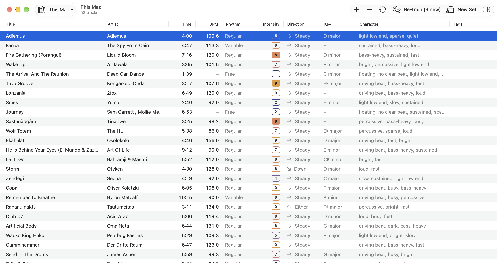
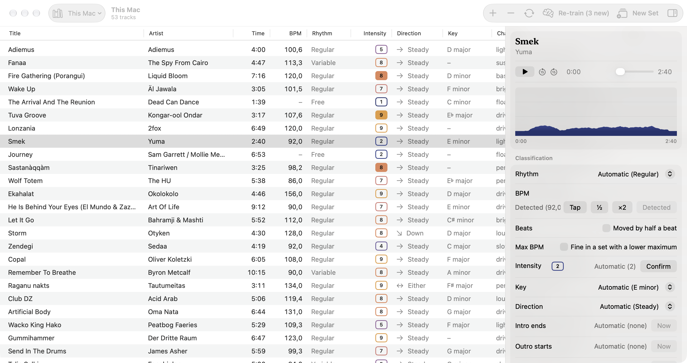
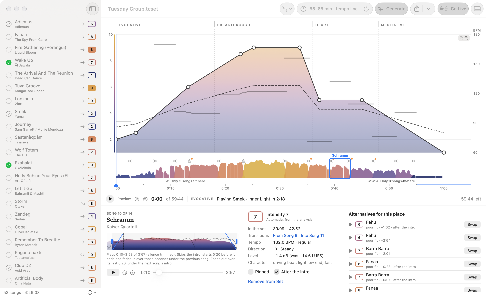
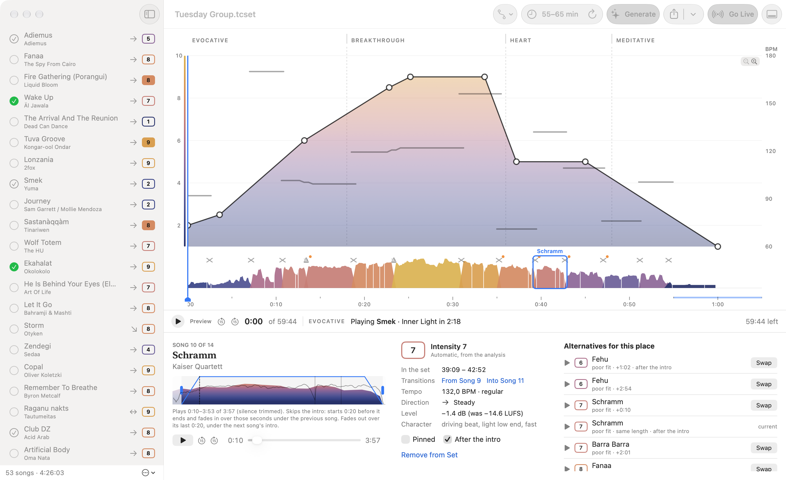
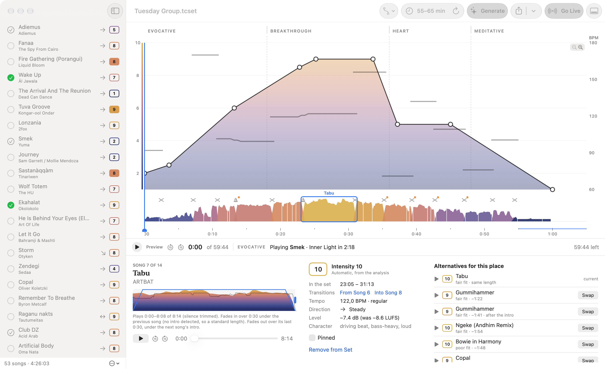
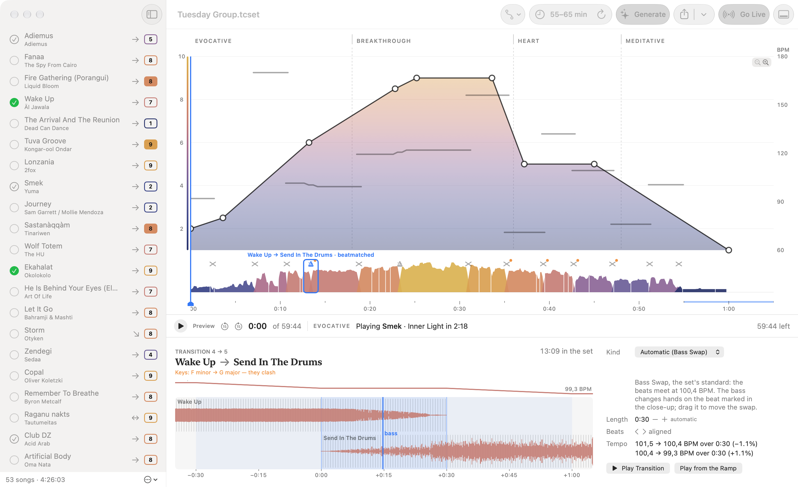
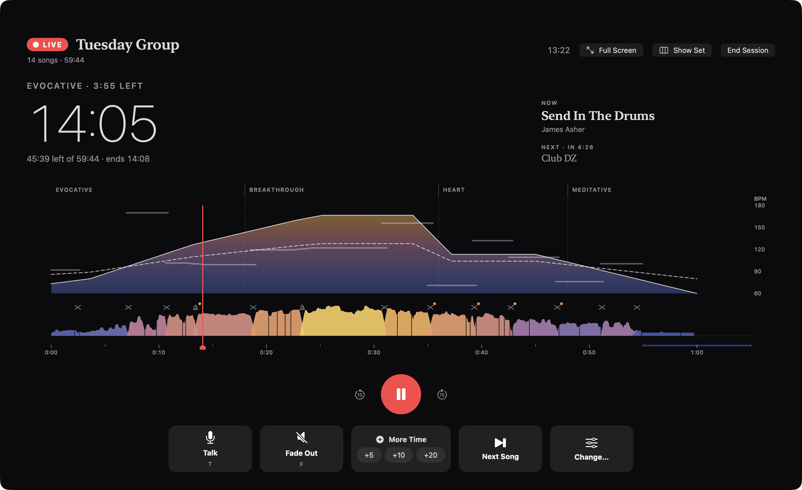
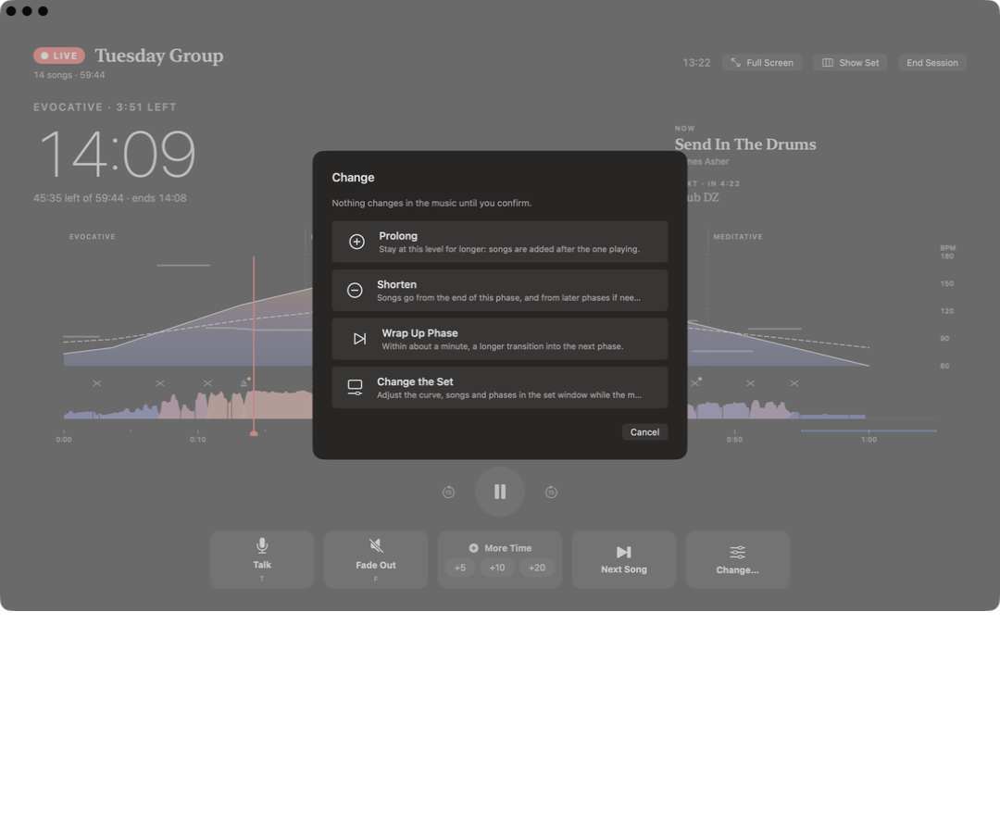

# What Track Catalogue does

Track Catalogue builds music sets for holotropic breathwork sessions. It's for preparing a
session at home, and for playing it in the room, not for mixing live with decks.

You describe the set you want: how long it is, how its intensity rises and falls, and which
songs it may use. The app picks songs from your music, puts them in order, and blends each one
into the next. Then you adjust what you don't like and listen as often as you want. At the end
it makes one continuous audio file and a tracklist, or you play the set in the session itself.

A set comes together in six steps:

1. **Add your music** to the catalogue. The app listens to every song and works out its tempo,
   rhythm, intensity and loudness.
2. **Correct** what the app got wrong, and add your own judgement: how intense a song is, where
   in a set it belongs.
3. **Shape the set**: its length and its intensity curve, such as the classic breathwork arc.
4. **Generate.** The app chooses and orders songs to follow the curve, and works out every
   transition.
5. **Adjust and listen.** Swap, move, pin or remove songs, change transitions, and play the set
   or any part of it.
6. **Play it in the session**, and change it there if the room needs something else, or
   **export** one audio file with its tracklist.

The app is in English. This manual uses its names, in **bold**.

# Installing and starting

## Installing

Download `TrackCatalogue-0.4.dmg` from <https://github.com/hdsjulian/TrackCatalogue-downloads>
and open it. Drag **TrackCatalogue** onto **Applications**. It needs macOS 15 (Sequoia) or later,
and runs on Apple Silicon and Intel Macs.

## Opening it the first time

macOS doesn't know the app yet, because it doesn't come from the App Store. You do this once per
version:

1. In Applications, double-click TrackCatalogue. macOS says it couldn't check the app. Click
   **Done**.
2. Open **System Settings › Privacy & Security**, scroll down to "TrackCatalogue was blocked…",
   and click **Open Anyway**.
3. Click **Open Anyway** once more and enter your Mac's password.

After that it opens normally.

## Light and dark

The app follows your Mac's appearance. To choose for the app alone, use **View › Appearance** or
**TrackCatalogue › Settings…**: **Same as System**, **Light** or **Dark**. The live view is always
dark.

## Where your work is kept

- **Your catalogues and everything the app knows about your songs** (analysis, your ratings,
  corrections and tags) are kept in the app's own folder in your Library. Time Machine backs it
  up with everything else.
- **Sets** are documents (`.tcset`) that you save wherever you like. Double-click one in the
  Finder to open it.
- **Your music** is never changed, moved or deleted by the app. It only reads it.

# The catalogue

The catalogue window opens when you start the app (**Window › Track Catalogue** brings it back).
It lists your songs with what the analysis found. Beside the list, the **Inspector** shows the
selected song.

## Adding music

- Drag MP3 and FLAC files, or folders containing them, into the window. An empty catalogue says
  **Drop Music Here**.
- Or click **Add Files…** (+) in the toolbar and choose files or folders. Folders are searched
  with all their subfolders.

Songs already in the catalogue aren't added twice. The app analyses each new song in the
background; the window's subtitle counts how many are left. You can carry on working meanwhile.

**Look for New Songs** checks the folders you've added for new files since, and adds them. If
songs have disappeared from where they were, it asks whether to remove them from the catalogue.

**Remove** (−, or the Delete key) takes the selected songs out of the catalogue. The files stay
where they are.

### Songs without tags

Some files have no tags: no artist, title or album inside them. The app then reads the names from
the file and its folders: "Artist - Album/03 Title.flac", "Artist/Album/03 Title.mp3", and
Bandcamp's "Artist - Album - 03 Title.mp3" all give the artist, the album and the title.

For each folder of such songs, a **Songs Without Tags** sheet shows what it read. Correct anything
that's wrong, then click **Confirm**; the files themselves aren't changed. **Skip** leaves the songs
as they were read, and **Skip All** does that for every folder still waiting. ⌘Z undoes a
confirmation.

## The columns

| Column | What it shows |
|------|----------------------|
| Title, Artist | From the file's tags, unless you've edited them. |
| Time | The song's length. |
| BPM | Its tempo in beats per minute. "–" means it has no steady beat. |
| Rhythm | **Regular** (the tempo holds steady), **Variable** (there's a pulse, but it drifts) or **Free** (no reliable pulse, such as drones or chant). |
| Intensity | From 1 (calmest) to 10 (most intense), as a coloured chip: filled for your rating, outlined for the automatic value. |
| Direction | Where the song belongs on the set's curve: **Up**, **Steady**, **Down** or **Either**. |
| Vocals | Whether the song has singing or speech: **None**, **Some** or **Throughout**. Empty until you set it. |
| Words | Whether people understand its words: **Understood**, **Not Understood** or **None**. **Unknown** while its language isn't known. Hover over it to see the language. |
| Character | A few words about how it sounds, such as "driving beat, percussive, bright". |
| Tags | Your own words, such as "drumming, chant, heart". |
| Sets | How many saved sets use the song. |
| Loudness | How loud it is, in LUFS. Sets level every song to the same loudness. |
| Format | MP3 or FLAC, with its quality. |

Values the app worked out itself are shown in grey; yours are in normal text, and **yours always
win**.

Click a column's header to sort by it. Right-click the header to show or hide columns. Drag rows
to put them in an order of your own.

## Listening

Double-click a song to play it, and again to pause. The Inspector has a player too.

## Several catalogues

You can keep several catalogues, for example one for all the music on this Mac, one for a
particular drive, and one for a selection you're working on. One is open at a time. The menu at the
left of the toolbar, labelled with the catalogue's name, switches between them, and has **New
Catalogue…**, **Rename…** and **Delete…**.

A song can be in several catalogues. What the app knows about a song belongs to the song itself,
so it's the same in every catalogue, and it even survives editing the file's tags in another
program. Deleting a catalogue deletes only its list of songs, never the music or what the app
knows about it.

A set belongs to the catalogue it was made in. If you open a set from another catalogue, the set
window offers to switch to it.

## Drives

Songs can live on external drives. When a drive isn't connected, its songs are greyed with a drive
symbol, and the window's subtitle names the drive. They can't be played until you connect it
again; the app notices by itself. A set that needs songs on a drive that isn't connected says
"Connect “Drive” to play this set".

# Getting the songs right

The app's analysis is a good start, but it can't know what you know about a song. Correcting it
is worth the time: sets are only as good as what the app knows about their songs.

## Automatic values and your own

Every value (rhythm, BPM, intensity, direction and the markers) has an automatic value from the
analysis and, if you set one, your own. Your value always wins, survives re-analysis, and can be
taken back with **Reset to Automatic**.

## The Inspector

Select a song to see it in the Inspector. **Inspector** in the toolbar (⌥⌘I) shows or hides it.

At the top are the song's title and artist, a player (play, back and forward 15 seconds), and the
song's intensity over time, from night blue (calm) to fire yellow (intense). Click it to play from
there, or drag across it to set the part that sets use. Below it:

**Classification**

- **Rhythm**: Automatic, or Regular, Variable or Free.
- **BPM**: type a tempo, or press **Tap** in time with the music several times. **½** and **×2** fix
  a tempo the analysis heard at half or double speed. **Detected** goes back to the tempo the
  analysis found.
- **Moved by half a beat**: tick this when the app's beats fall between the real ones (for example
  on off-beat hi-hats).
- **Fine in a set with a lower maximum**: see "Maximum BPM" under *Making a set*.
- **Intensity**: type a number from 1 to 10, or a range such as `2-4` when a song fits anywhere in
  it. **Confirm** keeps the automatic value as your own rating ("this one is right").
- **Direction**: **Up** songs are only placed on the way up to a peak, **Down** songs only on the way
  down, **Steady** songs on flat stretches; **Either** has no rule.
- **Intro ends** and **Outro starts** mark where the song's main part begins and ends. Correct them
  by typing a time (m:ss), or press **Now** while the song plays there. The button beside goes back
  to automatic.
- **Use from** and **Use until** mark a part of the song. When a song has a part, every set uses only
  that part, as if it were the whole song. **Use only** offers the parts the analysis found (the
  intro, the song without its intro and outro, the outro, or a section livelier or calmer than the
  rest), and **The Whole Song** clears it.
- **All Markers to Automatic** clears the markers.
- **Tags**: your own words about the song, separated by commas.
- **Character**, **Loudness** and **Pulse strength**, as the analysis found them.

**Info**: the title, artist and album. Edit them to correct the file's tags (in the app only; the
file isn't changed). **Revert to File Info** goes back to the file's tags.

**Reset to Automatic** clears every value of yours for the song.

**Other Copies**: the same recording in other files, for example an MP3 of a song you also have as
FLAC, or the same file in two folders. The catalogue shows such a song once, as its best copy
(lossless before MP3, then the higher quality); the other copies are listed here with their format
and file name. Sets use the best copy, or the next best when its drive isn't connected, and your
ratings on any copy count for the song. The app recognises copies by how they sound, so different
spellings in the tags don't matter; a radio edit or a remaster stays a song of its own. If two
files aren't the same song after all, **These Are Different Songs** separates them for good.

## Keys

The analysis finds each song's **key**, such as "A minor", for the whole song and for each part
where the music changes. Songs with no clear key, such as drumming or a drone, show "–". Show the
**Key** column by right-clicking the table's header; the **Key** menu in the Inspector lets you set
your own, or **No Clear Key**.

When it generates a set, the app prefers neighbours whose keys go together where they overlap. Keys
never outweigh the intensity curve: they only decide between songs that fit about equally well. In
the timeline, a small orange dot by a transition's mark says the keys clash there, and the
transition's details name both. Songs always play at their own pitch.

## Level

In a set, every song plays equally loud: the app levels them by measurement. If one still sounds
too loud or too quiet next to the others, play it and drag the **Level** slider in the Inspector:
−6 to +6 dB, in steps of 0.5 dB, and you hear the change at once. Let go and it's kept, for this
song in every set; double-click the slider to set it back to **As levelled**. The preview plays
songs as loud as a set does, so what you hear is what the set will do. The level doesn't change a
song's intensity. In a set, the song's details say "Level +1.5 dB, set in the catalogue."

## Vocals and words

A song whose words people understand pulls them into their heads. A chant in Sanskrit, humming or a
choir's "aah" doesn't. So each song has two values:

- **Vocals**: whether it has singing or speech: **None**, **Some** or **Throughout**. The analysis
  listens for voices, singing, speech, chant or a choir, second by second, and gives the share of
  seconds with them: a few makes **Some**, most of the song **Throughout**. Songs analysed before
  version 0.8 are listened to once, in the background.
- **Words**: whether people understand its words: **Understood**, **Not Understood** or **None**.

You never pick a language. For songs with vocals, the app looks up the language of the lyrics on
MusicBrainz, a public music database, after the song is analysed. Only its artist and title are
sent. Songs without vocals aren't looked up: their Words are **None**. If the
language is one people understand, Words says **Understood**; any other says **Not Understood**;
a song without lyrics says **None**. Until the language is known, Words says **Unknown**, in light
grey. Automatic values are grey, yours are in normal text, and **yours always win**. A song you've
set to Vocals **None** has no words.

Set both in the Inspector, or right-click several songs and choose **Vocals** or **Words**.
**Words › Look Up Language Again**, or **Look Up Again** in the Inspector, asks MusicBrainz again.
The Inspector's **Language** line says what was found, such as "German, from MusicBrainz".

**Listening for the language.** MusicBrainz doesn't know every song. For songs with vocals it
doesn't find, the app offers once to listen on this computer: it downloads a language model of
about 140 MB once (Whisper, from OpenAI, free to use), and then hears the language in each song's
most vocal 30 seconds. Nothing is sent; the songs stay on your computer. The **Language** line then
says, for example, "German, from listening". If Whisper can't tell for sure, it says **Unclear**,
and Words counts as **Not Understood**: if the app can't tell, listeners mostly can't either.
**Words › Detect Language by Listening**, or **Listen** in the Inspector, listens to selected songs
again, and asks to download the model if it isn't there. The
Vocals and Words columns can be shown or hidden like any other (right-click the header).

**TrackCatalogue › Settings…** has three settings for this:

- **Look up song languages online**: on unless you switch it off. Off, nothing is sent, and Words
  stays Unknown unless you set it.
- **Language model**: whether the model for listening is downloaded; **Remove** deletes it.
- **Understood languages**: tick the languages your groups understand. English and the language
  of your Mac are ticked at first. Changing the list changes every song's Words at once.

A set can leave out songs whose words people understand: see "The set's options" under *Making a
set*.

## Leaving parts out

To leave a stretch of a song out, such as a long silence or a spoken part, click **Leave Out
Parts…** under its intensity in the Inspector, and drag across the stretch. Its edges snap to where
the music changes, or to a beat; drag an edge to move it. Click a stretch to select it: **Join**
makes its crossfade shorter or longer, **Remove** takes it away. Play the song meanwhile: it jumps
over the stretches with a short crossfade, one beat long, or 2 seconds without a beat.

Then:

- **Edit This Song** keeps the stretches with the song: it leaves them out in every set, the
  preview and exports. The file isn't changed. **Play the Whole Song** brings them back.
- **Save as New Song…** adds a second song, "Title (edited)", with everything you set on this one.
  The app asks whether it should be its own file: **Its Own File…** writes a FLAC (a WAV, for a
  WAV) next to the original, with its title, artist, album and cover; **No, Just a New Song** adds
  a song that plays the original file without those parts. The original file is never changed.

## Changing several songs at once

Select several songs (⌘-click, ⇧-click or ⌘A) and right-click them for **Rhythm**, **Intensity**
and **Direction**, **Confirm Intensity**, **Reset to Automatic**, **Markers to Automatic**, **Edit
Title…**, **Set Artist…**, **Set Album…**, **Revert to File Info**, **Re-analyse**, **Double BPM**,
**Halve BPM**, **Use Detected BPM**, **Show in Finder** and **Remove from Catalogue**.

## Rating intensity with the keyboard

Select one or more songs and press **1** to **9** to rate their intensity, **0** for 10, or **C** to
confirm the automatic intensity as right.

## Teaching the app your sense of intensity

The automatic intensity starts from general rules. The more songs you rate or confirm, the better
it can learn how *you* hear intensity:

1. Rate at least 10 songs, especially ones it gets wrong, and confirm ones it gets right.
2. Click **Re-train** in the toolbar. It shows how many ratings are new, such as "Re-train (12
   new)".

Re-training takes about a second. It keeps the new way of judging intensity only if it matches
your ratings better than the one in use, and tells you either way, with the songs that changed
most. Songs you rated keep your rating. **Edit › Undo** puts the previous way back. Each catalogue
learns separately.

# Making a set

## Starting a set

Click **New Set** in the catalogue's toolbar. If two or more songs are selected, the new set's
**pool** (the songs it may use) is those songs; otherwise it's the whole catalogue. **File › New**
(⌘N) makes a set from the whole catalogue.

A set is a document, like a text file: **File › Save** (⌘S) saves it, and the Mac keeps earlier
versions (**File › Revert To**). Rename it by clicking its name in the title bar, or with **File ›
Rename…**. **File › Duplicate** makes a copy. A set you haven't saved yet is called "Untitled Set".

## The set window

- **The pool** is on the left.
- **The toolbar**: **Curve**, the set's options, **Generate Again**, **Generate**, **Export**,
  **Session**, and **Details**, which shows or hides the panel at the bottom.
- **The timeline**: the phases, the intensity curve, the songs as silhouettes of their own
  intensity, and the time.
- **The transport**: play, back and forward 15 seconds, where the set is, the phase, the song
  playing and when the next one comes.
- **The details** of the selected song or transition; with nothing selected, a summary of the set.

## The set's options

The button in the toolbar shows the set's options in short, such as "58–62 min · max 130 BPM".
Click it for:

- **Length**: the length as a range in minutes, such as 58 to 62 (the default), with buttons for 1,
  2 and 3 hours. With **Plan in Minutes** on, each phase gets a length in minutes instead, and the
  set's length is their sum: the curve keeps its shape inside each phase, squeezed or stretched, and
  the set may come out up to 5 minutes shorter or longer.
- **Clock**: **Starts at**, when the session is planned to start, such as 10:15. The timeline, the
  song and transition details and the tracklist then show clock times as well.
- **Tempo**: the **Maximum BPM**, and the **Tempo line** (see below).
- **Transitions**: the set's standard kind of transition.
- **Crossfades**: **Shorter**, **Normal**, **Longer** or **Much Longer**.
- **Group**: who the set is for, such as "Tuesday Group" (the arrow lists the groups you've used).
  Generate then prefers songs the group's other saved sets don't use, the more recently they were
  saved the more. **Settings** says when such a song is fresh again: after 4 weeks, 8 weeks,
  3 months, or never. In the pool, a people symbol marks such songs.
- **Loops**: the songs of the **Pre Loop** and the **Post Loop**, added from the pool (see Live
  play).
- **Other sets**: **Prefer songs not used in other sets**, and **In production**.
- **Keys**: **Key Fit**, how much Generate cares that neighbouring songs' keys fit where they
  overlap: the same key, its relative, or one step on the circle of fifths. **Off** ignores keys;
  **Some** is the default; **Strong** weighs a clash five times as much; **Must Fit** never lets
  clashing keys follow each other. Songs without a clear key fit anything.
- **Understood Words**: whether Generate uses songs whose words people understand (see "Vocals
  and words" under *Getting the songs right*):
  - **Include**: it uses them like any other.
  - **Exclude**: it leaves them out of the whole set, transitions included.
  - **Per Phase**: it leaves them out in the phases you choose: right-click a phase in the strip
    above the curve and choose **Leave Out Understood Words**.

  Songs you've pinned stay where they are. Songs whose words aren't known yet may be used: the
  note under the choice says how many such songs the pool has. Prolong, Shorten and Change the Set
  keep to the same rule while the set plays. If the pool can't fill the set without them, Generate
  says where they were left out.

## Generate

**Generate** (⌘G) chooses songs from the pool to fill a length in the range, following the curve,
and arranges the transitions.

- **Generate** keeps the songs you've pinned or placed by hand, and fills the time around them.
- **Generate Again** tries a different set: it chooses afresh. Your settings for a transition come
  back wherever the same two songs meet again.

If the pool can't fill the length, the app says so. Sets can be up to 4 hours long. Whenever you
change something, the set is arranged again at once, and what you hear is always the current set.

## The intensity curve

The curve says how intense the set should be from start to end. It's drawn as a landscape, warmer
the higher it goes, with the intensity (1 to 10) on the left. The songs' silhouettes below it show
how well they follow it.

- **Drag** a point to move it. The first and last points only move up and down.
- **Click** the line to add a point (or press and drag).
- **Double-click** a point, or select it and press Delete, to remove it.
- **Right-click** for **Add Point Here**, **Remove Point** and **Replace Curve with Preset**.
- **Curve** in the toolbar offers ready-made shapes: **Breathwork Arc** (the default), **Long
  Build**, **Two Peaks** and **Gentle Wave**.

The curve is relative to the set's length, so the same shape fits a one-hour or a three-hour set.

The app reads the curve in three kinds of stretches: **up** (into a peak), **down** (after a peak),
and **flat**. That's where a song's **Direction** matters.

## Phases

The strip above the curve names the stretches of the set. New sets start with the four phases of
the classic arc: **Evocative**, **Breakthrough**, **Heart** and **Meditative**.

- Drag the line between two phases to move it.
- Double-click a phase's name to rename it.
- Right-click for **Rename…**, **Add Phase Here** and **Remove Phase**. When the set's
  **Understood Words** is **Per Phase**, the menu also has **Leave Out Understood Words**.

The lines between phases are tied to the curve: when you drag one of the curve's points, the
phases around it move along, so a phase stays with its part of the curve.

Phases are labels for you: they don't change which songs are chosen, unless a phase leaves out
understood words (see "The set's options"). A phase that does has a small crossed-out text symbol
after its name. Phases are shown while the set plays, and in the live view.

## Templates

A set's shape can be kept as a **template**: its curve, phases, length, tempo line, maximum BPM,
kind of transition, crossfade length and understood words, but not its songs.

- In the curve's menu, **Save as Template…** saves the set's shape under a name. The same name
  replaces a template.
- The templates are listed in the same menu, under the presets: choose one to give the set its
  shape.
- In the catalogue, **New Set**'s arrow starts a new set from a template; the button itself works
  as before.
- **Manage Templates** has **Export** (a file to pass on), **Import…** and **Delete**.

## Maximum BPM

**Maximum BPM** sets the fastest tempo the set should have; leave it empty for no limit. A song over
the maximum isn't slowed down. Generate leaves it out, unless you've required it or placed it
yourself; then it's marked red with its tempo.

A song's BPM is the one shown in the catalogue, including your corrections: a drum track detected at
220 BPM counts as too fast for a 130 maximum until you halve it. If a song is fine anyway, tick
**Fine in a set with a lower maximum** in the Inspector, or choose **It's Fine, Include It**.

## The tempo line

The tempo line is an optional guide for the songs' tempos across the set, drawn dashed over the
curve with a BPM scale on the right. Switch on **Tempo line** in the set's options and set its range,
for example from 80 to 128 BPM.

At first it follows the intensity curve: it has the curve's shape, stretched over that range. To
give it a shape of its own, choose **Edit Tempo Separately**; then **Intensity | Tempo** above the
timeline chooses which line you drag. **Edit Tempo Together with Intensity** links it to the curve
again.

The tempo line only guides which songs are chosen, gently: when it and the intensity curve
disagree, intensity wins. It never speeds up or slows down a song.

## Songs in other sets

- **Prefer songs not used in other sets** (on for new sets): songs already in other saved sets are
  used only where they fit clearly better than the others. Songs you've required or placed yourself
  are always used.
- **In production**: tick this while you're still working on a set, so its songs don't count as used
  in your other sets.

## The pool

The pool lists the songs this set may use. Click the circle in front of a song to make it
**Required** (a green tick): it must be in the set somewhere. An **Excluded** song is struck
through: it's never chosen. The notes say what else matters: where in the set the song belongs
(such as "@2-4"), a tempo over the maximum (in red), other sets that use it, or a part of the song.

- **Double-click** plays a song; **Delete** takes it out of the pool.
- **Right-click** for **Play**, **Add to End of Set**, **Use** (Allowed, Required, Excluded),
  **Position in Set…** (where in the set the song belongs, in tenths: "2-4" means 10 to 40 % of the
  way through), **It's Fine, Include It** and **Remove from Pool**.
- **⋯** at the bottom: **Add Whole Catalogue**, **Remove Selected from Pool** and **Uncheck All
  Required**.
- Drag songs from the catalogue window into the pool, or drop audio files on it.

**Required** means "somewhere in this set". To keep a song exactly where it is, **pin** it instead.
Generate never puts more than two songs by the same artist in a row.

**Repeats** (right-click) lets Generate use a song more than once, each time another of its parts:
the intro, the middle, the outro, or a section that stands out. **Other Parts** plays each part at
most once; **Middle Again Too** lets the middle come back as well. Two parts of a song never follow
each other directly. A repeat symbol marks such songs. Dropping one on the timeline when it's
already in the set adds its next part.

## Reading the timeline

- **The songs** are drawn as silhouettes of their own intensity, tapering into each other where they
  overlap. Click one to select it; double-click to play from there; drag it to change the order.
- **The transitions** are the marks between songs: a metronome where the beats are matched, a cross
  where the songs simply crossfade. Click one to select it; double-click to hear it.
- **Right-click** a song for **Play Set from Here**, **Play Transition In**, **Play Song Alone**,
  **Pin**, **Automatic Crossfade**, **Start After the Intro**, **Move Earlier**, **Move Later** and
  **Remove from Set**; or a transition for **Play Transition**, **Play from the Ramp**, its kind,
  and **Reset Transition to Automatic**.
- **A red dot** marks a song over the maximum BPM.
- **A hatched band** under the songs shows where fewer than four pool songs fit the curve ("Only 2
  songs fit here"). Add songs that would fit there, or change the curve.
- Click below the curve, or drag the playhead, to play from there.

**← and →** step through the songs and transitions. **Zoom** with ⌘− and ⌘+, **Fit** (⌘0), pinching
on the trackpad, or ⌘ and the scroll wheel; scroll sideways to move along the set.

## Chart layers

The small buttons at the top left of the timeline choose what the songs show. Each switches on or
off by itself, in any mix:

- **Intensity:** the song's intensity, as before. On by itself at first.
- **Waveform:** the song's loudness peaks, ten a second. Over Intensity it's an outline; alone, it's
  filled. Songs analysed before version 0.8 show their coarser loudness until their waveform is
  measured, once, in the background.
- **Vocals:** the stretches with singing or speech, lightly shaded.
- **Volume:** the set's volume line (below).

⌥1, ⌥2, ⌥3 and ⌥4 switch them, also in the **View** menu; ⌥0 switches all on, or back to Intensity
alone. The choice counts for every chart (the timeline, the details, the transition close-up and a
song's chart in the Inspector) and is kept.

## The set's volume line

**Volume** (⌥4) shows a line across the songs: the set's volume, at 0 dB until you change it. Click
it to add a point, drag a point up or down (from −24 dB to +12 dB), and double-click it to take it
away. A point dragged near 0 dB snaps to it. The small diamond between two points bends the line:
faster first, or slower first. The line stays at its time in the set whatever songs play there, and
it's applied before the limiter, so louder never clips. Once it has points, the line is always shown.
Prolong, Shorten and Change the Set move it with the set. **Reset Volume** in the set's options
(Fades) takes all the points away.

## A song in the set

The details under the timeline are one strip: the set's summary first, then every song and
transition in order. Scroll it sideways (the trackpad, Shift and the mouse wheel, or its scroll
bar): what fills the strip is selected, and selecting in the timeline scrolls the strip there.
While the set plays, the strip follows what's playing, the transition while two songs overlap.
Once you scroll yourself it stops following; **Follow**, or selecting in the timeline, brings it
back.

Select a song to see in the details:

- Where it is, its intensity, its tempo, its transitions in and out, other sets that use it, and how
  much louder or quieter it was made to match the others.
- **The part that plays**, drawn over the whole song. Drag its edges, or the whole part, to change it.
  This changes the song's part in every set. **Play the Whole Song** plays it from the start.
- **Pinned** keeps the song where it is when you generate. **After the intro** leaves out its intro.
- **Alternatives for this place**: the pool songs that would fit best. Play one, and click **Swap** to
  put it in this song's place.
- **Remove from Set**.

## Building a set by hand

You don't have to generate. Drag songs from the pool (or straight from the catalogue window) onto the
timeline: they're placed where you let go. Drag songs along the timeline to change the order. Songs
you place or move by hand are pinned, so Generate keeps them and fills only the time that's left.

# Transitions

Every song blends into the next; there are no hard cuts or silences. Each blend is a transition,
and each can be chosen and adjusted on its own.

## The kinds of transition

| Kind | What you hear |
|------|----------------------|
| **Crossfade** | One song fades out while the next fades in. Works with any music. |
| **Beatmatched Blend** | A crossfade with the two songs' beats locked together. |
| **Bass Swap** | Beatmatched, and only one song has the bass at a time. The bass changes over on one beat, the swap point. |
| **EQ Blend** | Beatmatched, and the gentlest handover: first the highs change over, then the mids, then the bass. |
| **Filter Sweep** | A rising filter thins the outgoing song (**Out**), opens up the incoming one (**In**), or does both (**Both**). |
| **Automatic** | The set's standard kind. |

The kinds that match beats need two songs with steady beats at tempos close enough to meet. Where
they can't, the transition falls back to a crossfade, and its details say why.

- **TrackCatalogue › Settings… › Transitions in new sets**: the kind every new set starts with.
- **Transitions** in the set's options: the set's standard, for every transition on Automatic.
- **Kind** in a transition's details: that one transition's own kind.

## Crossfade length

The app makes each crossfade about as long as the incoming song's intro, between 15 seconds and 3
minutes. Without an intro, it's 30 seconds between two songs with a beat, and a minute if either has
none. It's never more than half of either song. **Crossfades** in the set's options makes all of them
shorter or longer.

## Fade shapes

A crossfade or a beatmatched blend fades in one of four shapes:

- **Even:** one song sinks as the other rises.
- **Smooth:** both hold longer, then cross quickly in the middle.
- **Slow Out:** the old song lingers and the new one comes in early.
- **Slow In:** the old song leaves early and the new one creeps in.

On **Automatic**, the app picks by the music: Smooth between two songs without a beat, Slow Out
where the set climbs, Slow In where it falls, and Even otherwise. **Fades › Shape** in the set's
options sets one shape for the whole set; **Fade** in a transition's details sets one for that
transition. Bass swaps, EQ blends and filter sweeps keep their own curves.

**End with a fade**, in the same place, lets the last song fade to silence, over 10 seconds to
2 minutes, in a shape of its own.

### Drawn fades

For a fade no shape gives, choose **Drawn** in a transition's **Fade** menu (for a bass swap, EQ
blend or filter sweep, **Draw** beside **Volume**). Two lines appear over the overlap, the outgoing
song's and the incoming song's volume, full at the top. They start as the shape the transition had.
Click a line to add a point, drag points anywhere in the overlap, and double-click one to remove it;
the small diamond between two points bends the segment. The ends stay where the overlap starts and
ends, and a longer or shorter overlap stretches the drawing. Over a bass swap, EQ blend or filter
sweep the lines are the volume, on top of the band curves. **Reset to Shape** goes back. The
drawing belongs to the transition, like its other settings: it comes back when the same song
follows the same song again.

## Beatmatching

When two songs' beats are matched, they **meet halfway**: at 118 and 122 BPM, the first slowly speeds
up to 120, both play at 120 while they overlap, and the second then returns to its own 122. Each song
is changed by at most 4 %. **Outside transitions, every song plays exactly as recorded.**

## A transition close up

Select a transition to see it close up: the outgoing song above, the incoming one below, with the
overlap shaded. A **bass** mark shows the swap point; an EQ blend also shows **highs** and **mids**.

- **Drag the overlap's edges** to make it longer or shorter, and **drag the bass mark** to move the
  swap point. **Click** anywhere to play from there.
- **Kind**: this transition's kind; for a Filter Sweep, **Direction**: Out, In or Both.
- **Length**: − and + in 5-second steps, and **Automatic**.
- **Beats** ‹ ›: moves the incoming song a beat earlier or later, if the beats aren't quite aligned.
- **Play Transition** plays from 15 seconds before the overlap; **Play from the Ramp** from where the
  tempo starts changing; **Reset to Automatic** undoes your changes to this transition.

A transition's settings belong to its two songs. They're kept when you generate again or move songs,
and come back whenever the same two songs meet again.

# Listening and the session

- **Space** plays the set from where it is, and pauses. The buttons beside it skip 15 seconds back or
  forward.
- **Double-click** a song in the timeline, or click below the curve, to play from there.

What you hear is exactly what the export will be, with every transition and every song levelled to
the same loudness.

## Live play

**Go Live** in the toolbar switches to the live view for the session room: large, dark and calm,
with a red **LIVE** badge, and "● LIVE" in the window's title. It opens **ready but silent**: it
checks that the drives are connected and the backup has started, and the room hears nothing until
you click the big red **Start**. The set then plays from the beginning.

It shows the phase and how long until the next, the time in the set and when it will really end,
the song playing and the next, the set's shape with a red playhead, and the time now.

- **Space** plays and pauses; the buttons beside it skip 15 seconds back or forward.
- **Talk** (T) dips the music so you can speak, and brings it back.
- **Fade Out** (F) fades to silence over a few seconds and pauses; again, it fades back in.
- **More Time** +5, +10 and +20 add songs after the one playing, at once; **Next Song** hands over to
  the next song within about 20 seconds. Both can be undone until they're heard.
- **Change…** opens Prolong, Shorten, Wrap Up Phase and Change the Set, with an overview first (see
  below).
- **Show Set** shows the set, locked under a red bar while it plays; **Back to Live** returns.
- **End Session** asks first, then stops the music.
- **Full Screen** (⌃⌘F) fills the screen. Esc does nothing here.

Only one set can be live at a time. In the set itself, the play button is **Preview**: it plays the
set for you, while Go Live plays it for the room.

### Pre and post loops

When the set has a **Pre Loop** (its options), **Pre Loop** appears beside Start: its songs play in
turn and round again while everyone settles, and **Start** fades it under the set's first song. A
**Post Loop** fades in over the set's last 20 seconds and plays on until **Stop the Post Loop**,
which fades it out over 10 seconds. Neither counts in the set's length or its export.

# Changing a set while it plays

Sometimes the room needs something else than you planned: more time at this level, an earlier end,
or the next phase sooner. **Change** in the live view does that while the music plays.

## Prolong, Shorten, Wrap Up Phase

- **Prolong** stays at the current level for longer: songs are added after the song playing, for
  10, 20 or 30 minutes or any number of minutes you type. The rest of the set follows, later. Songs
  come from the set's pool first; if too few fit, from the whole catalogue.
- **Shorten** takes songs from the end of the phase you're in, and from later phases if that isn't
  enough. The song playing finishes; each later phase keeps a song, and the last song stays.
- **Wrap Up Phase** ends the phase you're in: within about a minute, at a good point in the song
  playing, a longer transition leads into the first song of the next phase.

## Checking a change before the room hears it

Each change first shows an **overview**: when it will be heard (as a clock time), when the set will
end, and which songs come in and which go. Only **Confirm** makes the change; **Back** and **Cancel**
leave the set as it is.

After you confirm, a line above the play button says what you changed and how long until it's heard,
with **Undo**. Undo works until the change starts playing. The set you prepared never changes: the
session plays a copy with your changes.

## Listening first

With headphones or a second sound output, you can hear a change before the room does.

1. Choose the output in **TrackCatalogue › Settings… › Preview output** (not the one the room hears).
2. In a change's overview, click **Listen on the Preview Output**. It plays the change from 15 seconds
   before it, on that output, while the room hears the set as it is.

## Change the Set

**Change the Set** switches to the set window while the music goes on. An orange bar at the top says
**Adjusting the running set**.

- What has played and the song playing are **locked**: dimmed and marked **Played**. Everything after
  them can be changed: the curve, the phases, the songs.
- **−** and **+** in the bar make the set end 5 minutes sooner or later.
- **Preset for the Rest** lets the rest of the set follow one of the curve presets. It shows the preset
  with a suggested point where the session is now; click elsewhere to choose another, then **Use**.
- The room keeps hearing the set as it was until you click **Adjust Running Set**. That shows the
  overview, where you confirm it. **Cancel** drops your changes.

A change to the curve's shape takes over at a good point within about a minute, with a longer
transition.

## What is kept after a session

When a session with changes ends, the app saves the set as it was played, for example "Tuesday Group
– as played 20 Nov", with a FLAC and its tracklist. The first time, it asks which folder to keep them
in (**Keep Here**), and remembers it. Choose the folder your sets are in to keep them next to each
other. A session without changes saves nothing extra.

## If the app or the Mac stops during a session

- While a session runs, the app keeps a **backup** of the set as it plays in your Downloads folder,
  "TrackCatalogue session backup.wav". The live view says how far it's ready. As a last resort,
  play it in any player from the time where the session was.
- The next time you open the app, it asks **Continue the session?** **Continue Session** opens the set
  with your changes and plays from where the music stopped, fading in.

# Saving and exporting

## Saving

Sets save like other Mac documents (⌘S), and the Mac keeps their versions. A set file holds the
running order, the curve, the phases, the pool and every transition's settings, but not the music:
it refers to the songs in the catalogue.

## Exporting

**Export › Export…** (⌘E) makes one audio file of the whole set:

- **Format**: **FLAC** (lossless, 24-bit), **WAV, 24-bit** or **WAV, 16-bit** (CD quality).
- **Also save the tracklist, as text and CSV**: each song's start time, artist and title.

**Choose Folder and Export…** asks where; **Stop** stops an export that's running. When it's done,
**Show in Finder** shows the files.

**Export › Quick Export for Sending** (⇧⌘E) skips every question: it saves the set as AAC at 192 kbps,
with its tracklist as text, straight into your Downloads folder. It never overwrites an earlier one:
the next gets a number.

## Loudness

Every song is brought to the same loudness (−16 LUFS), raised or lowered by at most 12 dB, and a
limiter keeps the loudest moments from distorting.

# Undo

**Edit › Undo** (⌘Z) and **Redo** (⇧⌘Z) work for every change: in the catalogue (ratings, corrections,
removing songs, re-training) and in a set (the curve, songs, transitions).

# Keyboard shortcuts

| Keys | What it does |
|:---|:---|
| ⌘N | New set from the whole catalogue |
| ⌘O | Open a set |
| ⌘S | Save the set |
| ⌘W | Close the window |
| ⌘Z, ⇧⌘Z | Undo, redo |
| ⌘, | Settings |
| ⌥⌘I | Show or hide the Inspector |
| ⌃⌘F | Full screen |
| 1 to 9, 0 | Rate intensity in the catalogue (0 is 10) |
| C | Confirm the automatic intensity |
| Delete | Remove from the catalogue or the pool; remove the selected curve point |
| ⌘G | Generate |
| ⌘E, ⇧⌘E | Export, Quick Export |
| Space | Play or pause (in the live view, after Start) |
| T, F | In the live view: Talk; Fade Out |
| ← and → | The previous or next song or transition |
| ⌘−, ⌘+, ⌘0 | Zoom out, in, fit the whole set |
| Esc | Cancel a sheet (in the live view, nothing) |
| Return | Confirm a sheet |

# When something isn't right

**macOS says it couldn't check the app.** See *Opening it the first time*.

**A song's BPM is half or double what it should be.** Right-click it and choose **Double BPM** or
**Halve BPM**, or use **½** and **×2** in the Inspector.

**The beats in a transition don't line up.** Select the transition and use **Beats ‹ ›**. If it happens
with every transition of one song, tick **Moved by half a beat** in that song's Inspector.

**A song is marked too fast.** It's over the set's maximum BPM. Halve its BPM if that was misread,
raise the maximum, or choose **It's Fine, Include It**.

**There's a hatched band under the songs.** Fewer than four pool songs fit the curve there. Add songs
with the right intensity to the pool, or change the curve.

**Songs are greyed with a drive symbol.** Connect the drive they're on.

**The app or the Mac stopped during a session.** Open the app again and choose **Continue Session**.
Until then, "TrackCatalogue session backup.wav" in Downloads plays in any player.

**Listen isn't offered.** Choose a preview output in **TrackCatalogue › Settings…**, and make sure it's
connected and isn't the output the room hears.

# Words used in the app

| Word | Meaning |
|------|----------------------|
| Catalogue | A list of your songs. You can have several. |
| Pool | The songs a set may use. |
| Set | A running order of songs with transitions, for one session. |
| Intensity | How intense a song is, from 1 (calm) to 10 (most intense). |
| Curve | The set's planned intensity from start to end. |
| Phase | A named stretch of a set, such as "Heart". |
| Direction | Whether a song belongs on the way up to a peak, down from one, on a flat stretch, or anywhere. |
| Understood words | Words people listening understand, because they're in a language they know. |
| BPM | Beats per minute: a song's tempo. |
| Tempo line | An optional guide for the songs' tempos across the set. |
| Transition | The blend from one song into the next. |
| Beatmatched | Two songs' beats locked together while they overlap. |
| Swap point | The beat where the bass changes from one song to the next. |
| Pinned | Kept in its place when you generate. |
| Required | Must be in the set somewhere. |
| Part | The stretch of a song that sets use, if not the whole song. |
| LUFS | A measure of loudness. |
