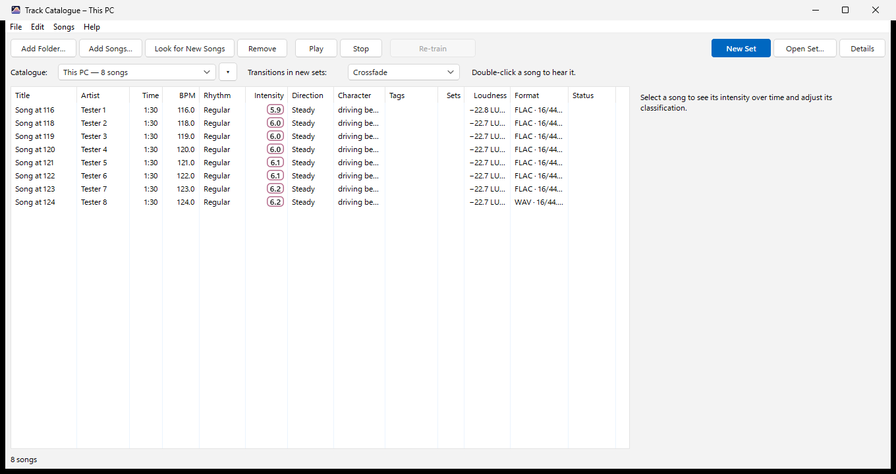
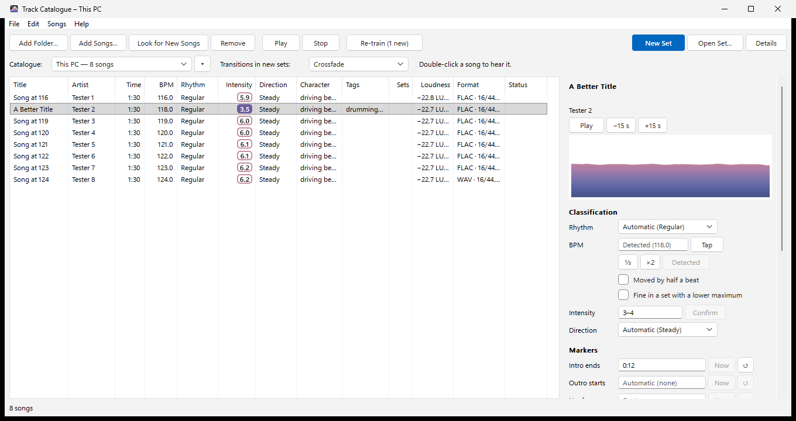
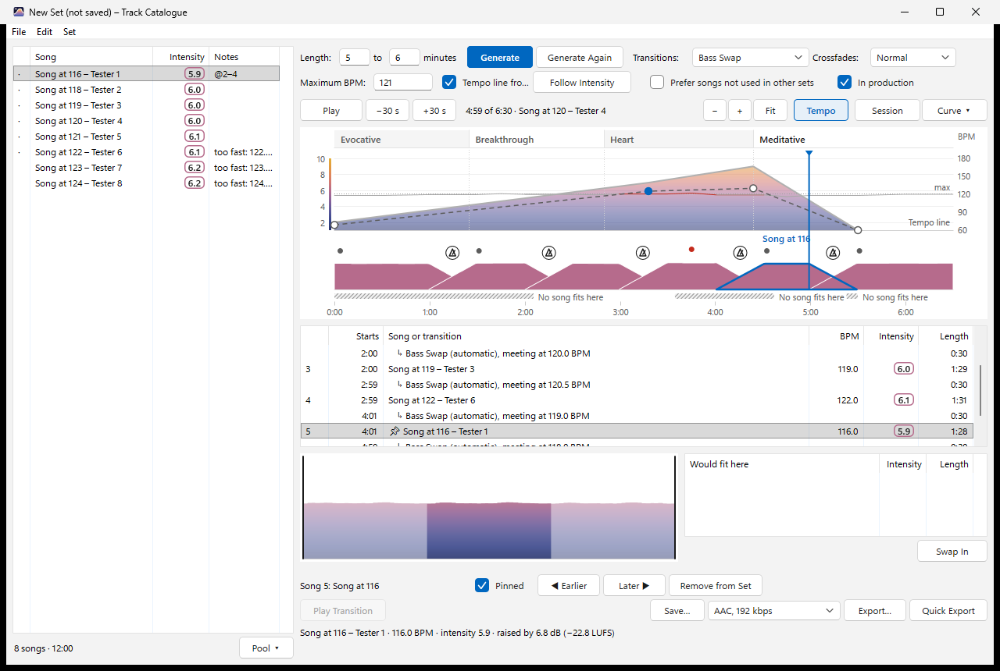
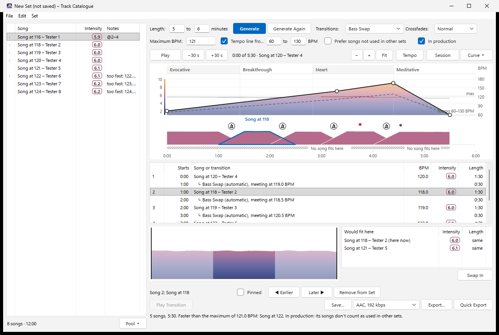
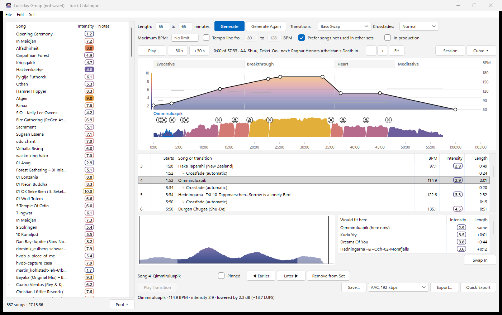
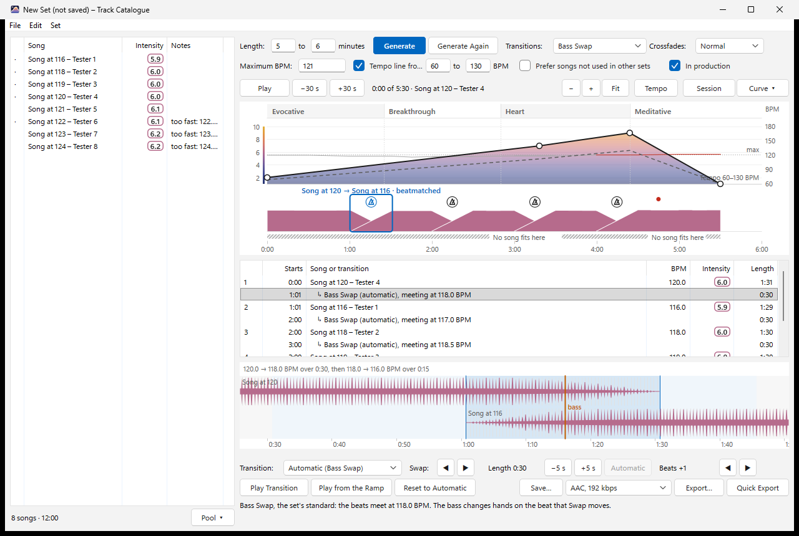
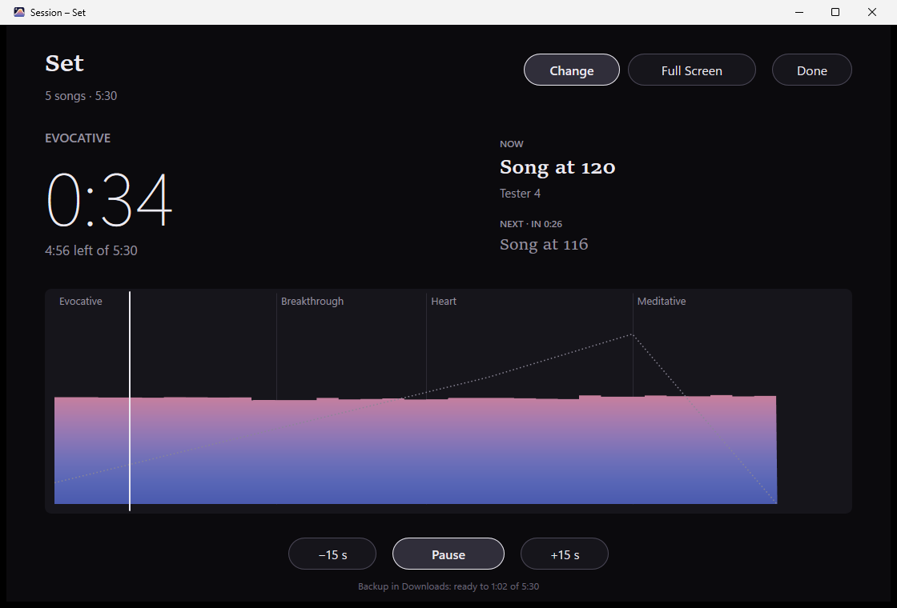
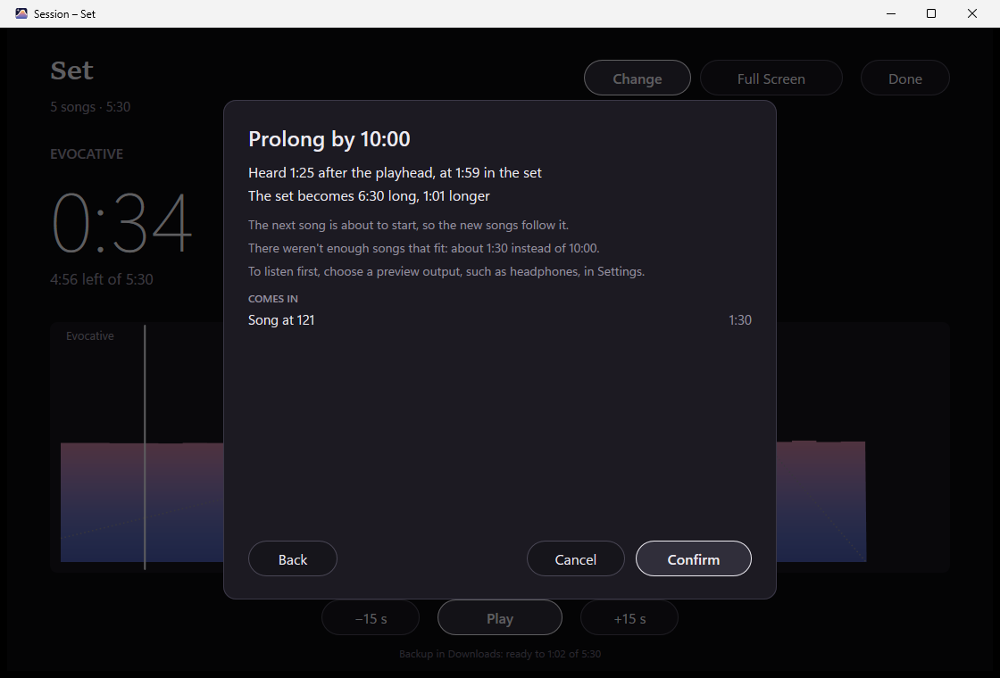

# What Track Catalogue does

Track Catalogue builds music sets for holotropic breathwork sessions. It's for preparing a
session at home, not for playing live with decks.

You describe the set you want: how long it is, how its intensity rises and falls, and which
songs it may use. The app picks songs from your music, puts them in order, and blends each one
into the next. Then you adjust what you don't like and listen as often as you want. At the end
it makes one continuous audio file and a tracklist, ready to play in the session.

A set comes together in six steps:

1. **Add your music** to the catalogue. The app listens to every song and works out its tempo,
   rhythm, intensity and loudness.
2. **Correct** what the app got wrong, and add your own judgement: how intense a song is, where
   in a set it belongs.
3. **Shape the set**: its length and its intensity curve, such as the classic breathwork arc.
4. **Generate.** The app chooses and orders songs to follow the curve, and works out every
   transition.
5. **Adjust and listen.** Swap, move, pin or remove songs, change transitions, and play the set
   or any part of it.
6. **Export** one audio file with its tracklist.

Everything works with music files on your own computer or drives (MP3, FLAC and WAV). Music from
streaming services can't be used, because it's copy-protected.

# Installing and starting

## Installing

Download it from <https://github.com/hdsjulian/TrackCatalogue-downloads>. There are two ways to
get Track Catalogue onto a PC. Both need Windows 10 or 11 on an ordinary (x64) PC.

- **The installer**, `TrackCatalogue-Setup-0.4.exe`. It puts Track Catalogue in the Start menu,
  makes set files (`.tcset`) open with it, and can be removed again under **Settings › Apps**.
  It installs for you only and doesn't need an administrator.
- **The folder**, `TrackCatalogue-Windows-0.4.zip`. Unzip it anywhere, for example into
  Documents, and start `TrackCatalogue.exe`. Nothing is installed.

The app isn't signed, so the first time you start it Windows may say it **protected your PC**.
Click **More info**, then **Run anyway**. This happens only once.

## Language

Track Catalogue speaks German when Windows' display language is German, and English otherwise.
This manual uses the English names.

## Where your work is kept

- **Your catalogues and everything the app knows about your songs** (analysis, your ratings,
  corrections and tags) are kept in `%APPDATA%\TrackCatalogue`. That's the folder to back up.
  To open it, type `%APPDATA%\TrackCatalogue` into Explorer's address bar.
- **Sets** are files (`.tcset`) that you save wherever you like.
- **Your music** is never changed, moved or deleted by the app.

Only one copy of Track Catalogue runs at a time. If you open a set from Explorer while the app
is running, it opens in the copy that's already there.

# The catalogue

The catalogue window opens when you start the app. It lists your songs with what the analysis
found. Beside the list are the selected song's details.

## Adding music

- **Add Folder…** adds every MP3, FLAC and WAV file in a folder and all its subfolders.
- **Add Songs…** adds the files you choose.
- You can also **drag** files and folders from Explorer onto the window.

Songs already in the catalogue aren't added twice. The app analyses each new song in the
background; the **Status** column shows **Waiting** or **Analysing…**, and the line at the
bottom counts how many are left. You can carry on working meanwhile.

**Look for New Songs** checks the folders you've added for new files since, and adds them. If
songs have disappeared from where they were added, it asks before removing them from the
catalogue.

**Remove** (or the Delete key) takes the selected songs out of the catalogue. The files stay
where they are.

### Songs without tags

Some files have no tags: no artist, title or album inside them. The app then reads the names from
the file and its folders: `Artist - Album\03 Title.wav`, `Artist\Album\03 Title.flac`, and
Bandcamp's `Artist - Album - 03 Title.mp3` all give the artist, the album and the title.

For each folder of such songs, a **Songs Without Tags** window shows what it read. Correct
anything that's wrong, then press **Confirm**; the files themselves aren't changed. **Skip** leaves
the songs as they were read, and **Skip All** does that for every folder still waiting. Ctrl+Z
undoes a confirmation.

## The columns

| Column | What it shows |
|------|----------------------|
| Title, Artist | From the file's tags, unless you've edited them. |
| Time | The song's length. |
| BPM | Its tempo in beats per minute. "–" means it has no steady beat. |
| Rhythm | **Regular** (the tempo holds steady), **Variable** (there's a pulse, but it drifts) or **Free** (no reliable pulse, such as drones or chant). |
| Intensity | From 1 (calmest) to 10 (most intense). A range such as "2–4" is a rating of yours. |
| Direction | Where the song belongs on the set's curve: **Up**, **Steady**, **Down** or **Either**. |
| Vocals | Whether the song has singing or speech: **None**, **Some** or **Throughout**. Empty until you set it. |
| Words | Whether people understand its words: **Understood**, **Not Understood** or **None**. **Unknown** while its language isn't known. Hover over it to see the language. |
| Character | A few words about how it sounds, such as "driving beat, percussive, bright". |
| Tags | Your own words, such as "drumming, chant, heart". |
| Sets | How many saved sets use the song. |
| Loudness | How loud it is, in LUFS. Sets level every song to the same loudness. |
| Format | MP3, FLAC or WAV, with its quality. |
| Status | What the analysis is doing, or why it failed. |

Values the app worked out itself are shown in grey. Values you've set are in normal text, and
**yours always win**.

Click a column's header to sort by it. Drag rows to put them in an order of your own.

## Listening

Double-click a song to hear it, or select it and press **Play**. **Stop** stops it. The line
at the top of the window says what's playing and where.

## Several catalogues

You can keep several catalogues, for example one for all the music on this PC, one for a
particular drive, and one for a selection you're working on. One is open at a time; switch with
the **Catalogue** list in the toolbar. The **▾** button next to it makes a **New Catalogue…**,
and renames or deletes the open one.

A song can be in several catalogues. What the app knows about a song (its analysis, your
ratings, corrections and tags) belongs to the song itself, so it's the same in every catalogue.
It even survives editing the file's tags in another program. Deleting a catalogue deletes only
its list of songs, never the music or what the app knows about it.

A set belongs to the catalogue it was made in, and uses only that catalogue's songs.

## Drives

Songs can live on external drives. When a drive isn't connected, its songs show **Drive not
connected** and can't be played until you plug it in again; the app notices by itself. A set
that needs songs on a drive that isn't connected won't play or export, and tells you which
drive to connect.

If you move or rename a music file on the same drive, the app finds it again.

# Getting the songs right

The app's analysis is a good start, but it can't know what you know about a song. Correcting
it is worth the time: sets are only as good as what the app knows about their songs.

## Automatic values and your own

Every value (rhythm, BPM, intensity, direction and the markers) has an automatic value from the
analysis and, if you set one, your own. Your value always wins, survives re-analysis, and can be
taken back with **Reset to Automatic**.

## The song's details

Select a song to see its details beside the list. **Details** in the toolbar shows or hides
them.

At the top is the song's intensity over time, from night blue (calm) to fire yellow (intense). Click
it to play from there; **Play**, **−15 s** and **+15 s** control playback. Below it:

**Classification**

- **Rhythm**: Automatic, or Regular, Variable or Free.
- **BPM**: type a tempo, or press **Tap** in time with the music several times. **½** and **×2**
  fix a tempo the analysis heard at half or double speed. **Detected** goes back to the tempo
  the analysis found. Your BPM counts everywhere a tempo matters.
- **Moved by half a beat**: tick this when the app's beats fall between the real ones (for
  example on off-beat hi-hats).
- **Fine in a set with a lower maximum**: see "Maximum BPM" under *Making a set*.
- **Intensity**: type a number from 1 to 10, or a range such as `2-4` when a song fits anywhere
  in it. **Confirm** keeps the automatic value as your own rating ("this one is right").
- **Direction**: **Up** songs are only placed on the way up to a peak, **Down** songs only on
  the way down, **Steady** songs on flat stretches; **Either** has no rule.

**Markers**

- **Intro ends** and **Outro starts** mark where the song's main part begins and ends. The app
  finds them itself; correct them by typing a time (m:ss), or press **Now** while the song
  plays there. **↺** goes back to automatic.
- **Use from** and **Use until** mark a part of the song. When a song has a part, every set uses
  only that part, as if it were the whole song. **Use only** offers the parts the analysis
  found (the intro, the song without its intro and outro, the outro, or a section livelier or
  calmer than the rest), and **The Whole Song** clears it.
- **All Markers to Automatic** clears all four.

**Tags**: your own words about the song, separated by commas.

**Info**: the character words, loudness and pulse strength, and the title, artist and album.
Edit these to correct the file's tags (in the app only; the file isn't changed). **Revert to
File Info** goes back to the file's tags; **Reset to Automatic** clears every value of yours for
the song.

**Other Copies**: the same recording in other files, for example an MP3 of a song you also have as
FLAC, or the same file in two folders. The catalogue shows such a song once, as its best copy
(lossless before MP3, then the higher quality); the other copies are listed here with their format
and file name. Sets use the best copy, or the next best when its drive isn't connected, and your
ratings on any copy count for the song. The app recognises copies by how they sound, so different
spellings in the tags don't matter; a radio edit or a remaster stays a song of its own. If two
files aren't the same song after all, **These Are Different Songs** separates them for good.

Fields are kept when you press Enter or leave them.

## Keys

The analysis finds each song's **key**, such as "A minor", for the whole song and for each part
where the music changes. Songs with no clear key, such as drumming or a drone, show "–". The
**Key** column shows it, and the **Key** list in the song's details lets you set your own, or
**No Clear Key**.

When it generates a set, the app prefers neighbours whose keys go together where they overlap.
Keys never outweigh the intensity curve: they only decide between songs that fit about equally
well. In the timeline, a small orange dot by a transition's mark says the keys clash there, and
the transition's close-up names both. Songs always play at their own pitch.

## Level

In a set, every song plays equally loud: the app levels them by measurement. If one still sounds
too loud or too quiet next to the others, play it and drag **Level** in its details: −6 to +6 dB,
in steps of 0.5 dB, and you hear the change at once. Let go and it's kept, for this song in every
set; **↺** sets it back to as levelled. The preview plays songs as loud as a set does, so what you
hear is what the set will do. The level doesn't change a song's intensity. In a set, the song's
line says "level +1.5 dB, set in the catalogue".

## Vocals and words

A song whose words people understand pulls them into their heads. A chant in Sanskrit, humming or a
choir's "aah" doesn't. So each song has two values:

- **Vocals**: whether it has singing or speech: **None**, **Some** or **Throughout**. The analysis
  listens for voices, singing, speech, chant or a choir, second by second, and gives the share of
  seconds with them: a few makes **Some**, most of the song **Throughout**. Songs analysed before
  version 0.8 are listened to once, in the background.
- **Words**: whether people understand its words: **Understood**, **Not Understood** or **None**.

You never pick a language. For songs with vocals, the app looks up the language of the lyrics on
MusicBrainz, a public music database, after the song is analysed. Only its artist and title are
sent. Songs without vocals aren't looked up: their Words are **None**. If the
language is one people understand, Words says **Understood**; any other says **Not Understood**;
a song without lyrics says **None**. Until the language is known, Words says **Unknown**, in light
grey. Automatic values are grey, yours are in normal text, and **yours always win**. A song you've
set to Vocals **None** has no words.

Set both in the song's details, or right-click several songs and choose **Vocals** or **Words**.
**Words › Look Up Language Again**, or **Look Up Again** in the details, asks MusicBrainz again.
The details' **Language** line says what was found, such as "German, from MusicBrainz".

**Listening for the language.** MusicBrainz doesn't know every song. For songs with vocals it
doesn't find, the app offers once to listen on this computer: it downloads a language model of
about 140 MB once (Whisper, from OpenAI, free to use), and then hears the language in each song's
most vocal 30 seconds. Nothing is sent; the songs stay on your computer. The **Language** line then
says, for example, "German, from listening". If Whisper can't tell for sure, it says **Unclear**,
and Words counts as **Not Understood**: if the app can't tell, listeners mostly can't either.
**Words › Detect Language by Listening**, or **Listen** in the details, listens to selected songs
again, and asks to download the model if it isn't there.

**File › Settings** has three settings for this:

- **Look up song languages online**: on unless you switch it off. Off, nothing is sent, and Words
  stays Unknown unless you set it.
- **Language model**: whether the model for listening is downloaded; **Remove** deletes it.
- **Understood languages**: tick the languages your groups understand. English and the language
  of Windows are ticked at first. Changing the list changes every song's Words at once.

A set can leave out songs whose words people understand: see "The set's options" under *Making a
set*.

## Leaving parts out

To leave a stretch of a song out, such as a long silence or a spoken part, click **Leave Out
Parts…** under its intensity in the song's details, and drag across the stretch. Its edges snap to
where the music changes, or to a beat; drag an edge to move it. Click a stretch to select it: **−**
and **+** make its join shorter or longer, **Remove** takes it away. Play the song meanwhile: it
jumps over the stretches with a short crossfade, one beat long, or 2 seconds without a beat.

Then:

- **Edit This Song** keeps the stretches with the song: it leaves them out in every set, the
  preview and exports. The file isn't changed. **Play the Whole Song** brings them back.
- **Save as New Song…** adds a second song, "Title (edited)", with everything you set on this one.
  The app asks whether it should be its own file: **Yes** writes a FLAC (a WAV, for a WAV) next to
  the original, with its title, artist, album and cover; **No** adds a song that plays the original
  file without those parts. The original file is never changed.

## Changing several songs at once

Select several songs (Ctrl+click, Shift+click or Ctrl+A) and right-click them for:

- **Rhythm**, **Intensity** and **Direction**, each with its choices.
- **Confirm Intensity**, **Reset to Automatic**, **Markers to Automatic**.
- **Edit Title…**, **Set Artist…**, **Set Album…** and **Revert to File Info**.
- **Re-analyse**.
- **Double BPM**, **Halve BPM** and **Use Detected BPM**.
- **Show in Explorer** and **Remove from Catalogue**.

## Rating intensity with the keyboard

Select one or more songs and press:

- **1** to **9** to rate their intensity, **0** for 10;
- **C** to confirm the automatic intensity as right.

## Teaching the app your sense of intensity

The automatic intensity starts from general rules. The more songs you rate or confirm, the
better it can learn how *you* hear intensity:

1. Rate at least 10 songs, especially ones it gets wrong, and confirm ones it gets right.
2. Press **Re-train** in the toolbar. It shows how many ratings are new, such as "Re-train (12
   new)".

Re-training takes about a second. It keeps the new way of judging intensity only if it matches
your ratings better than the one in use, and tells you either way, with the songs that changed
most. Songs you rated keep your rating. Ctrl+Z undoes a re-training. Each catalogue learns
separately.

The note at the bottom of a song's details says where the catalogue stands, and how many more
ratings it needs.

# Making a set

## Starting a set

Press **New Set** (Ctrl+N). If two or more songs are selected, the new set's **pool** (the songs
it may use) is those songs; otherwise it's the whole catalogue.

**Open Set…** (Ctrl+O) opens a saved set. You can also double-click a `.tcset` file in
Explorer.

## The set window

From top to bottom:

- **The options**: the length, Generate, the kind of transitions, the maximum BPM, the tempo
  line, and two choices about songs in other sets.
- **The transport**: Play, −30 s and +30 s, where the set is playing, and the zoom and view
  buttons.
- **The timeline**: the phases, the intensity curve, the songs as silhouettes of their own
  intensity, and the time.
- **The running order**: every song and every transition as a row, with its start, BPM,
  intensity and length.
- **The details** of the selected song or transition.
- **Saving and exporting**, and a line saying what the app did last.

The **pool** is on the left.

## Length and Generate

Set the **Length** as a range in minutes, such as 58 to 62 (the default). **Generate** (Ctrl+G)
chooses songs from the pool to fill a length in that range, following the curve, and arranges
the transitions.

- **Generate** keeps the songs you've pinned or placed by hand, and fills the time around them.
- **Generate Again** (Ctrl+Shift+G) tries a different set: it chooses afresh. Your settings for
  a transition come back wherever the same two songs meet again.

If the pool can't fill the length, the app says so. Sets can be up to 4 hours long.

There's no separate "compile" step: whenever you change something, the set is arranged again
at once, and what you hear is always the current set.

## The intensity curve

The curve says how intense the set should be from start to end. It's drawn as a landscape,
with the intensity (1 to 10) on the left. The songs' silhouettes below it show how well they
follow it.

- **Drag** a point to move it.
- **Click** the line to add a point (or press and drag).
- **Double-click** a point, or select it and press Delete, to remove it.
- **Right-click** for the same.
- **Curve ▾** offers ready-made shapes: **Breathwork Arc** (the default), **Long Build**, **Two
  Peaks** and **Gentle Wave**.

The curve is relative to the set's length, so the same shape fits a one-hour or a three-hour
set.

The app reads the curve in three kinds of stretches: **up** (into a peak), **down** (after a
peak), and **flat**. That's where a song's **Direction** matters.

## Phases

The strip above the curve names the stretches of the set. New sets start with the four phases
of the classic arc: **Evocative**, **Breakthrough**, **Heart** and **Meditative**.

- Drag the line between two phases to move it.
- Double-click a phase's name to rename it.
- Right-click for **Add Phase Here**, **Rename** and **Remove Phase**. When the set's
  **Understood Words** is **Per Phase**, the menu also has **Leave Out Understood Words**.

The lines between phases are tied to the curve: when you drag one of the curve's points, the
phases around it move along, so a phase stays with its part of the curve.

Phases are labels for you: they don't change which songs are chosen, unless a phase leaves out
understood words (see "The set's options"). A phase that does has a small struck-through "Aa"
after its name. Phases are shown while the set plays, and in the live window.

## Templates

A set's shape can be kept as a **template**: its curve, phases, length, tempo line, maximum BPM,
kind of transition, crossfade length and understood words, but not its songs.

- **Curve ▾ › Save as Template…** saves the set's shape under a name. The same name replaces a
  template.
- The templates are listed in **Curve ▾**, under the presets: choose one to give the open set
  its shape.
- In the catalogue, the **▾** beside **New Set** starts a new set from a template.
- **Curve ▾ › Manage Templates** has **Export…** (a file to pass on), **Import…** and
  **Delete…** for each.

## The set's options

**Options ▾** holds a few choices for the whole set:

- **Starts At…**: when the session is planned to start, such as 10:15. The timeline's time axis
  and the running order then show clock times as well, such as "0:30 · 10:45". Leave it empty
  for none.
- **Group**: who the set is for, such as "Tuesday Group". Generate then prefers songs the
  group's other saved sets don't use, the more recently they were saved the more. **Settings**
  says when such a song is fresh again: after 4 weeks, 8 weeks, 3 months, or never. The pool's
  Notes say "Tuesday Group had it 3 weeks ago".
- **Pre Loop** and **Post Loop**: songs from the pool that play round again before and after
  the set (see Live play). Tick the songs in each menu.
- **Plan in Minutes**: each phase gets a length in minutes, and the set's length is their sum.
  **Phase Minutes…** asks for them in one line, such as "15, 20, 15, 10". The curve keeps its
  shape inside each phase, squeezed or stretched, and the set may come out up to 5 minutes
  shorter or longer. While it's on, the length fields only show the result.
- **Key Fit**: how much Generate cares that neighbouring songs' keys fit where they overlap: the
  same key, its relative, or one step on the circle of fifths. **Off** ignores keys; **Some** is the
  default; **Strong** weighs a clash five times as much; **Must Fit** never lets clashing keys follow
  each other. Songs without a clear key fit anything.
- **Understood Words**: whether Generate uses songs whose words people understand (see "Vocals
  and words" under *Getting the songs right*):
  - **Include**: it uses them like any other.
  - **Exclude**: it leaves them out of the whole set, transitions included.
  - **Per Phase**: it leaves them out in the phases you choose: right-click a phase in the strip
    above the curve and choose **Leave Out Understood Words**.

  Songs you've pinned stay where they are. Songs whose words aren't known yet may be used: after
  you choose, the status line says how many such songs the pool has. Prolong, Shorten and Change
  the Set keep to the same rule while the set plays. If the pool can't fill the set without them,
  Generate says where they were left out.

## Maximum BPM

**Maximum BPM** sets the fastest tempo the set should have; leave it empty for no limit. A song
over the maximum isn't slowed down. Generate leaves it out, unless you've required it or placed
it yourself, and then it's marked red with **too fast** and its tempo.

A song's BPM is the one shown in the catalogue, including your corrections: a drum track
detected at 220 BPM counts as too fast for a 130 maximum until you halve it.

If a song is fine anyway, tick **Fine in a set with a lower maximum** in its details, or choose
**It's Fine, Include It** in the pool. That applies to the song in every set.

## The tempo line

The tempo line is an optional guide for the songs' tempos across the set, drawn dashed over the
curve with a BPM scale on the right. Tick **Tempo line from** and set its range, for example 80
to 128 BPM.

At first it **follows the intensity curve**: it has the curve's shape, stretched over that
range. To give it a shape of its own, press **Tempo** and drag the tempo line's points, as with
the curve; **Follow Intensity** links it to the curve again.

The tempo line only guides which songs are chosen, gently: when it and the intensity curve
disagree, intensity wins. It never speeds up or slows down a song. Songs without a steady beat
ignore it.

## Songs in other sets

- **Prefer songs not used in other sets** (on for new sets): songs already in other saved sets
  are used only where they fit clearly better than the others. Songs you've required or placed
  yourself are always used.
- **In production**: tick this while you're still working on a set, so its songs don't count as
  used in your other sets.

The catalogue's **Sets** column, the pool and a song's details show which other sets use a song.

## The pool

The pool lists the songs this set may use. To see long titles, drag the edge between the pool and
the set to the right; the pool keeps that width in every set. The first column shows each song's rule:

| Mark | Meaning |
|----|------------------------|
| ✔ | **Required**: it must be in the set somewhere. |
| ✗ | **Excluded**: it's never chosen. |
| · | It's in the set now. |
| (none) | **Allowed**: it may be chosen. |

The **Notes** column says what else matters: where in the set the song belongs (such as
"@2–4"), **too fast** for the maximum BPM, **also in** other sets, or a part of the song only.

- **Space** requires the selected songs, or makes them optional again.
- **Delete** takes them out of the pool.
- **Double-click** plays a song.
- **Right-click** for:
  - **Use**: Allowed, Required or Excluded.
  - **Position in Set…**: where in the set the song belongs, in tenths of the set. 1 is the
    first tenth and 10 the last; "2-4" means 10 to 40 % of the way through. Leave it empty to
    let intensity and direction decide.
  - **It's Fine, Include It**, for a song over the maximum BPM.
  - **Add to End of Set** and **Place After the Selected Song**.
  - **Remove from Pool**.
- **Pool ▾** at the bottom: **Add Whole Catalogue**, **Add the Songs Selected in the Catalogue**,
  **Remove Selected from Pool** and **Uncheck All Required**.

**Required** means "somewhere in this set". To keep a song exactly where it is, **pin** it
instead (see below).

**Repeats** (right-click) lets Generate use a song more than once, each time another of its parts:
the intro, the middle, the outro, or a section that stands out. **Other Parts** plays each part
at most once; **Middle Again Too** lets the middle come back as well. Two parts of a song never
follow each other directly. The Notes show "↻" with the choice. Dropping such a song on the
timeline when it's already in the set adds its next part.

When choosing songs, Generate also never puts more than two songs by the same artist in a row.

## Reading the timeline

- **The songs** are drawn as silhouettes of their own intensity, tapering into each other where
  they overlap. Click one to select it.
- **The transitions** are the marks between songs: a metronome where the beats are matched, a
  cross where the songs simply crossfade. Click one to select it.
- **A red dot** marks a song over the maximum BPM.
- **A hatched band** under the songs shows where fewer than four pool songs fit the curve
  ("Only 2 songs fit here", "No song fits here"). Add songs that would fit there, or change the
  curve.
- **The time axis**: click it to play from there.

**← and →** step through the songs and transitions. **Double-click** a song to play from there.

**Zoom** with **−**, **+** and **Fit**, or Ctrl and the scroll wheel. Scroll along the set with
the scroll wheel or the scroll bar.

## Chart layers

The small buttons at the left, just above the songs, choose what the songs show. Each switches on
or off by itself, in any mix:

- **Intensity:** the song's intensity, as before. On by itself at first.
- **Waveform:** the song's loudness peaks, ten a second. Over Intensity it's an outline; alone, it's
  filled. Songs analysed before version 0.8 show their coarser loudness until their waveform is
  measured, once, in the background.
- **Vocals:** the stretches with singing or speech, lightly shaded.
- **Volume:** the set's volume line (below).

**Alt+1** to **Alt+4** switch them, also in the catalogue's **View** menu; **Alt+0** switches the
first three on, or back to Intensity alone. The choice counts for every chart (the timeline, the
part of a song in the set, the transition close-up and the song's chart in the catalogue) and is
kept.

## The set's volume line

**Volume** (Alt+4) shows a line across the songs: the set's volume, at 0 dB until you change it.
Click it to add a point, drag a point up or down (from −24 dB to +12 dB), and double-click it to
take it away. A point dragged near 0 dB snaps to it. The small diamond between two points bends
the line: faster first, or slower first. The line stays at its time in the set whatever songs play
there, and it's applied before the limiter, so louder never clips. Once it has points, the line is
always shown. Prolong, Shorten and Change the Set move it with the set. **Options › Reset Volume**
takes all the points away.

## A song in the set

The details under the timeline go through the set one item at a time: the bar under them, Shift
and the scroll wheel, or a sideways scroll, steps from song to transition to song, and selects
what it shows. While the set plays, the details follow what's playing, the transition while two
songs overlap. Once you step yourself they stop following; **Follow**, or selecting in the
timeline, brings it back.

Select a song, in the timeline or the running order, to see:

- **The part that plays**, drawn over the whole song with its fades. Drag its edges, or the
  whole part, to change it. This changes the song's part in every set, as its markers do.
- **Would fit here**: the pool songs that would fit this place best. Choose one and press **Swap
  In** to put it in this song's place.
- **Pinned**: keeps the song where it is when you generate.
- **◀ Earlier** and **Later ▶** (or Alt+↑ and Alt+↓) move it in the running order.
- **After the intro**, where the song has one: the set leaves out its intro.
- **Remove from Set**.

The line at the bottom says the song's BPM and intensity, and how much it was made louder or
quieter to match the others.

## Building a set by hand

You don't have to generate. Drag songs from the pool onto the timeline: they're placed where
you let go. Drag songs along the timeline to change the order. Songs you place or move by hand
are pinned, so Generate keeps them, and fills only the time that's left.

To bring songs from the catalogue into the set's pool, select them in the catalogue and choose
**Pool ▾ › Add the Songs Selected in the Catalogue**.

# Transitions

Every song blends into the next; there are no hard cuts or silences. Each blend is a
transition, and each can be chosen and adjusted on its own.

## The kinds of transition

| Kind | What you hear |
|------|----------------------|
| **Crossfade** | One song fades out while the next fades in. Works with any music. |
| **Beatmatched Blend** | A crossfade with the two songs' beats locked together. |
| **Bass Swap** | Beatmatched, and only one song has the bass at a time. The incoming song comes in without its bass, and the bass changes over on one beat, the swap point. |
| **EQ Blend** | Beatmatched, and the gentlest handover: first the highs change over, then the mids, then the bass. |
| **Filter Sweep** | A rising filter thins the outgoing song until only air is left (**Out**), opens up the incoming one (**In**), or does both (**Both**). Beatmatched where it can be. |
| **Automatic** | The set's standard kind, shown in brackets, such as "Automatic (Bass Swap)". |

The kinds that match beats need two songs with steady beats at tempos close enough to meet.
Where they can't, the transition falls back to a crossfade, and its details say why.

## Choosing the kind

- **File › Settings** (Ctrl+,), or **Transitions in new sets** in the catalogue window: the kind
  every new set starts with. It starts as Crossfade.
- **Transitions** in the set window: the set's standard, used by every transition still on
  Automatic.
- **Transition** in a transition's details: that one transition's own kind.

## Crossfade length

The app makes each crossfade about as long as the incoming song's intro, between 15 seconds and
3 minutes. Without an intro, it's 30 seconds between two songs with a beat, and a minute if
either has none. It's never more than half of either song.

**Crossfades** in the set window makes all of them **Shorter**, **Normal**, **Longer** or **Much
Longer** (up to twice as long). Longer crossfades mean more songs in the same time.

## Fade shapes

A crossfade or a beatmatched blend fades in one of four shapes:

- **Even:** one song sinks as the other rises.
- **Smooth:** both hold longer, then cross quickly in the middle.
- **Slow Out:** the old song lingers and the new one comes in early.
- **Slow In:** the old song leaves early and the new one creeps in.

On **Automatic**, the app picks by the music: Smooth between two songs without a beat, Slow Out
where the set climbs, Slow In where it falls, and Even otherwise. **Options › Fade Shape** sets
one shape for the whole set; **Fade** in a transition's settings sets one for that transition.
Bass swaps, EQ blends and filter sweeps keep their own curves.

**Options › End with a Fade** lets the last song fade to silence, over 10 seconds to 2 minutes
(**End Fade Length**), in a shape of its own (**End Fade Shape**).

### Drawn fades

For a fade no shape gives, choose **Drawn** at the end of a transition's **Fade** list. For a bass
swap, EQ blend or filter sweep, press **Draw Volume** at the top right of its close-up instead. Two
lines appear over the overlap, the outgoing song's and the incoming song's volume, full at the top.
They start as the shape the transition had. Click a line to add a point, drag points anywhere in
the overlap, and double-click one to remove it; the small diamond between two points bends the
stretch. The ends stay where the overlap starts and ends, and a longer or shorter overlap stretches
the drawing. Over a bass swap, EQ blend or filter sweep the lines are the volume, on top of the
band curves. Choosing a shape again, or **Reset to Shape** in the close-up, goes back. The drawing
belongs to the transition, like its other settings: it comes back when the same song follows the
same song again.

## Beatmatching

When two songs' beats are matched, they **meet halfway**. Say one song is at 118 BPM and the
next at 122: the first slowly speeds up to 120, both play at 120 while they overlap, and the
second then slowly returns to its own 122. Each song is changed by at most 4 %, so songs up to
about 8 % apart can meet. **Outside transitions, every song plays exactly as recorded.**

The details show the tempos, such as "118.0 → 120.0 BPM over 0:30, then 120.0 → 122.0 BPM over
0:15".

## A transition close up

Select a transition (click its mark, or its row) to see it close up: the outgoing song above,
the incoming one below, each drawn as the waveform of what plays, with the overlap shaded and the
tempo changes lighter. A **bass** mark shows the swap point; an EQ blend also shows **highs** and
**mids**.

- **Drag the overlap's edges** to make it longer or shorter: by whole beats when the beats are
  matched, by seconds otherwise.
- **Click** anywhere to play from there.

Below it:

- **Transition**: the kind of this transition.
- **Swap ◀ ▶**: moves the swap point a beat earlier or later (Bass Swap and EQ Blend). For a
  Filter Sweep, **Sweep** chooses Out, In or Both instead.
- **Length**: **−5 s**, **+5 s**, and **Automatic** to go back to the automatic length.
- **Beats ◀ ▶**: moves the incoming song a beat earlier or later against the outgoing one, if
  the beats aren't quite aligned.
- **Play Transition**: plays from 15 seconds before the overlap. While it plays, the button says
  **Pause Transition**.
- **Play from the Ramp**: plays from where the tempo starts changing.
- **Reset to Automatic**: undoes all your changes to this transition.

A transition's settings belong to its two songs. They're kept when you generate again or move
songs, and come back whenever the same two songs meet again.

# Listening to a set

- **Play** (or Space) plays the set from where it is; press again to pause.
- **−30 s** and **+30 s** skip back and forward.
- **Double-click** a song in the timeline, or click the time axis, to play from there.
- The line beside the buttons says where the set is, which song is playing, and when the next
  one starts.

What you hear is exactly what the export will be, with every transition and every song levelled
to the same loudness.

## Live play

**Go Live** opens the live window for the session room: large, dark and calm, with a red **LIVE**
badge. It opens **ready but silent**: it checks that the drives are connected and the backup has
started, and the room hears nothing until you press the big red **Start** (or Space). The set then
plays from the beginning.

It shows the phase and how long until the next ("HEART · 12:30 LEFT"), the time in the set and
when it will really end, the song playing and the next, the set's shape with a red playhead, and
the time now.

- **Space** plays and pauses; **−15 s** and **+15 s** (or ← and →) skip.
- **Talk** (T) dips the music so you can speak, and brings it back.
- **Fade Out** (F) fades to silence over a few seconds and pauses; again, it fades back in.
- **+5**, **+10** and **+20 min** add songs after the one playing, at once; **Next Song** hands over
  to the next song within about 20 seconds. Both can be undone until they're heard.
- **Change…** opens Prolong, Shorten, Wrap Up Phase and Change the Set, with an overview first
  (see below).
- **Show Set** shows the set window. While live, the set is locked under a red bar; **Back to
  Live** returns.
- **End Session** (or closing the window) asks first, then stops the music and unlocks the set.
- **Full Screen** (or F11) fills the screen; Esc leaves it, and does nothing else here.

Only one set can be live at a time. The set window's play button says **Preview**: it plays the
set for you, while Go Live plays it for the room.

### Pre and post loops

When the set has a **Pre Loop** (Options ▾), **Pre Loop** appears before Start: its songs play in
turn and round again while everyone settles. **Start** fades it under the set's first song.
A **Post Loop** fades in over the set's last 20 seconds and plays on until **Stop the Post Loop**,
which fades it out over 10 seconds. Neither counts in the set's length or its export.

# Changing a set while it plays

Sometimes the room needs something else than you planned: more time at this level, an earlier
end, or the next phase sooner. **Change** in the live window does that while the music plays.

## Prolong, Shorten, Wrap Up Phase

- **Prolong** stays at the current level for longer: songs are added after the song playing, for
  10, 20 or 30 minutes or any number of minutes you choose. The rest of the set follows, later.
  Songs come from the set's pool first; if too few fit, from the whole catalogue.
- **Shorten** takes songs from the end of the phase you're in, and from later phases if that isn't
  enough. The song playing finishes; each later phase keeps a song, and the last song stays.
- **Wrap Up Phase** ends the phase you're in: within about a minute, at a good point in the song
  playing, a longer transition leads into the first song of the next phase.

## Checking a change before the room hears it

Each change first shows an **overview**: when it will be heard (as a clock time), when the set will
end, and which songs come in and which go. Only **Confirm** makes the change. **Back** and **Cancel**
leave the set as it is.

After you confirm, a line above the play button says what you changed and how long until it's
heard, with **Undo**. Undo works until the change starts playing.

The set you prepared never changes: the session plays a copy with your changes.

## Listening first

With headphones or a second sound output, you can hear a change before the room does.

1. Choose the output in **File › Settings › Preview output** (not the one the room hears).
2. In a change's overview, click **Listen on the Preview Output**. It plays the change from 15
   seconds before it, on that output, while the room hears the set as it is.

## Change the Set

**Change the Set** opens the set window on the set as it plays, while the music goes on. A bar
at the top says **Adjusting the running set**.

- What has played and the song playing are **locked** and dimmed; everything after them can be
  changed: the curve, the phases, the songs.
- **−** and **+** in the bar make the set end 5 minutes sooner or later.
- **Preset for the Rest** lets the rest of the set follow one of the curve presets. It shows the
  preset with a suggested point where the session is now; click elsewhere to choose another.
- The room keeps hearing the set as it was until you click **Adjust Running Set**. That shows the
  overview in the live window, where you confirm it. **Cancel** drops your changes.

A change to the curve's shape takes over at a good point within about a minute, with a longer
transition.

## What is kept after a session

When a session with changes ends (you click **Done**), the app saves the set as it was played next
to the prepared set, for example "Tuesday Group – as played 20 Nov", with a FLAC and its tracklist.
For a set you never saved, they go to your Music folder. A session without changes saves nothing
extra.

## If the app or the computer stops during a session

- While a session runs, the app keeps a **backup** of the set as it plays in your Downloads folder,
  "TrackCatalogue session backup.wav". The live window says how far it's ready. As a last resort,
  play it in any player from the time where the session was.
- The next time you start Track Catalogue, it offers **Continue Session**. It opens the set with
  your changes and plays from where the music stopped, fading in.

## Settings for sessions

**File › Settings** has two settings for sessions:

- **Warn when a live change leaves the length range**: the overview then says when a change takes
  the set outside the length you set for it. You can still confirm.
- **Preview output**: the sound output for listening first.

# Saving and exporting

## Saving

**Save…** (Ctrl+S) saves the set as a `.tcset` file; **File › Save As…** (Ctrl+Shift+S) saves a
copy under a new name. The window's title says **(not saved)** while there are changes, and the
app asks before closing a set with unsaved changes.

A set file refers to the songs in your catalogue; it doesn't contain the music. If a song's file
is missing, the set still opens, and that song is silent.

## Exporting

**Export…** (Ctrl+E) makes the set into one audio file, in the format chosen in the list next
to it, and asks where to save it:

| Format | For |
|-----------|-----------|
| WAV, 16-bit (CD quality) | Any player; large files. |
| WAV, 24-bit | The best quality; the largest files. |
| FLAC (lossless, 24-bit) | The best quality in about half the size of WAV. |
| AAC, 192 kbps | Phones, laptops and sharing; small files. |

A **tracklist** is saved next to it, as text and as a spreadsheet (CSV): each song's start time,
artist and title. A song's start time is the middle of the transition into it.

**Stop** stops an export that's running. When it's done, **Show in Explorer** shows the files.

**Quick Export** (Ctrl+Shift+E) skips every question: it saves the set as AAC at 192 kbps,
with its tracklist as text, straight into your Downloads folder. It never overwrites an earlier
one: the next gets a number. A three-hour set is about 260 MB.

## Loudness

Every song is brought to the same loudness (−16 LUFS), raised or lowered by at most 12 dB, and
a limiter keeps the loudest moments from distorting. A quiet recording that's raised a lot also
raises its background noise; a song's details say how much it was raised or lowered.

# Undo

Ctrl+Z undoes, and Ctrl+Y (or Ctrl+Shift+Z) redoes, every change: in the catalogue (ratings,
corrections, removing songs, re-training) and in a set (the curve, songs, transitions).

# Keyboard shortcuts

**Everywhere**

| Keys | What it does |
|:---|:---|
| Ctrl+Z | Undo |
| Ctrl+Y or Ctrl+Shift+Z | Redo |

**The catalogue**

| Keys | What it does |
|:---|:---|
| Ctrl+N | New Set |
| Ctrl+O | Open Set… |
| Ctrl+, | Settings |
| Ctrl+A | Select all songs |
| 1 to 9, 0 | Rate intensity (0 is 10) |
| C | Confirm the automatic intensity |
| Delete | Remove from the catalogue |
| Double-click | Play the song |

**A set**

| Keys | What it does |
|:---|:---|
| Space | Play or pause |
| Ctrl+G | Generate |
| Ctrl+Shift+G | Generate Again |
| Ctrl+S | Save |
| Alt+1 to Alt+4 | Switch the Intensity, Waveform, Vocals and Volume layers |
| Alt+0 | All layers, or Intensity only |
| Ctrl+Shift+S | Save As |
| Ctrl+E | Export |
| Ctrl+Shift+E | Quick Export |
| Ctrl+W | Close the set |
| Ctrl++ and Ctrl+− | Zoom in and out |
| Ctrl+0 | Fit the whole set |
| Ctrl+scroll wheel | Zoom |
| ← and → | The previous or next song or transition |
| Alt+↑ and Alt+↓ | Move the selected song earlier or later |
| Delete | Remove the selected curve point, or else the selected song |

**The pool**

| Keys | What it does |
|:---|:---|
| Space | Require, or make optional again |
| Delete | Remove from the pool |
| Double-click | Play the song |

**The live window**

| Keys | What it does |
|:---|:---|
| Space | Start; then play or pause |
| T | Talk: dip the music, and bring it back |
| F | Fade out and pause, and fade back in |
| ← and → | 15 seconds back or forward |
| F11 | Full screen |
| Esc | Leave full screen (nothing else) |

# When something isn't right

**Windows says it protected your PC.** The app isn't signed. Click **More info**, then **Run
anyway**.

**A song's BPM is half or double what it should be.** Right-click it and choose **Double BPM**
or **Halve BPM**, or use **½** and **×2** in its details. Tempos are detected between 40 and 260
BPM, and slow music is sometimes heard at double speed.

**The beats in a transition don't line up.** Select the transition and use **Beats ◀ ▶**. If it
happens with every transition of one song, tick **Moved by half a beat** in that song's details.

**A song is marked "too fast".** It's over the set's maximum BPM. Halve its BPM if that was
misread, raise the maximum, or choose **It's Fine, Include It**.

**There's a hatched band under the songs.** Fewer than four pool songs fit the curve there. Add
songs with the right intensity to the pool, or change the curve.

**A song's analysis failed.** Its **Status** says why. Try **Re-analyse**; if the file is
damaged, the app can't read it.

**A song shows "Drive not connected".** Plug in the drive it's on. A set that needs it won't play
or export until then.

**A set says it was made with another catalogue.** Switch to that catalogue in the catalogue
window, then open the set again.

**There's no sound.** Check Windows' sound output and volume. The app plays through Windows'
default output.

**The app or the computer stopped during a session.** Start Track Catalogue again and choose
**Continue Session**. Until then, "TrackCatalogue session backup.wav" in Downloads plays in any
player.

**Listen isn't offered.** Choose a preview output in **File › Settings**, and make sure it's
connected and isn't the output the room hears.

**The app stopped working.** Start it again. A song it was analysing when it stopped isn't
analysed again by itself: its **Status** says so, and **Re-analyse** tries again. Then choose
**Help › Save Diagnostics…**. It puts a zip file on the desktop with the app's log and, if it
crashed, a record of what it was doing. Send that file to whoever gave you the app.

# Words used in the app

| Word | Meaning |
|------|----------------------|
| Catalogue | A list of your songs. You can have several. |
| Pool | The songs a set may use. |
| Set | A running order of songs with transitions, for one session. |
| Intensity | How intense a song is, from 1 (calm) to 10 (most intense). |
| Curve | The set's planned intensity from start to end. |
| Phase | A named stretch of a set, such as "Heart". |
| Direction | Whether a song belongs on the way up to a peak, down from one, on a flat stretch, or anywhere. |
| Understood words | Words people listening understand, because they're in a language they know. |
| BPM | Beats per minute: a song's tempo. |
| Tempo line | An optional guide for the songs' tempos across the set. |
| Transition | The blend from one song into the next. |
| Beatmatched | Two songs' beats locked together while they overlap. |
| Swap point | The beat where the bass changes from one song to the next. |
| Pinned | Kept in its place when you generate. |
| Required | Must be in the set somewhere. |
| Part | The stretch of a song that sets use, if not the whole song. |
| LUFS | A measure of loudness. |
